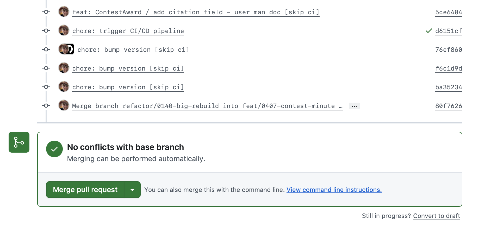

# Gemini say del 31 ottobre 2026

## Domanda 1 - del criceto

Git, github per una PR tra il branch A e il branch B mi dice che non posso procedere tramite il sito e devo fare delle operazioni di merge in locale. seguo le indicazioni, le seguo tutte e però mi ritrovo punto a capo. Sono già al terzo giro.

## Risposta 1

Quando GitHub blocca il merge di una Pull Request e chiede di risolverlo in locale, significa che ci sono **conflitti non risolvibili automaticamente** o che lo stato dei branch richiede un allineamento manuale. Girare in tondo per tre volte di solito succede perché ci si dimentica di fare il `push` del branch corretto o perché il merge viene fatto nella direzione sbagliata.

Ecco la procedura esatta, passo dopo passo, per sbloccare la situazione in modo definitivo direttamente dal tuo terminale.

---

### Procedura di risoluzione in locale

Apri il terminale nella cartella del tuo progetto e segui questi comandi (assumendo che il branch di partenza sia `A` e quello di arrivo sia `B`):

1. **Aggiorna tutto dal remote:** 1 min.
Assicurati di avere l'ultima versione di entrambi i branch aggiornata dal server remoto:

```bash
git fetch origin

```

*Verification:* Il comando termina senza errori e mostra gli ultimi aggiornamenti di `origin`.


2. **Spostati sul branch di destinazione e aggiornalo:** 1 min.
Vai sul branch in cui vuoi fare il merge (il branch `B`):

```bash
git checkout B
git pull origin B

```

*Verification:* Il terminale conferma che il branch `B` è `up to date` con `origin/B`.


3. **Spostati sul tuo branch di origine e avvia il merge:** 2 min.
Ora vai sul tuo branch di lavoro (`A`) e fondi dentro il branch di destinazione (`B`) per intercettare i conflitti sul tuo terreno:

```bash
git checkout A
git merge B

```

*Verification:* Se ci sono conflitti, Git ti avviserà scrivendo `Automatic merge failed; fix conflicts and then commit the result`.


4. **Risolvi i conflitti nel codice:** Time varies.
Apri il tuo editor di codice (es. VS Code). Troverai i file con i conflitti contrassegnati dai classici indicatori di Git (`<<<<<<<`, `=======`, `>>>>>>>`).

1. Modifica i file tenendo il codice corretto.
2. Salva i file.
3. Aggiungi i file risolti all'area di stage:

```bash
git add .

```

*Verification:* Eseguendo `git status`, tutti i file in conflitto devono risultare verdi sotto la voce "Changes to be committed".


5. **Completa il merge e fai il push:** 1 min.
Finalizza il merge creando il commit e spingi tutto su GitHub:

```bash
git commit -m "Risolti conflitti di merge con il branch B"
git push origin A

```

*Verification:* Il `git push` va a buon fine e la PR su GitHub si aggiorna automaticamente sbloccandosi.


---

## Domanda 2 

0407 è l branch A 0140 è il B, questo è (per la terza volta) quello che va fatto per il merge. Se facessi invece un rebase?

```bash
$ git checkout feat/0407-contest-minute
Switched to branch 'feat/0407-contest-minute'
Your branch is up to date with 'origin/feat/0407-contest-minute'.
Mac5:yapcp massimorainato$ git merge refactor/0140-big-rebuild
Auto-merging dev-diary/2026-10/2026-10-28_IT.md
CONFLICT (add/add): Merge conflict in dev-diary/2026-10/2026-10-28_IT.md
Auto-merging docs/1.0/navigation.json
CONFLICT (content): Merge conflict in docs/1.0/navigation.json
Auto-merging docs/1.0/organizations/jury_reasoning.md
CONFLICT (add/add): Merge conflict in docs/1.0/organizations/jury_reasoning.md
warning: Cannot merge binary files: docs/1.0/organizations/jury_reasoning_img01.png (HEAD vs. refactor/0140-big-rebuild)
Auto-merging docs/1.0/organizations/jury_reasoning_img01.png
CONFLICT (add/add): Merge conflict in docs/1.0/organizations/jury_reasoning_img01.png
warning: Cannot merge binary files: docs/1.0/organizations/jury_reasoning_img02.png (HEAD vs. refactor/0140-big-rebuild)
Auto-merging docs/1.0/organizations/jury_reasoning_img02.png
CONFLICT (add/add): Merge conflict in docs/1.0/organizations/jury_reasoning_img02.png
warning: Cannot merge binary files: docs/1.0/organizations/jury_reasoning_img03.png (HEAD vs. refactor/0140-big-rebuild)
Auto-merging docs/1.0/organizations/jury_reasoning_img03.png
CONFLICT (add/add): Merge conflict in docs/1.0/organizations/jury_reasoning_img03.png
warning: Cannot merge binary files: docs/1.0/organizations/jury_reasoning_img04.png (HEAD vs. refactor/0140-big-rebuild)
Auto-merging docs/1.0/organizations/jury_reasoning_img04.png
CONFLICT (add/add): Merge conflict in docs/1.0/organizations/jury_reasoning_img04.png
Auto-merging routes/web.php
CONFLICT (content): Merge conflict in routes/web.php
Auto-merging storage/app/private/version.json
CONFLICT (content): Merge conflict in storage/app/private/version.json
Resolved 'dev-diary/2026-10/2026-10-28_IT.md' using previous resolution.
Resolved 'docs/1.0/navigation.json' using previous resolution.
Resolved 'docs/1.0/organizations/jury_reasoning.md' using previous resolution.
Resolved 'routes/web.php' using previous resolution.
Resolved 'storage/app/private/version.json' using previous resolution.
Automatic merge failed; fix conflicts and then commit the result.
```

## Risposta 2

Passare a un **rebase** in questo momento **non risolverà i conflitti**, anzi: se il tuo branch `feat/0407-contest-minute` ha più di un commit, il rebase ti costringerebbe a risolverli **uno per uno, commit per commit**, trasformandolo in un lavoro molto più lungo e frustrante.

Il motivo per cui ti ritrovi punto a capo è la combinazione di file di testo modificati contemporaneamente e, soprattutto, dei **file binari in conflitto (`add/add`)** sulle immagini (`jury_reasoning_img01.png`, ecc.) e sui diari, che bloccano Git se non vengono gestiti esplicitamente scegliendo quale versione tenere.

Visto che il comando di merge è già stato eseguito e si trova nello stato di conflitto, portiamolo a termine una volta per tutte seguendo questi passaggi esatti via terminale.

---

### Come completare il merge attuale

1. **Controlla lo stato esatto dei file**
Esegui questo comando per vedere l'elenco aggiornato di cosa manca:
```bash
git status

```


*Verification:* Vedrai i file di testo con conflitti e le immagini segnate come `both added`.
2. **Risolvi i conflitti delle immagini (file binari)**
Per i file di immagine, Git non può "unire" le righe di codice, quindi devi scegliere quale versione tenere.
* Se vuoi tenere la versione del tuo branch (`feat/0407-contest-minute`, cioè `--ours`):
```bash
git checkout --ours docs/1.0/organizations/jury_reasoning_img01.png
git checkout --ours docs/1.0/organizations/jury_reasoning_img02.png
git checkout --ours docs/1.0/organizations/jury_reasoning_img03.png
git checkout --ours docs/1.0/organizations/jury_reasoning_img04.png

```


*(Se invece preferisci la versione del branch `0140`, sostituisci `--ours` con `--theirs`).*
* Subito dopo, metti in stage le immagini:
```bash
git add docs/1.0/organizations/jury_reasoning_img*.png

```


*Verification:* I file immagine non compaiono più tra i conflitti non tracciati.
3. **Risolvi i file di testo**
Apri nel tuo editor (es. VS Code) i file rimasti in conflitto:
* `docs/1.0/navigation.json`
* `docs/1.0/organizations/jury_reasoning.md`
* `routes/web.php`
* `storage/app/private/version.json`
* `dev-diary/2026-10/2026-10-28_IT.md`


Pulisci i marcatori di conflitto (`<<<<<<<`, `=======`, `>>>>>>>`), tieni il codice corretto, salva ogni file e aggiungili all'area di stage:
```bash
git add docs/1.0/navigation.json docs/1.0/organizations/jury_reasoning.md routes/web.php storage/app/private/version.json dev-diary/2026-10/2026-10-28_IT.md

```


*Verification:* Eseguendo `git status`, tutti i file devono apparire colorati in verde sotto la voce "Changes to be committed".
4. **Finalizza il merge e spingi su GitHub**
Ora che tutto è pulito e tracciato, crea il commit di merge e fai il push:
```bash
git commit -m "Merge branch refactor/0140-big-rebuild into feat/0407-contest-minute"
git push origin feat/0407-contest-minute

```


*Verification:* Il terminale conferma il push completato con successo e la Pull Request su GitHub si sblocca automaticamente.

## Domanda 3

```bash
$ git status 
On branch feat/0407-contest-minute
Your branch is up to date with 'origin/feat/0407-contest-minute'.

You have unmerged paths.
  (fix conflicts and run "git commit")
  (use "git merge --abort" to abort the merge)

Unmerged paths:
  (use "git add <file>..." to mark resolution)
        both added:      dev-diary/2026-10/2026-10-28_IT.md
        both modified:   docs/1.0/navigation.json
        both added:      docs/1.0/organizations/jury_reasoning.md
        both added:      docs/1.0/organizations/jury_reasoning_img01.png
        both added:      docs/1.0/organizations/jury_reasoning_img02.png
        both added:      docs/1.0/organizations/jury_reasoning_img03.png
        both added:      docs/1.0/organizations/jury_reasoning_img04.png
        both modified:   routes/web.php
        both modified:   storage/app/private/version.json

no changes added to commit (use "git add" and/or "git commit -a")
```

## Risposta 3

Ottimo, la situazione è chiarissima. Hai il merge bloccato esattamente su quei file. Per sbloccare tutto in pochi comandi, procediamo con ordine.

1. **Gestisci le immagini binarie:** 1 min.
Per i 4 file PNG in conflitto (`both added`), devi decidere quale versione tenere. Se vuoi mantenere le immagini del tuo branch (`feat/0407-contest-minute`), esegui:

```bash
git checkout --ours docs/1.0/organizations/jury_reasoning_img01.png docs/1.0/organizations/jury_reasoning_img02.png docs/1.0/organizations/jury_reasoning_img03.png docs/1.0/organizations/jury_reasoning_img04.png
git add docs/1.0/organizations/jury_reasoning_img*.png

```

*(Se preferivi quelle dell'altro branch, sostituisci `--ours` con `--theirs`).*
*Verification:* Eseguendo `git status`, i file PNG non saranno più segnati come in conflitto.


2. **Risolvi i file di testo, JSON e PHP:** 2 min.
Apri nel tuo editor i restanti file in conflitto:

* `dev-diary/2026-10/2026-10-28_IT.md`
* `docs/1.0/navigation.json`
* `docs/1.0/organizations/jury_reasoning.md`
* `routes/web.php`
* `storage/app/private/version.json`

Pulisci i marcatori di conflitto (`<<<<<<<`, `=======`, `>>>>>>>`), tieni il codice desiderato, salva ogni file e aggiungili all'area di stage:

```bash
git add dev-diary/2026-10/2026-10-28_IT.md docs/1.0/navigation.json docs/1.0/organizations/jury_reasoning.md routes/web.php storage/app/private/version.json

```

*Verification:* Eseguendo `git status`, tutti i file devono risultare in verde ("Changes to be committed").


3. **Finalizza e invia su GitHub:** 1 min.
Ora che non ci sono più conflitti pendenti, crea il commit di merge e fai il push:

```bash
git commit -m "Merge branch refactor/0140-big-rebuild into feat/0407-contest-minute"
git push origin feat/0407-contest-minute

```

*Verification:* Il terminale conferma il push completato e la PR su GitHub risulta finalmente aggiornata e pronta per il merge definitivo sul sito.

## Domanda 4

Modificato per correggere un refuso

```bash
$ git status 
On branch feat/0407-contest-minute
Your branch is up to date with 'origin/feat/0407-contest-minute'.

All conflicts fixed but you are still merging.
  (use "git commit" to conclude merge)

Changes to be committed:
        modified:   docs/1.0/organizations/jury_reasoning.md
```

## Risposta 4

Ottimo! Sei arrivato all'ultimo miglio: hai risolto tutto e Git ti sta dicendo chiaramente che **i conflitti sono tutti sistemati**, manca solo da chiudere ufficialmente il merge.

Esegui questi due comandi nel terminale:

```bash
git commit -m "Merge branch refactor/0140-big-rebuild into feat/0407-contest-minute"
git push origin feat/0407-contest-minute

```

*Cosa succederà:*

1. Il `git commit` creerà il commit di merge definitivo salvando la situazione sul tuo branch locale.
2. Il `git push` caricherà tutto su GitHub.

A quel punto, vai sulla pagina della tua Pull Request su GitHub: vedrai che i conflitti saranno magicamente spariti e la PR sarà finalmente **pronta per essere mergiata** dal sito!

## Domanda 5

Posso aggiungere [skip ci] nel primo commit o faccio danni?

## Risposta 5

Puoi metterlo tranquillamente, **non fai nessun danno**! Anzi, è una tecnica comunemente usata per evitare di sprecare minuti di build/CI su GitHub Actions o altri servizi mentre stai ancora sistemando i conflitti di merge in locale.

### Cosa fa esattamente `[skip ci]` (o `[ci skip]`)?

Se inserisci la stringa `[skip ci]` (o varianti simili a seconda del servizio di CI che usi, come `[ci skip]` o `NO-CI`) all'interno del **messaggio del commit**, dici al sistema di integrazione continua di **saltare l'esecuzione delle pipeline/test** per quel commit specifico.

Nel tuo caso specifico, visto che stai facendo un commit di merge per sistemare i conflitti, aggiungere `[skip ci]` è utile se:

1. Hai una CI pesante che parte a ogni push e vuoi risparmiare tempo/risorse.
2. Vuoi fare il push subito per sbloccare la PR senza aspettare che partano i test (la CI partirà comunque quando farai il merge definitivo sul branch principale, oppure puoi riattivarla dopo).

### Come metterlo nel messaggio:

Basta aggiungerlo alla fine della riga del tuo messaggio di commit, ad esempio:

```bash
git commit -m "Merge branch refactor/0140-big-rebuild into feat/0407-contest-minute [skip ci]"
git push origin feat/0407-contest-minute

```

Vai tranquillo, non rompe nulla né sul tuo branch né su GitHub!

## Domanda 6

```bash
$ git commit -m "Merge branch refactor/0140-big-rebuild into feat/0407-contest-minute [skip ci]"
[feat/0407-contest-minute 80f7626c] Merge branch refactor/0140-big-rebuild into feat/0407-contest-minute [skip ci]
Mac5:yapcp massimorainato$ git push origin feat/0407-contest-minute
Enumerating objects: 16, done.
Counting objects: 100% (16/16), done.
Delta compression using up to 8 threads
Compressing objects: 100% (6/6), done.
Writing objects: 100% (6/6), 638 bytes | 638.00 KiB/s, done.
Total 6 (delta 5), reused 0 (delta 0), pack-reused 0 (from 0)
remote: Resolving deltas: 100% (5/5), completed with 5 local objects.
To https://github.com/mrai64/yapcp
   ba35234b..80f7626c  feat/0407-contest-minute -> feat/0407-contest-minute
```

## Risposta 6

Ottimo lavoro! Il push è andato perfettamente a buon fine (`ba35234b..80f7626c` sul tuo branch `feat/0407-contest-minute`).

Ora puoi tornare sulla pagina della tua Pull Request su GitHub: i conflitti sono risolti, il branch è aggiornato e la PR dovrebbe essersi sbloccata in autonomia, pronta per il merge finale sul sito!

## Domanda 7



## Risposta 7

Spettacolare! Lo screenshot parla chiaro: **"No conflicts with base branch - Merging can be performed automatically."**

Ora la PR è completamente sbloccata e hai il via libera definitivo.

Puoi procedere in sicurezza cliccando direttamente sul grosso pulsante verde **"Merge pull request"** sul sito di GitHub (o completando l'operazione con il metodo che preferisci).

Ottimo lavoro per aver tenuto duro e aver risolto tutti i conflitti binari e testuali passo dopo passo!

