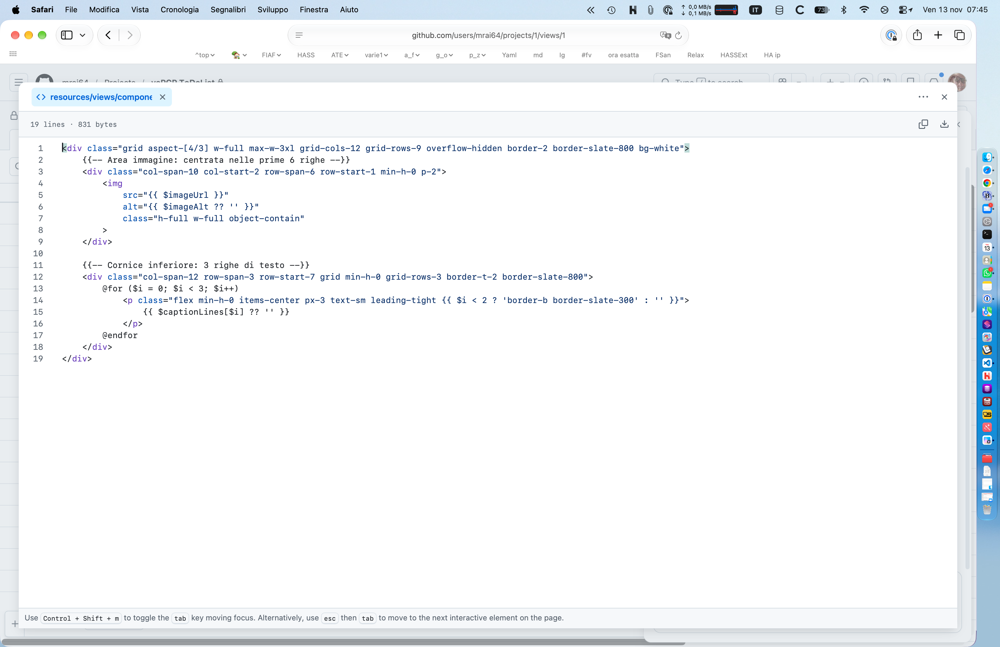

# 13/11/2026

| &nbsp;                               | **Dev diary**                           | &nbsp;                           |
| :---                                 | :---:                                   | ---:                             |
| [Man](/docs/1.0/navigation.json)     | [yaPCP](https://yapcp.test/)            | [Project](https://github.com/users/mrai64/projects/1/views/1?filterQuery=is%3Aopen&sortedBy%5Bdirection%5D=asc&sortedBy%5BcolumnId%5D=352635177&sortedBy%5Bdirection%5D=desc&sortedBy%5BcolumnId%5D=226158474) |
| [Man](https://yapcp.test/docs/)      | [Doc template](/docs/dev/template.md)   | &nbsp;                           |
| [<< ieri](./2026-11-12_IT.md)        | [index](../index.md)                    | [domani >>](./2026-11-14_IT.md)  |

## main-2026

- composer audit
- composer update --dry-run
- aggiornamento diario

Chiesto all'ia come si può preparare una griglia per impaginare il catalogo,
ha solo frainteso le tre righe per le didascalie ma di fatto la cosa non sembra complicata.

