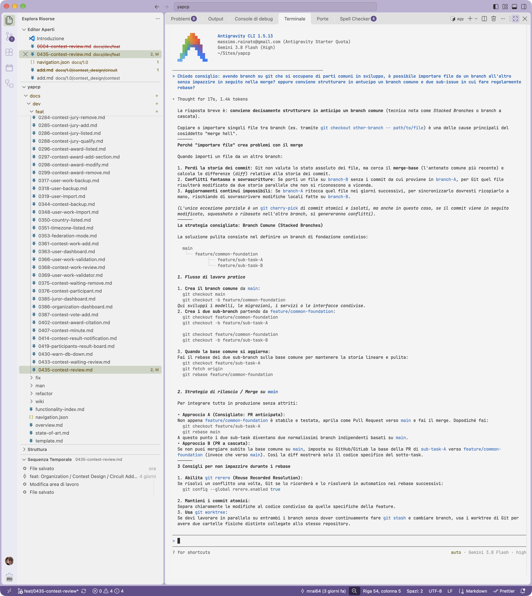

# 22/11/2026

| &nbsp;                               | **Dev diary**                           | &nbsp;                           |
| :---                                 | :---:                                   | ---:                             |
| [Man](/docs/1.0/navigation.json)     | [yaPCP](https://yapcp.test/)            | [Project](https://github.com/users/mrai64/projects/1/views/1?filterQuery=is%3Aopen&sortedBy%5Bdirection%5D=asc&sortedBy%5BcolumnId%5D=352635177&sortedBy%5Bdirection%5D=desc&sortedBy%5BcolumnId%5D=226158474) |
| [Man](https://yapcp.test/docs/)      | [Doc template](/docs/dev/template.md)   | &nbsp;                           |
| [<< ieri](./2026-11-21_IT.md)        | [index](../index.md)                    | [domani >>](./2026-11-23_IT.md)  |

## main-2026

- composer audit
- composer update --dry-run
- aggiornamento diario

## docs/dev-diary

Su consiglio di google Antigravity apro un git worktree per usare
su due binari VSC in un ramo dedicato a dev-diary.

Qui da oggi in poi sarà aggiornato il diario dello sviluppatore.

&nbsp;

&nbsp;

## feat/0435-contest-review

Questo branch si occupa di creare una prima funzione di aggiunta Circuit,
che sono i record del contest con il flag is_circuit attivato, e di conseguenza
il campo circuit_id nullificato.

Il concorso viene creato al click sul link con un make e poi passa sempre per il pannello modify-name,
la differenza tra il curcuito e il concorso fin qui è solo nella impostazione "by default" del flag is_circuit. Preferisco fare le cose in cartelle separate anche se hanno molto in comune.

