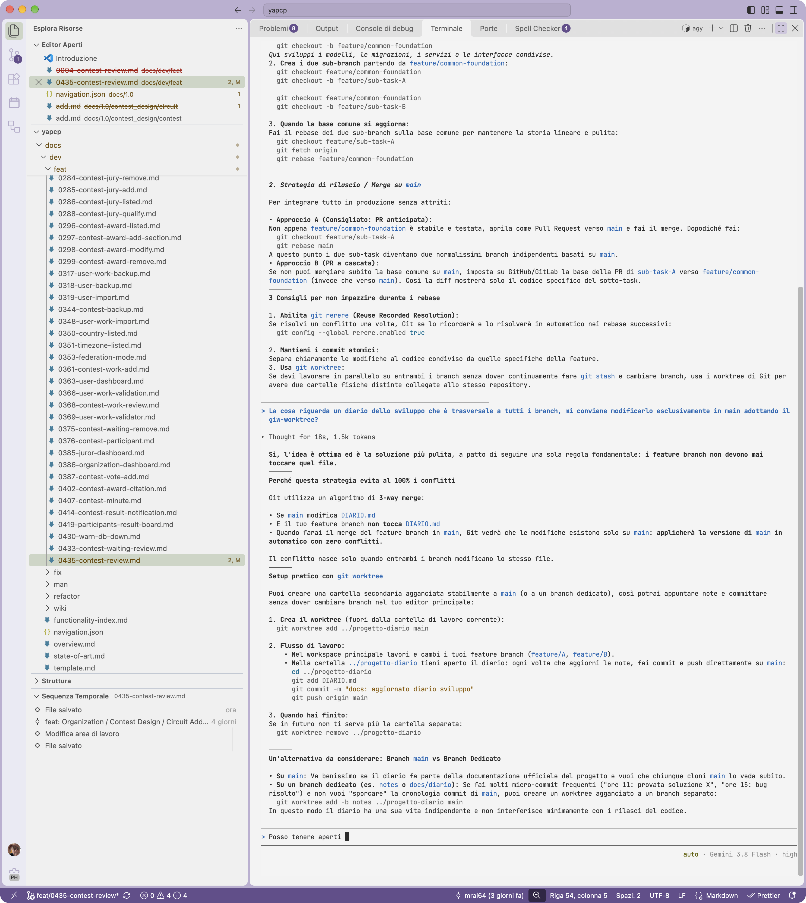

# 22/11/2026

| &nbsp;                               | **Dev diary**                           | &nbsp;                           |
| :---                                 | :---:                                   | ---:                             |
| [Man](/docs/1.0/navigation.json)     | [yaPCP](https://yapcp.test/)            | [Project](https://github.com/users/mrai64/projects/1/views/1?filterQuery=is%3Aopen&sortedBy%5Bdirection%5D=asc&sortedBy%5BcolumnId%5D=352635177&sortedBy%5Bdirection%5D=desc&sortedBy%5BcolumnId%5D=226158474) |
| [Man](https://yapcp.test/docs/)      | [Doc template](/docs/dev/template.md)   | &nbsp;                           |
| [<< ieri](./2026-11-21_IT.md)        | [index](../index.md)                    | [domani >>](./2026-11-23_IT.md)  |

## main-2026

- composer audit
- composer update --dry-run
- aggiornamento diario

---

## docs/dev-diary

Su consiglio di google Antigravity apro un git worktree per usare
su due binari VSC in un ramo dedicato a dev-diary.

Qui da oggi in poi sarà aggiornato il diario dello sviluppatore.

&nbsp;

&nbsp;

---

## Lista dei branch attualmente aperti

- ### `docs/0425-faq`  

  dedicato alla modifica / scrittura della FAQ

- ### `docs/dev-diary`

  questo dedicato al registro del diario e aperto oggi

- ### `feat/0004-contest-review`

  dedicata alla revisione del modello Contest per l'uso di Circuit  
  **solo modello** per lo sviluppo vedi branch legato alla questione
  fet/0435-contest-review

- ### `feat/0422-contest-catalog-page`

  dedicata al modelli ContestCatalogPage, ma sono già in dubbio
  se il model abbia un nome troppo lungo, e potrei cambiarlo
  a breve in Catalog. In realtà la cosa che mi intriga è relativa
  anche a UserContact > Contact mentre UserWork e ContestWork
  dovrebbero restare.

- ### `feat/0426-contest-Catalog-page-templates`

  dedicata alla costruzione dei template per il model
  ContestCatalogPage.

- ### `feat/0435-contest-review`

  si occupa di sviluppare per il model Contest della
  add di un record con is_circuit impostato a true.
  parte creando il record e passando al primo pannello in cui
  vengono definiti il nome del circuito, la sua posizione
  geografica per paese (country_id) e fuso orario (timezone_id)
  e altre informazioni di tipo testuale sui contatti dell'organizzazione,
  sulle modalità di partecipazione (pagamenti), sulla manifestazione
  di premiazione.

- ### `main-2026`

  si tratta del precedente branch big-rebuild che era arrivato ormai a
  quasi 1600 modifiche, e completata la parte di premiazione concorso,
  si è ritenuto giustificato renderlo il ramo principale
  relegando il precedente main a ruolo storico.

---

## feat/0435-contest-review

Questo branch si occupa di creare una prima funzione di aggiunta Circuit,
che sono i record del contest con il flag is_circuit attivato, e di conseguenza
il campo circuit_id nullificato.

Il concorso viene creato al click sul link con un make e poi passa sempre per il pannello modify-name,
la differenza tra il circuito e il concorso fin qui è solo nella impostazione "by default" del flag is_circuit. Preferisco fare le cose in cartelle separate anche se hanno molto in comune.

create le blade per costruire il record nel model contest e per modificare dati di nome circuito, più informazioni sul pagamento e sulla cerimonia di premiazione.

Di fatto andrebbero modificate anche le pagine di creazione dei concorsi in cui NON va indicato "is_circuit" che sarà sempre false, mentre in questa blade non viene chiesto perché sempre true.

Aggiunto un link nel cruscotto dell'organizzazione.  
Aggiunto un componente per la barra di navigazione.  
Verificato il funzionamento della blade di inserimento del circuito,
cancellato il record e rifatta l'iscrizione per formare le pagine del
manuale.

**bug**: il valore del parametro per la timezone list è timezone_id e non country_id

## Pianificare passaggio da Herd a flock

Attualmente sto usando una versione vecchia di herd perché,
giustamente, con il passaggio alla versione 2 chiedono (e li darei)
dei soldi in abbonamento. Che è anche quello che chiedeva MAMP,
con pagamento annuale. Non sarebbe un problema se avessi uno stipendio
per pagarli. Flock al momento non chiede pagamenti.
