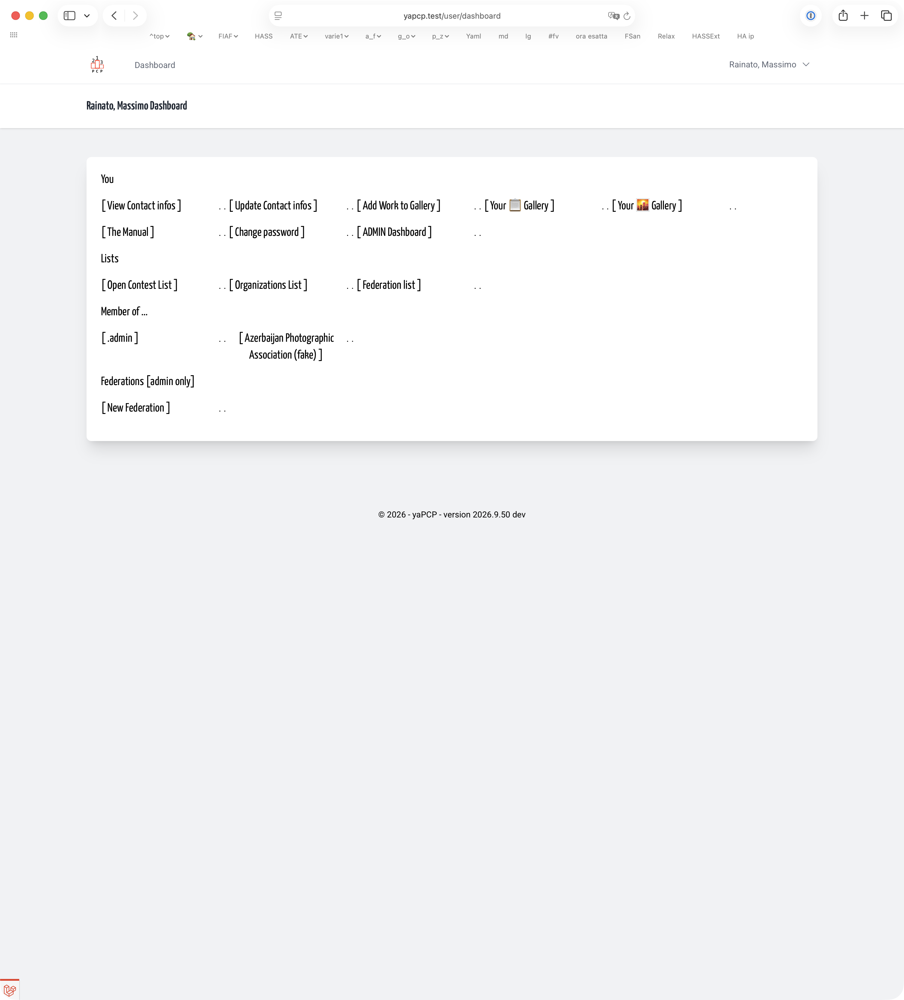
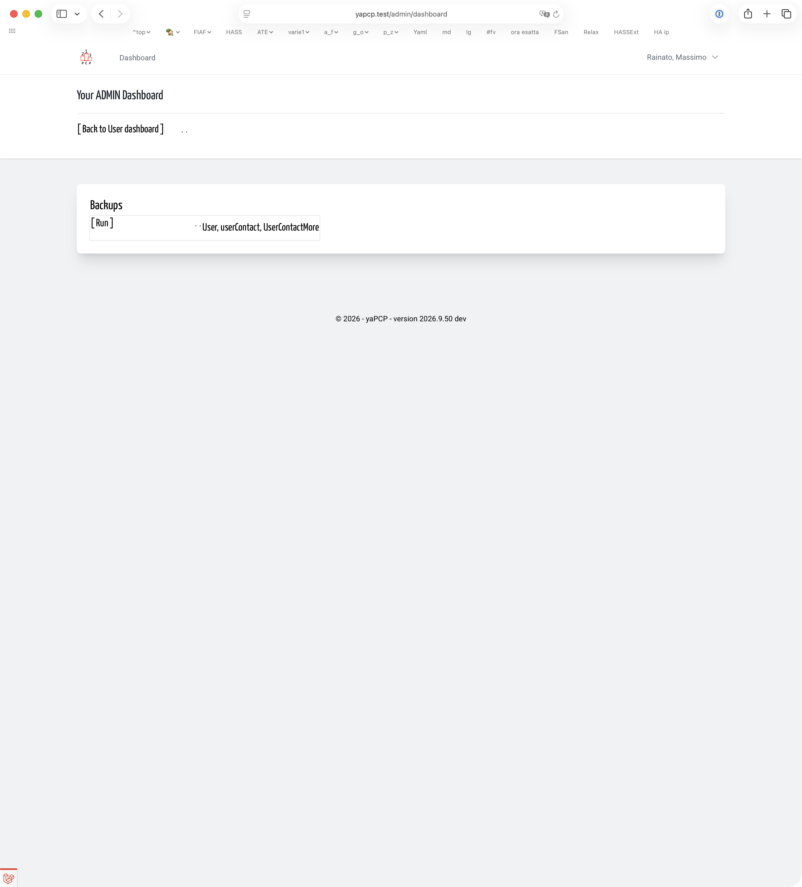
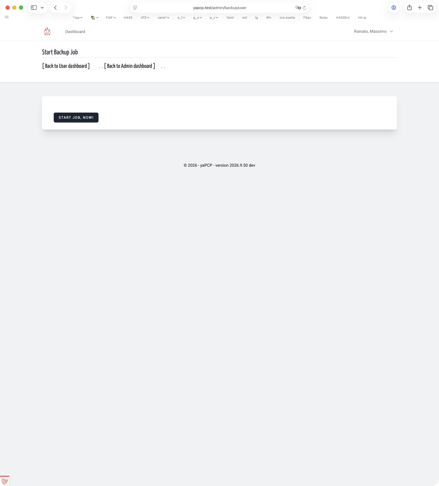
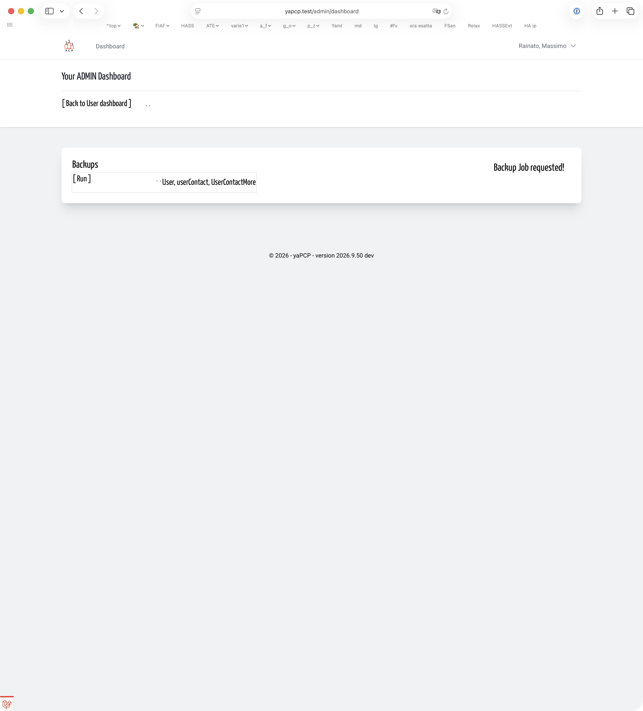

# Backup user + userContact + userContactMore | Admin
<!-- absolute links are /resources/docs/1.0/    -->
<!-- larecipe links are /{{route}}/{{version}}/ -->
<!-- images must be uploaded in same folder of md then url prefixed by ./  -->

---

## A backup is *something you ‘should have done earlier’* – so do it.

The yaPCP platform uses data, so that data must be stored and, if necessary, restored.  
Here how an admin user can easily ask for a backup of only User
(name, email, passowrd), UserContact (first name, last name, country, posta address, email, cell number, others), UserContactMore (federation id, field, value). Just these 3 model.

&nbsp;

From your user dashboard link to ADMIN dashboard (for the entire time you are)

&nbsp;

In your admin dashboard a link to user+userCnotact+UserContactMore backup

&nbsp;

Just to make sure you don’t start the operation by mistake

&nbsp;

Job started immediately

