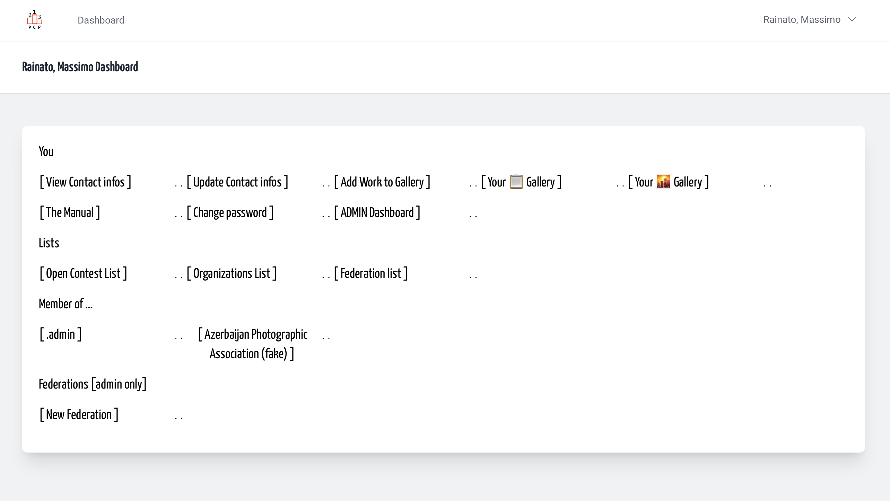
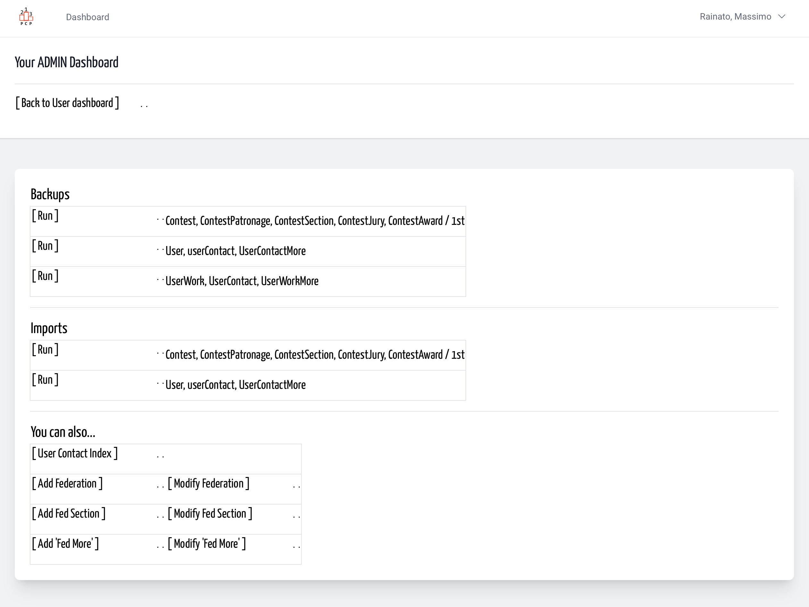
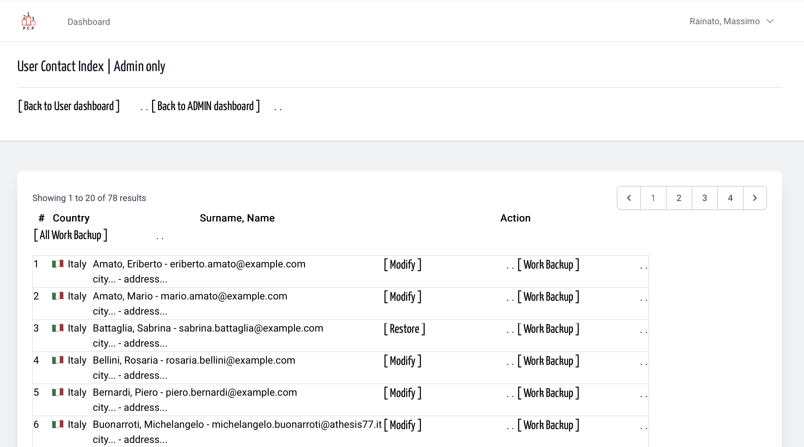
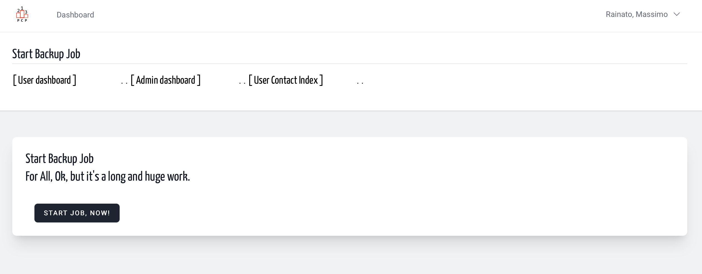
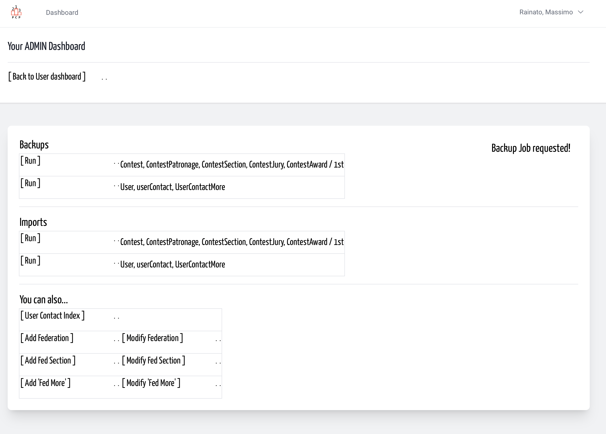
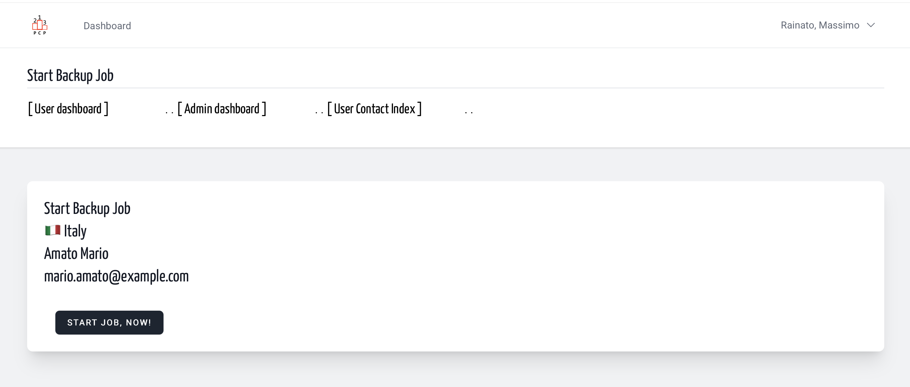
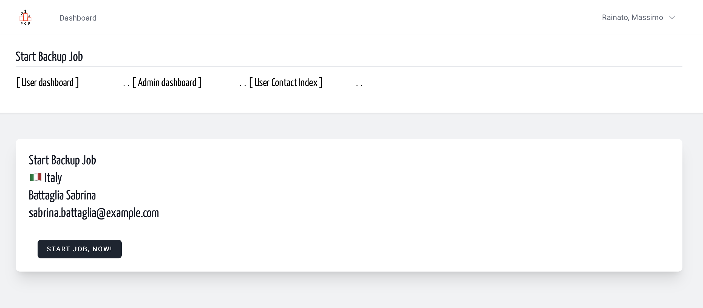
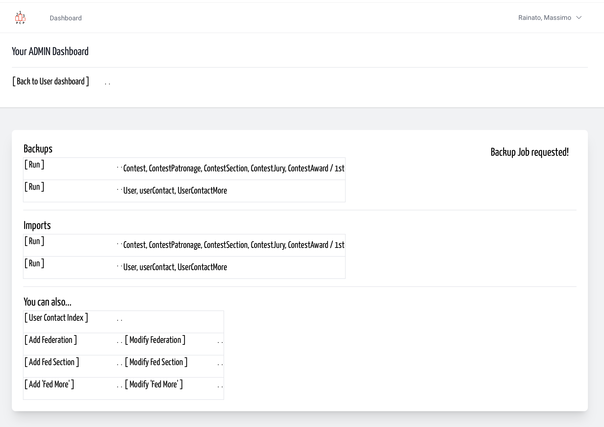

# Backup userWork + userContact + userWorkMore | Admin
<!-- absolute links are /resources/docs/1.0/    -->
<!-- larecipe links are /{{route}}/{{version}}/ -->
<!-- images must be uploaded in same folder of md then url prefixed by ./  -->

---

## A backup is *something you ‘should have done earlier’* – so do it

The yaPCP platform uses data, so that data must be stored and, if necessary, restored.  
Here how an admin user can easily ask for a backup of the models
User, UserContact, UserWork, userWorkMore. In *yaml-file-produced*
a specific url is inserted to consent access thru platform to
UserWork items, under check of user permissions.  
Lately *file as is* can be used to restore previous records.

&nbsp;

From your user dashboard link to ADMIN dashboard (for the entire time you are)

&nbsp;

Then pass to User Index List or use the Backup Run link (for all user)

&nbsp;

Choose All or Single backup

&nbsp;

All: Just to make sure you don’t start the operation by mistake

&nbsp;

As you see some user should be deleted but can be backup anyway.

&nbsp;

Choose one Single backup

&nbsp;

&nbsp;

You can choose also a deleted record (Restore instead of modify)

&nbsp;

