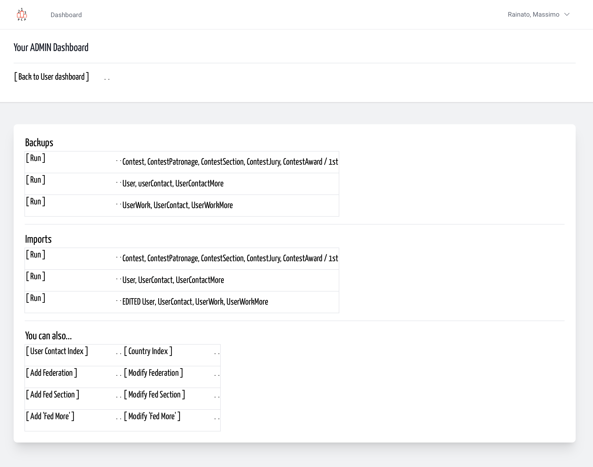
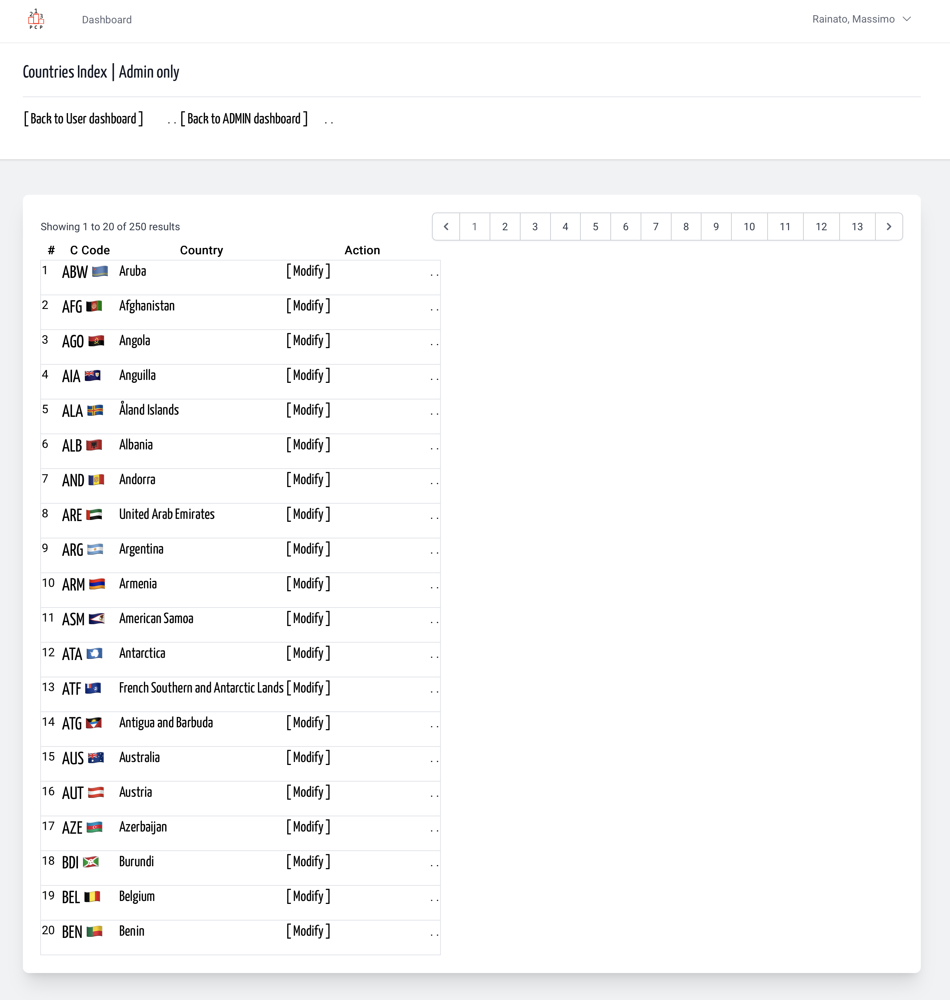

# Country Index / List | Admin
<!-- absolute links are /resources/docs/1.0/    -->
<!-- larecipe links are /{{route}}/{{version}}/ -->
<!-- images must be uploaded in same folder of md then url prefixed by ./  -->

---

*Sometimes user do wrong act, so an admin must repair.*  
In case you need to remember or check a value...

Reach your personal dashboard, then / or your
Admin dashboard and click on Countries index link.

&nbsp;

&nbsp;

&nbsp;

The index cover all the countries registered on the platform,
ordered by country code, even soft-deleted records that can be restored.  
Consequently the link list after update can be different.

&nbsp;
