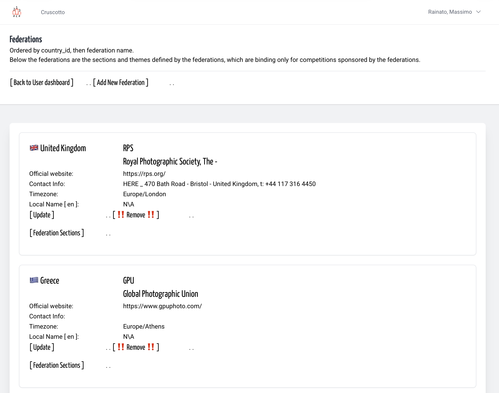
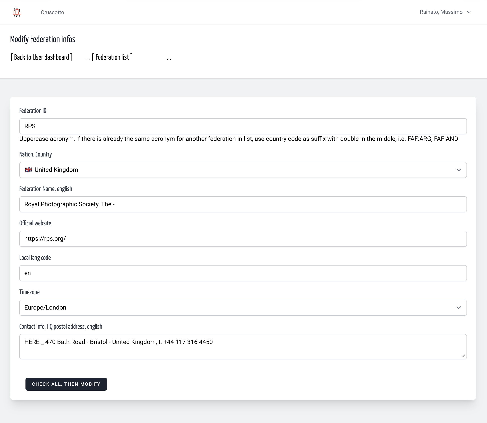
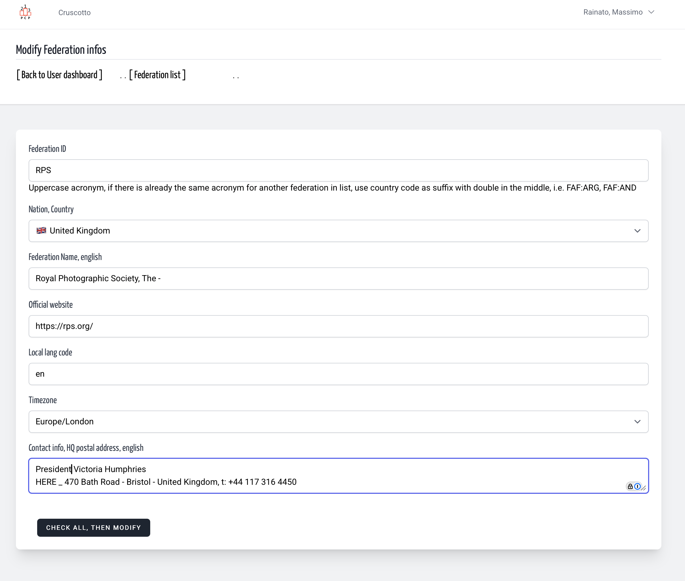
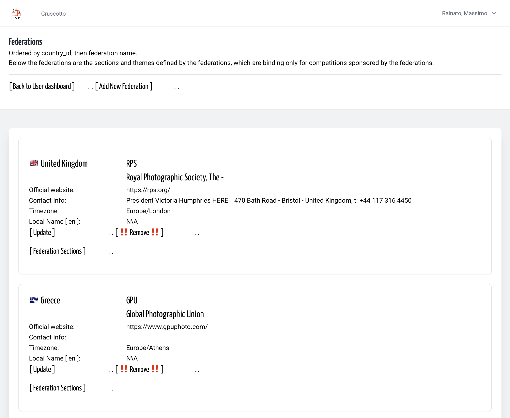

# Modify an existing Federation
<!-- absolute links are /resources/docs/1.0/    -->
<!-- larecipe links are /{{route}}/{{version}}/ -->
<!-- images must be uploaded in same folder of md then url prefixed by ./  -->

---

## Choose a Federation

From Federation List, only if you are authorized to modify a Federation card
you can click to the Update link.

&nbsp;

Here you can modify once and every fields, even Federation ID

&nbsp;

&nbsp;

Back to Federation List, done

