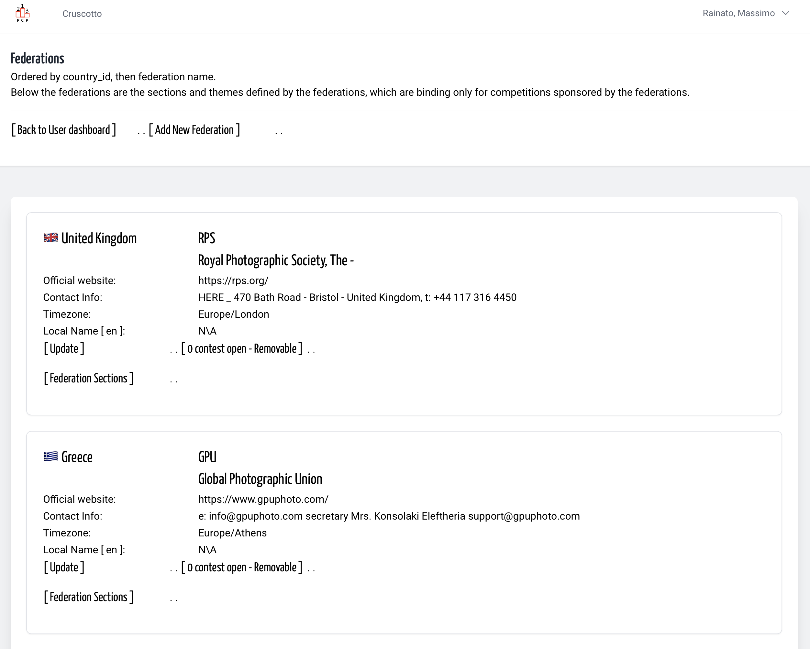
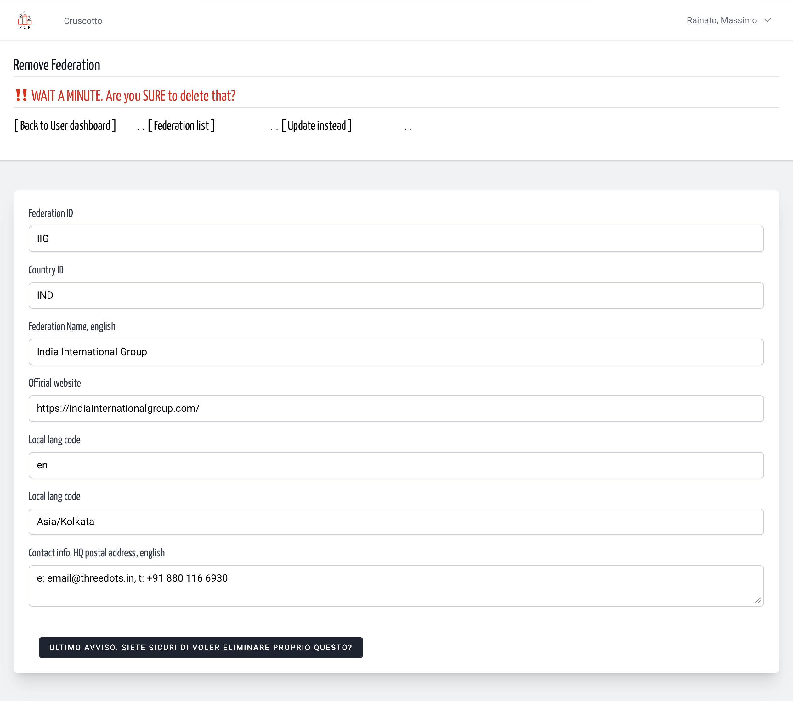
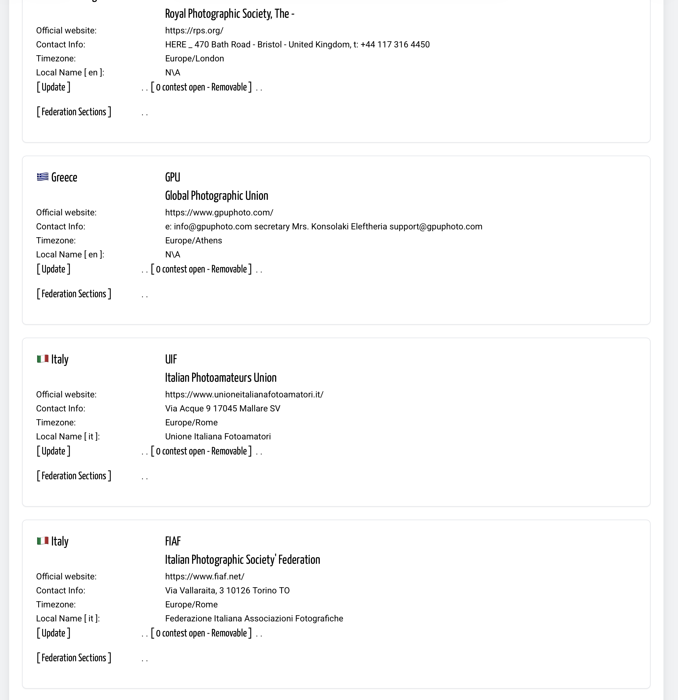

## 🇬🇧 Remove a Federation, Really? When?

When can a federation’s profile be removed? There are two cases: when it was added by mistake, or when the collaboration with the federation ends. It is much rarer for a federation—representing a group of photographers at the national or international level—to dissolve.

In any case, a federation’s listing can be removed only under two conditions: it must be done by a member of the admin group, and there must be no ongoing contests sponsored by the federation. In this case, you can access the deletion page from the list of federations; otherwise, you cannot.

The panel has a single function: to display the data and allow time to consider the decision before proceeding with the deletion request.
Due to the volume of data that may be linked to the federation’s ID in multiple parts of the platform, this task is delegated to the platform, which first deletes all related items and then deletes the federation’s profile. Therefore, even if the deletion has been requested, the federation may still appear in the list of federations for a few minutes.

*Translated with DeepL.com (free version)*

&nbsp;

Sample remove a Federation with no open contest.

&nbsp;

Think before click. Think before click. Think before delete. 

&nbsp;

Delete is running.

