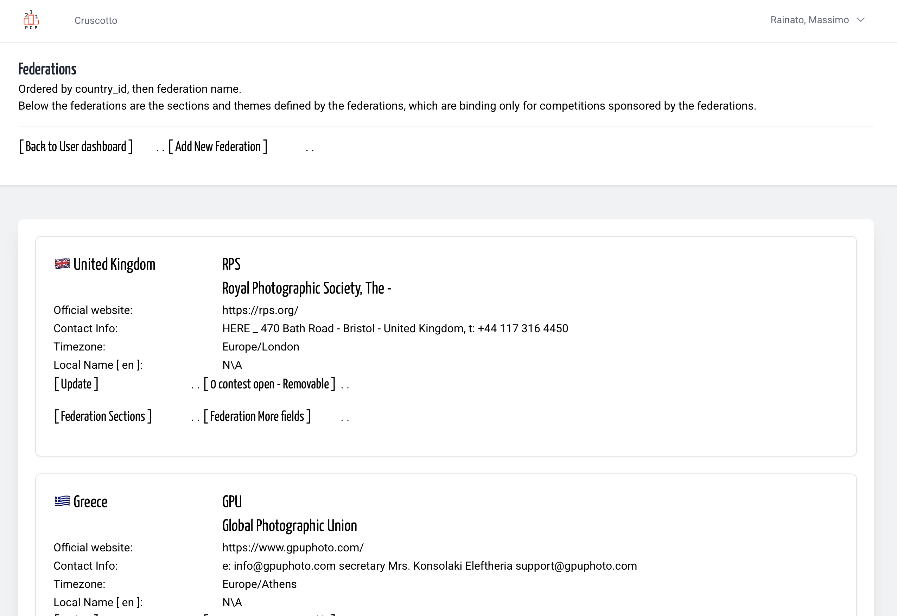
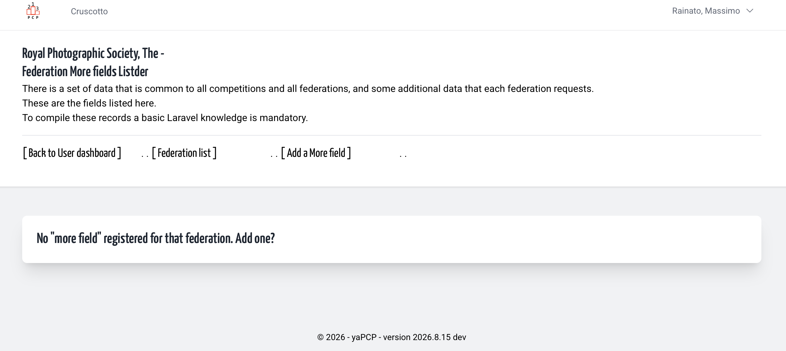
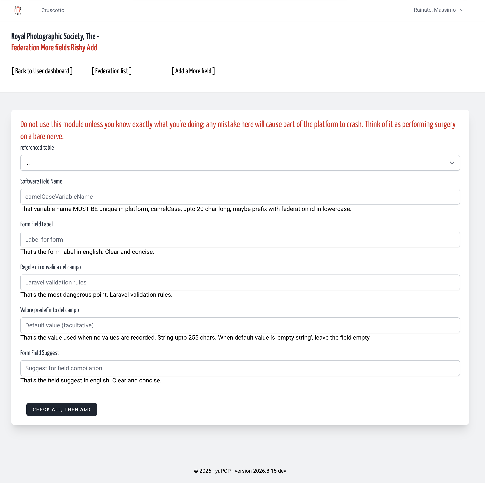
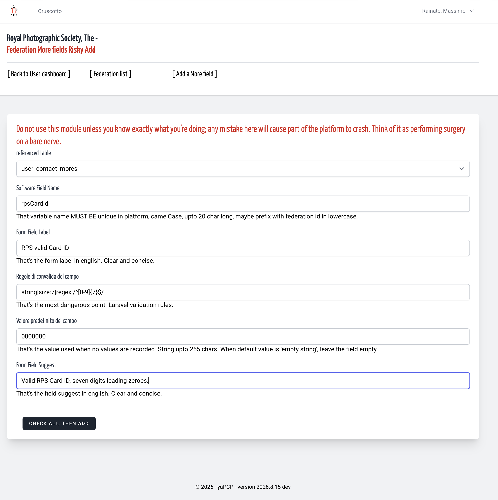
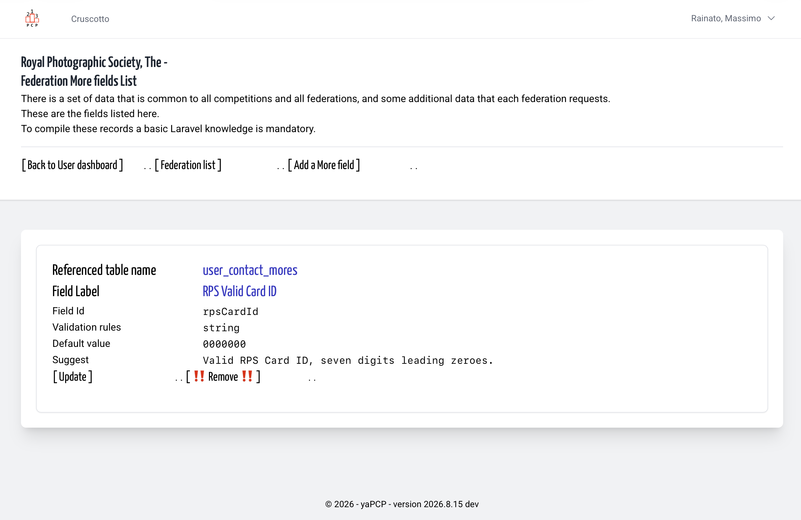

# Federation More Add | Dangerous place
<!-- absolute links are /resources/docs/1.0/    -->
<!-- larecipe links are /{{route}}/{{version}}/ -->
<!-- images must be uploaded in same folder of md then url prefixed by ./  -->

---

## The meta-form

Know, Federation require 'more fields' than the default data set.
In this form we define how create in laravel other form
to give to every federation the flexibility to obtain
'more data' the way they need.

So the "data validation" is part of Laravel php framework,
and all these record must, must, must be inserted in accordion
with admin group and developer group tested before applied
in a production platform.

## Add a record to Federation More (fields) table

&nbsp;

&nbsp;

&nbsp;

&nbsp;

&nbsp;

