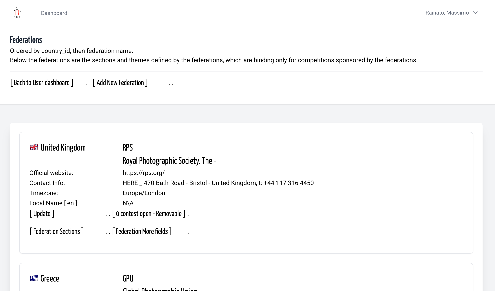
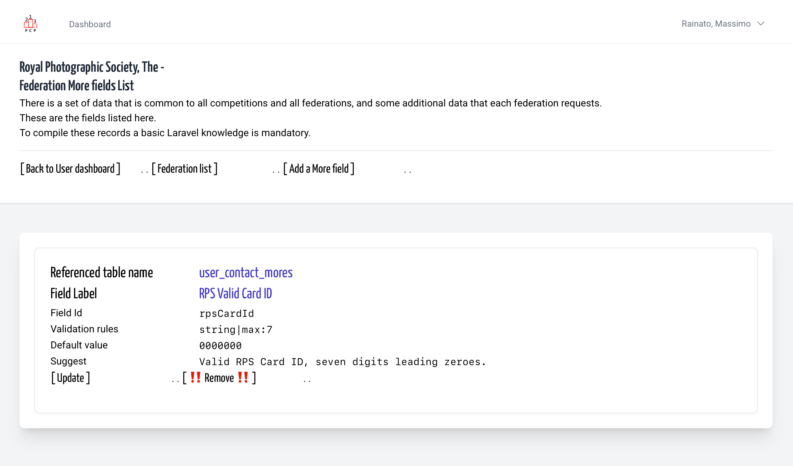
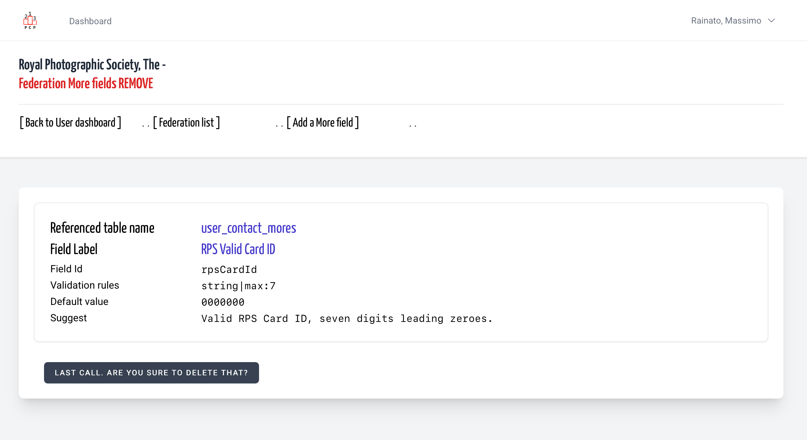
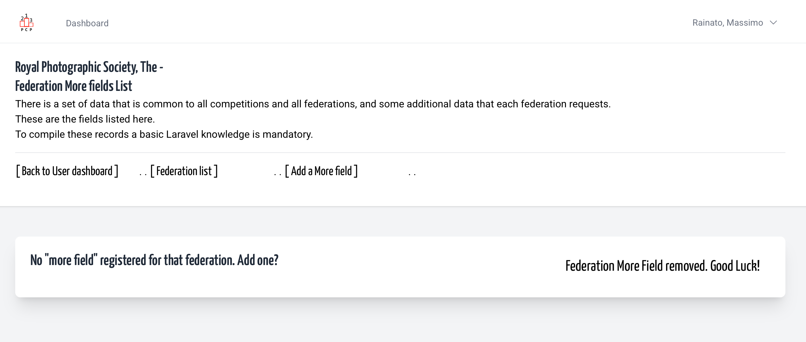

# Federation More Remove | Dangerous place
<!-- absolute links are /resources/docs/1.0/    -->
<!-- larecipe links are /{{route}}/{{version}}/ -->
<!-- images must be uploaded in same folder of md then url prefixed by ./  -->

---

## Remove a record on Federation More (fields) table

Given the sensitive nature of this table that you are editing, it should go without saying that any changes or deletions must—must—be approved by more than a single  platform administrator.  
*Translated with DeepL.com (free version)*

&nbsp;

Starting from usual federation list, click on Federation More list

&nbsp;

I.e. we want remove a rules

&nbsp;

Ask for confirmation

&nbsp;

Removed, and if was the last...

