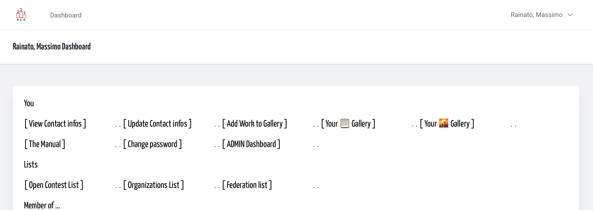
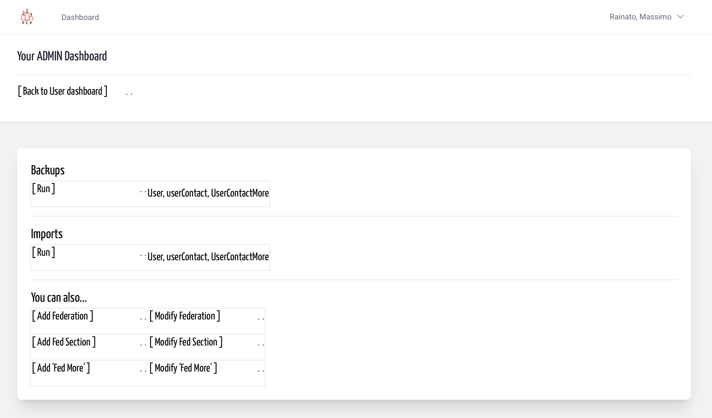
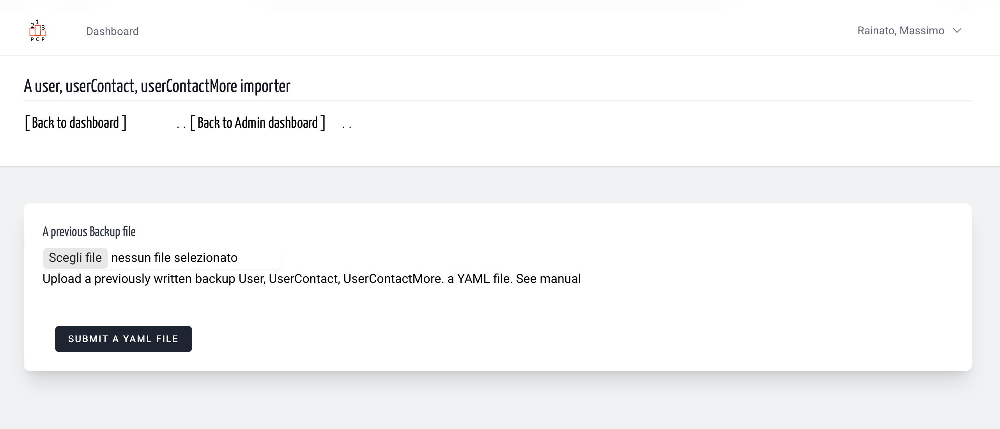
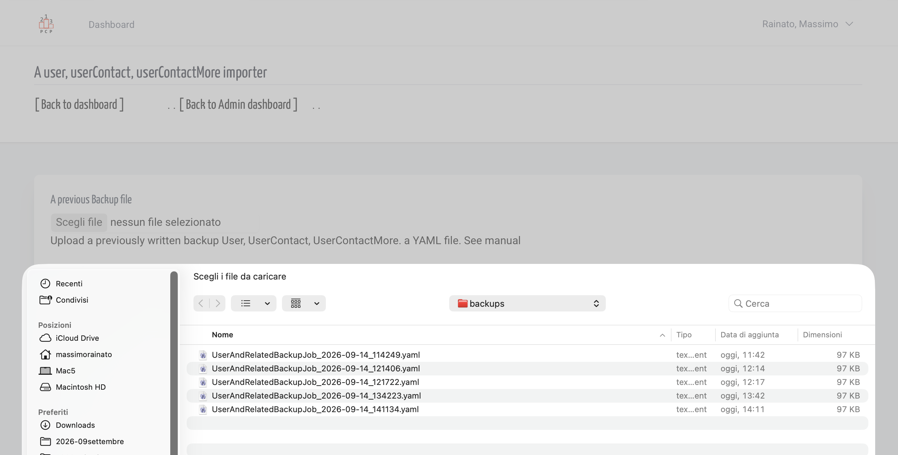
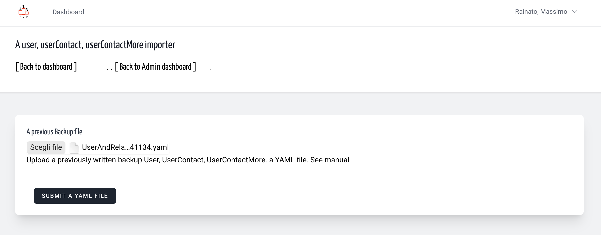
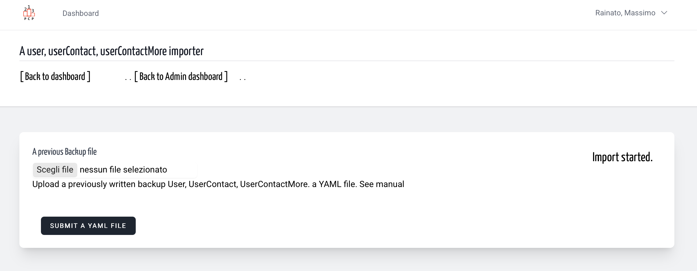
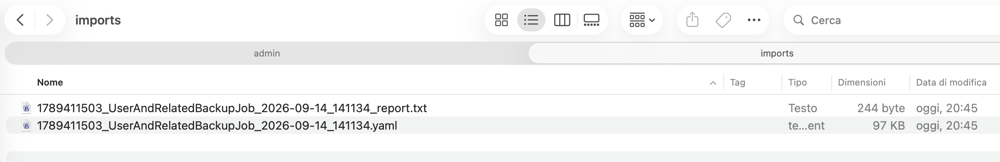
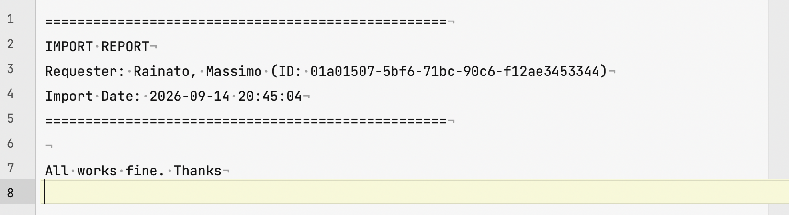

# Import User + UserContact + UserContactMore | Admin
<!-- absolute links are /resources/docs/1.0/    -->
<!-- larecipe links are /{{route}}/{{version}}/ -->
<!-- images must be uploaded in same folder of md then url prefixed by ./  -->

---

## A backup is *something you ‘should have done earlier’* – so do it.  

So, after write a backup sometimes we need to import old data.  
Choose the function, choose the file, start the process.

&nbsp;

From your user dashboard link to ADMIN dashboard (for the entire time you are)

&nbsp;

In your admin dashboard a link to user+userCnotact+UserContactMore import

&nbsp;

Ask for the backup file to upload

&nbsp;

File choose

&nbsp;

File choosed

&nbsp;

Job started immediately

&nbsp;

Back office - the file generated.  
Original file name is maintained and a timestamp is added as prefix,
even for report file.

&nbsp;

A smiling report file (note: admin id was regenerated)

---

Build yaml file can be a quiet walk in the park or like the climbing  of Everest,
but one thing cannot be denied: it is humanly readable and quite understanding to everyone.
That's the reason to maintain every time backup and restore in user admin group.
Probably for a long time the *admin user group* **must be limited** upto a 3-4 unit, even less.

The process to transform an excel into an YAML usually is already done,
because all the federation require the same data, and *few more fields*,
that became a load for UserContactMore and/or UserWorkMore.

We put in platform a chain link using email as a reference
for unknown /fresh uuid code between User and userContact and UserContactMore models.
The same to chain UserWork and User when user uuid is unknown,
but to chain UserWork ant UserWorkMore, when necessary,
you can adopt some personalized not-uuid id, i.e. simplest 
*'photo1', 'photo2', 'photo3'* and...
