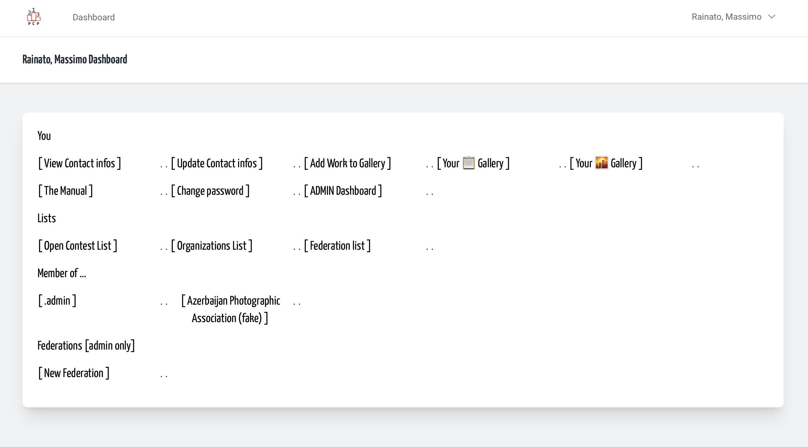
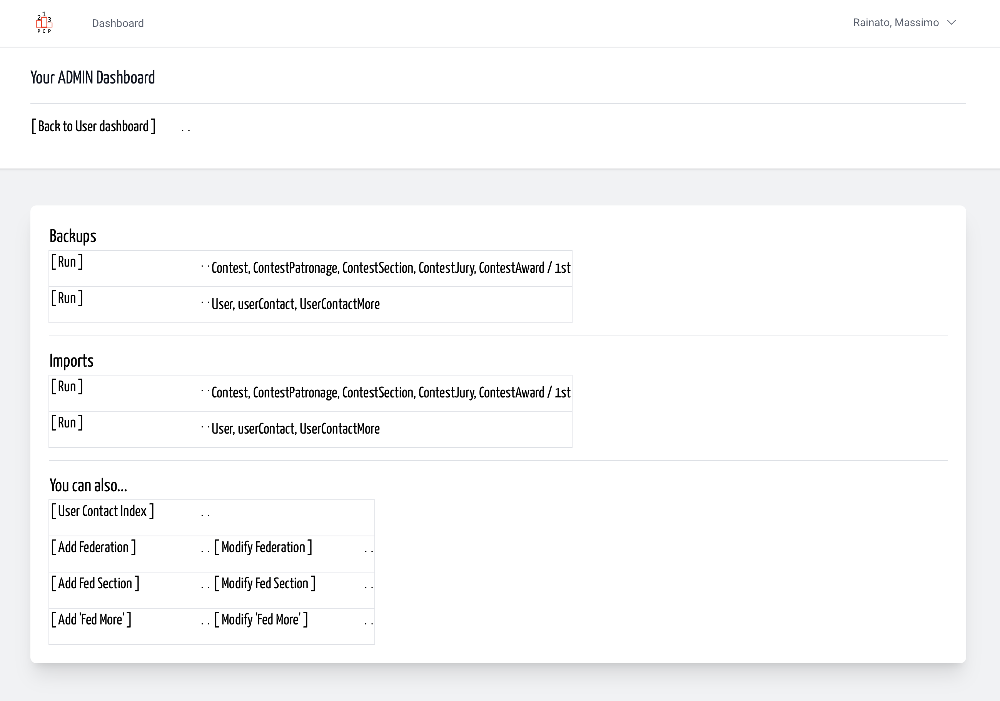
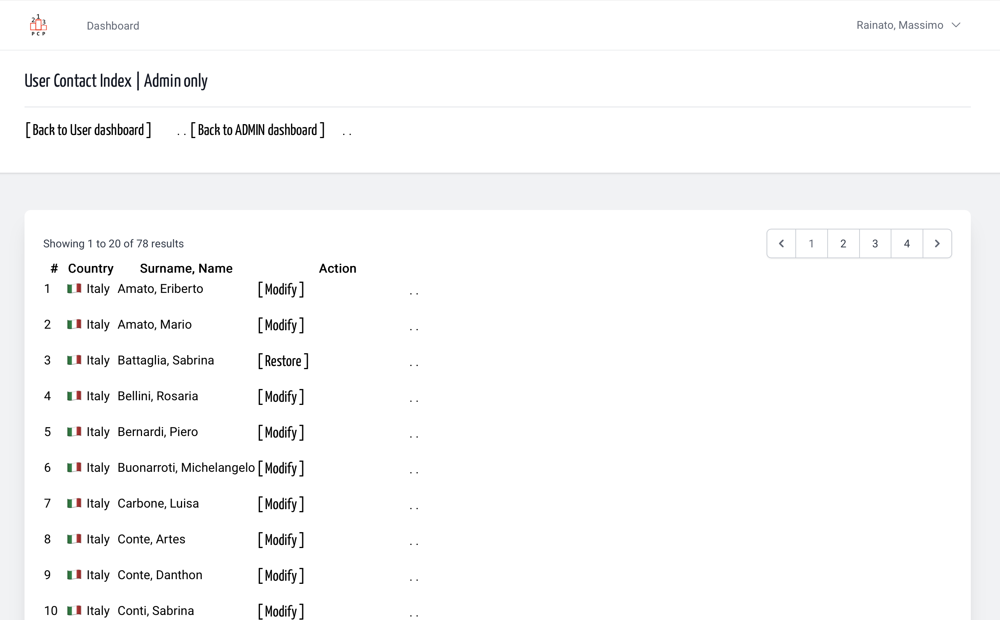

## Sometimes users do wrong act, so an admin must repair.

Reach your personal dashboard, then / or your
Admin dashboard and click on userContact index link.

&nbsp;

&nbsp;

&nbsp;

The index cover all the people on the platform is registered,
even soft-deleted records that can be restored.  
Consequently the link list after surname and name can be different.

&nbsp;
