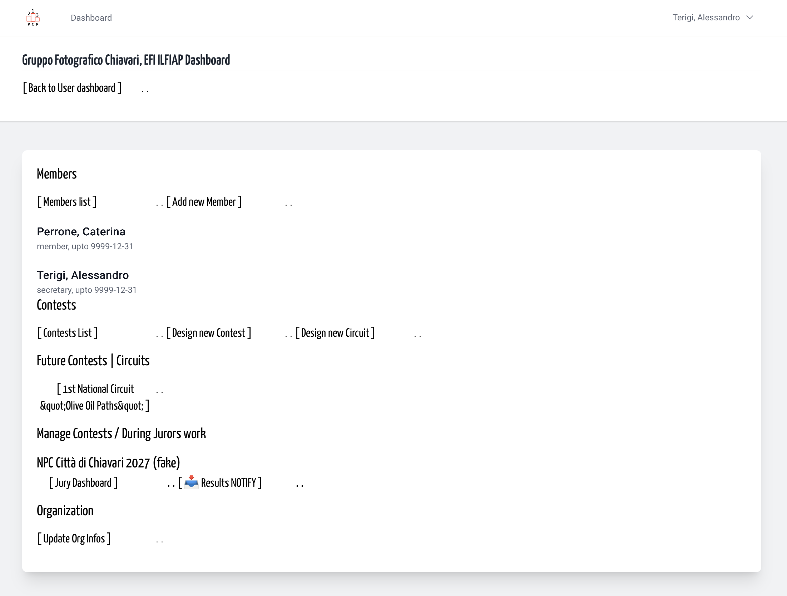
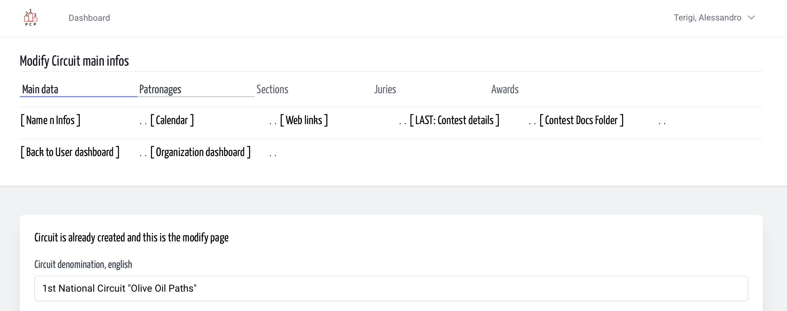
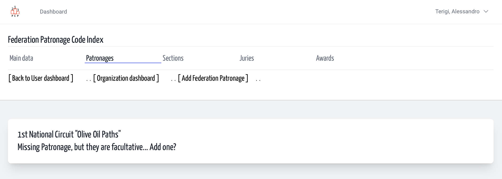
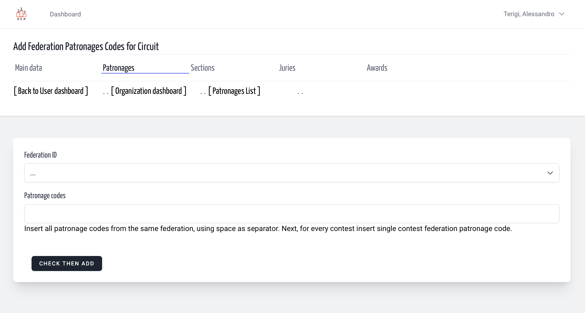
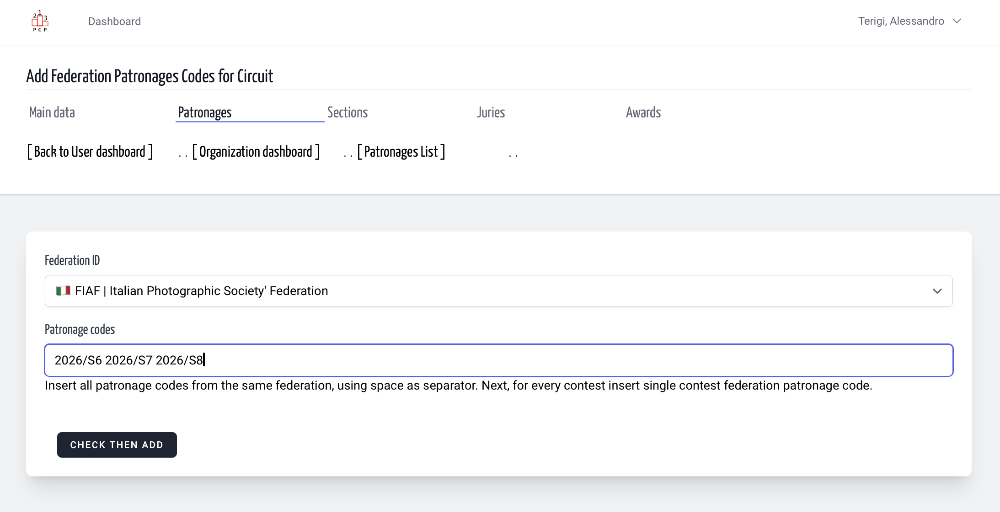
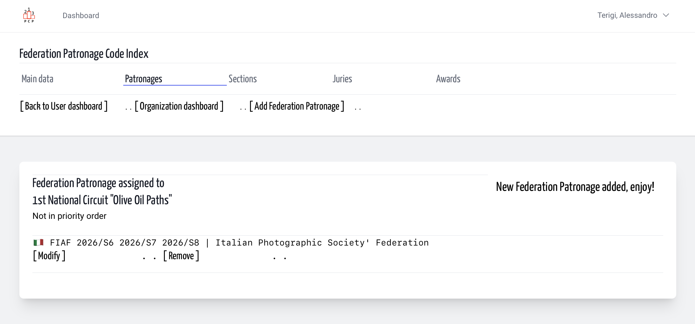

- [Fed Patronage(s)](./listed.md)
- [Add new](./add.md)
- [Modify](./modify.md)
- [Remove](./remove.md)

---

Add Circuit Patronages.
Here you can add Federation Patronages, the only difference
is that here you must insert all the patronages code assigned
from the federation.

&nbsp;

&nbsp;

&nbsp;

From Patronage Circuit list choose Add Federation Patronage

&nbsp;

Choose Federation and insert all Federation patronage codes 
from this Federation, not from all federations.

&nbsp;

All Federation Patronages Codes inserted, space only separated

&nbsp;

Done.

