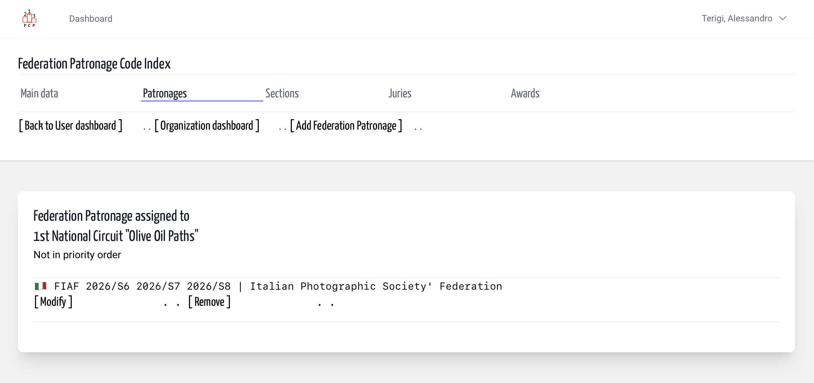
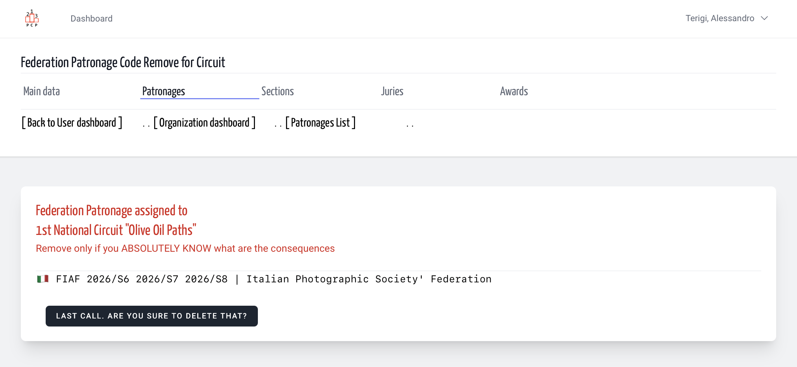
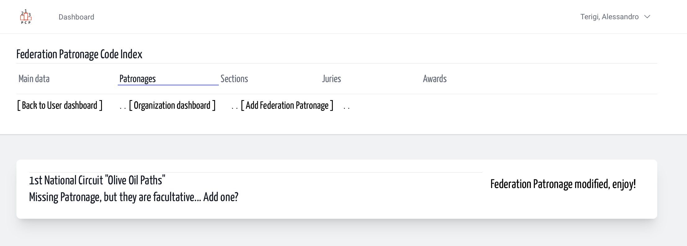

- [Fed Patronage(s)](./listed.md)
- [Add new](./add.md)
- [Modify](./modify.md)
- [Remove](./remove.md)

---

Uhm. Wrong inserted Contest Patronage? Wrong Federation? You can easily remove.  
**WARN** Obviously remove a Circuit Patronage can be easily done
**ONLY WHEN** the contest is in design phase.

&nbsp;

From Patronage Circuit list choose remove link

&nbsp;

You are warned, it's not a modify: it's a REMOVE

&nbsp;

Done.

