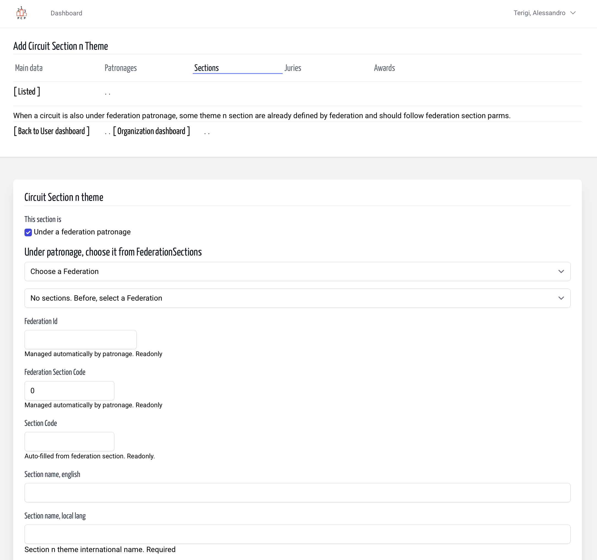
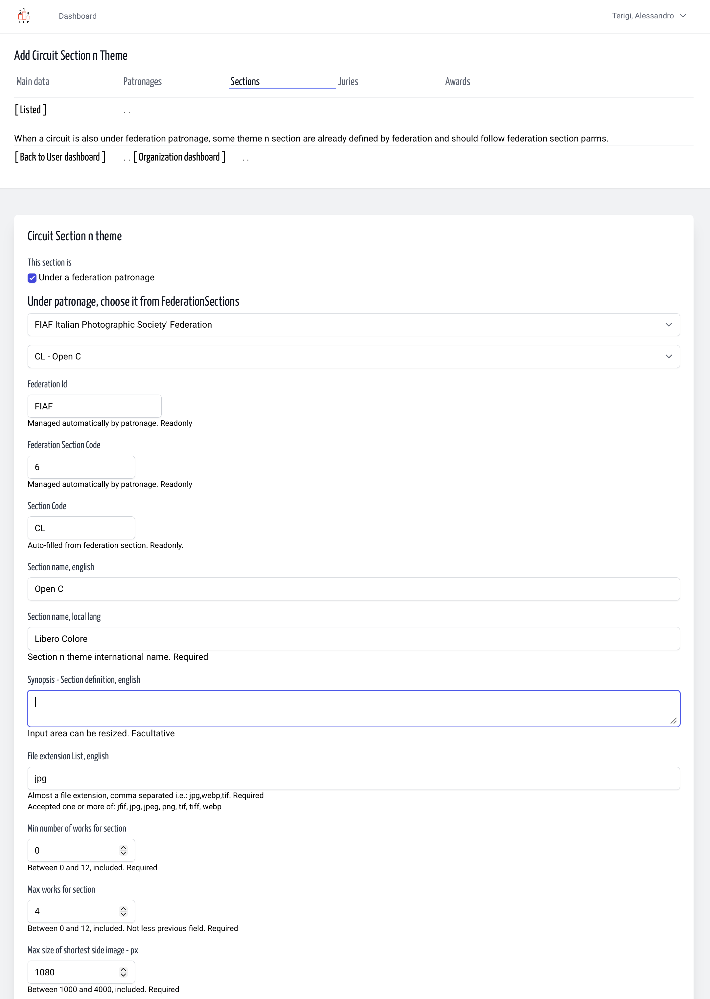
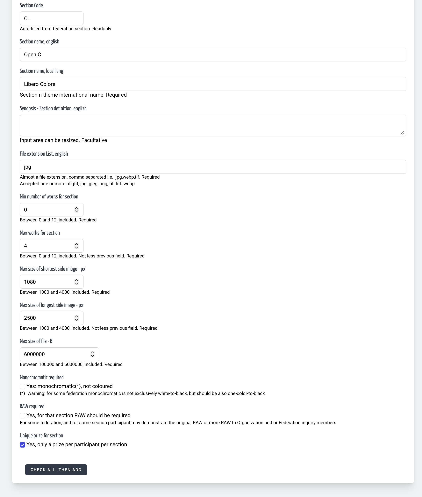
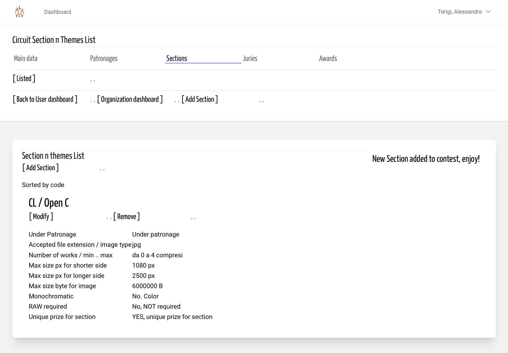

- [Section Index](./listed.md)
- [Add FP free](./add1.md)
- [Add with FP](./add2.md)
- [Modify FP free](./modify.md)
- [Remove](./remove.md)

---

## About

Instead of previous page, this is a section of circuit that is Under a federation patronage.
Even for a *Federation Patronized Contest* the "*under FP*" it's a facultative choose.  
For many reasons the *contest theme* may not be “broad enough” to allow everyone to participate equally; for example, a theme dedicated to "Photos about the 2026 Marostica Chess Match” event limits participation only to the many photographers who attended that specific event, unlike “Work Around the World,” is a much broader theme.  

&nbsp;

Clicking on the field discover a pair of field when choose a section from
Federation. First field appeared is a federation drop down selector.
Second is a list of section related to federation choosed.
  

&nbsp;

  

&nbsp;

Following fields (not all) are filled with FederationSection default values.
  

&nbsp;

And the new Section was added to contest.
  

&nbsp;

All the fields are modifiable, but don't enlarge FederationSection
limits without explicit permission of Federation. I.e. if max works for section
was limited by federation upto 6 (six) you can reduce it to 4 (four),
but to enlarge at 8 (eight) require an explicit Special Dispensation.  
Choose the Fed / Fed Section then modify only Section Name and/or Synopsis,
then click on Add button.  
Fields are:

- **Under patronage flag**  
  Even when contest is under patronage a contest section theme can be 
  'out of range' for federation patronages, or 'under' federation
  patronage as clone of a federation section definition data.
- **Federation id**  
  What federation is to patronage contest. 
- **Federation Section Code**  
  The federation section picked as reference.
- **Section Code**  
  When applicable, the Federation Section code  
  *Uppercase code, min 1 upto 10 char* must be unique in contest
- **Section Name**  
  When appliable, the Federation Section name  
  In international english, short description of theme and section
- **Section Name, local lang**  
  for future use
- **Synopsis**  
  A description - definition for section n theme, in international english.
  *textarea can be enlarged manually*
- **File extension list**  
  Actually all photographic contest are JPEG based, but when a jury can evaluate
  a photographic image stored in WebP or Jpx with a browser session, **why not?**
  That's a multi-value filed, default value is jpg, when change it
  insert a list of file extension in lowercase
  comma separated values.
- **Min / Max number of works**  
  There two fields are used to distinguish section for single photos
  by section for short-story - reportage - portfolio section.
  When min works is 0 it's a single photo section  
  When min works is > 0 it's a portfolio section.
- **Short and Long max size**  
  Horizontal, Vertical, Squared, these two numeric fields
  require *how many pixel*.
- **File size Bytes**  
  In the past photographic contest may require a file size limit
  usually 1,44 MiB as floppy capacity. here you can inserta value
  between 100 KB and 6 MB.
- **Mono only**  
  Only monochrome can partecipate in that section y/n.
- **RAW required**  
  Some contests require that, for images that have been accepted or even awarded
  prizes, the original RAW files be available; the contestant must provide these
  to the organizers upon request within a relatively short period of time.
- **Cumulative prizes**  
  Can the author give *only a prize per section*? Not 2 or more prizes, one only.
