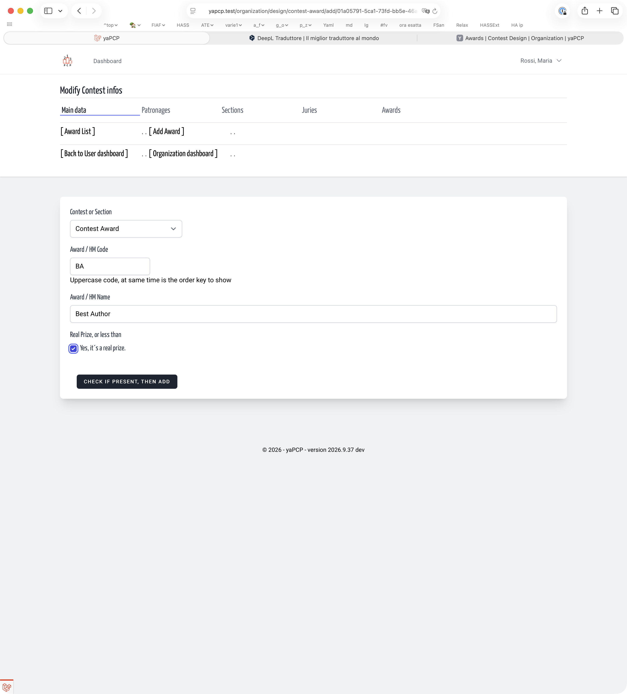
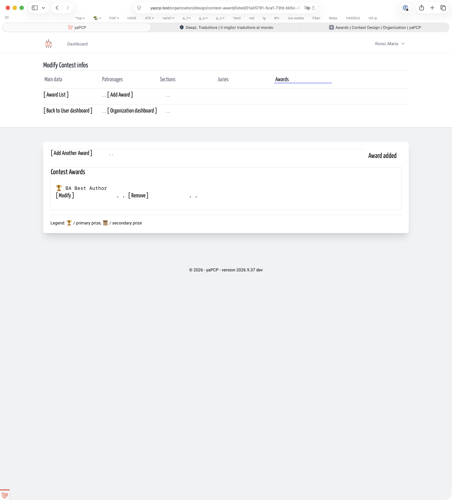

# Awards | Contest Design | Organization
<!-- absolute links are /resources/docs/1.0/    -->
<!-- larecipe links are /{{route}}/{{version}}/ -->
<!-- images must be uploaded in same folder of md then url prefixed by ./  -->

- [Awards List](listed.md)
- [Add a Prize](add.md)
- [Modify](modify.md)
- [Remove](remove.md)

---

## Add a Contest prize / a Section Prize

It's the same work, we ask 3 info:

- it's a contest or section prize (no errors: choose by list)
- an award code, sortable uppercase chars and numbers, i.e.
  the code is the sort key, BA for best Author is over HM honorable
  mention. Easy. 3 record for the same HM? HM1, HM2, HM3. Or HMA, HMB, HMC. Easy.

&nbsp;

The insert form

&nbsp;

Done

