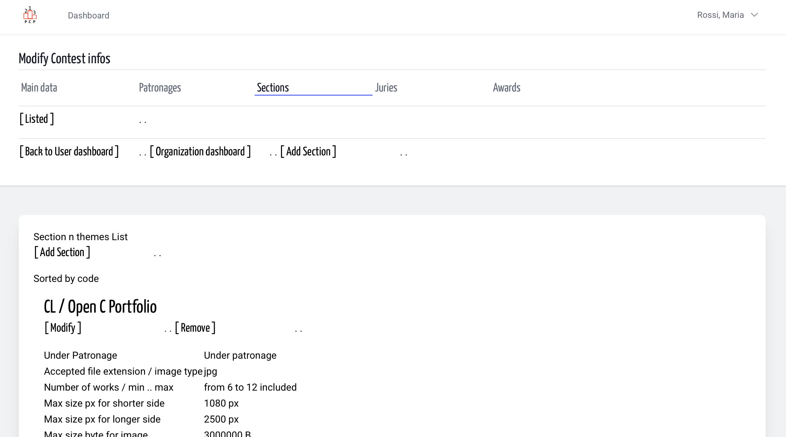
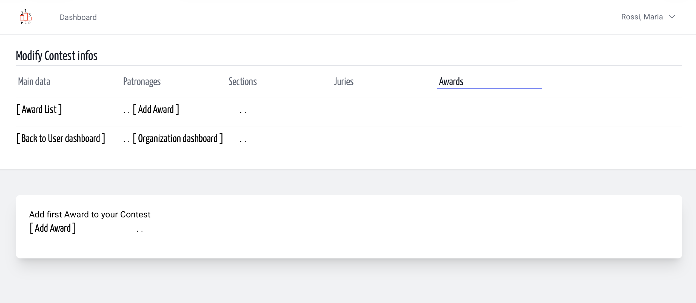
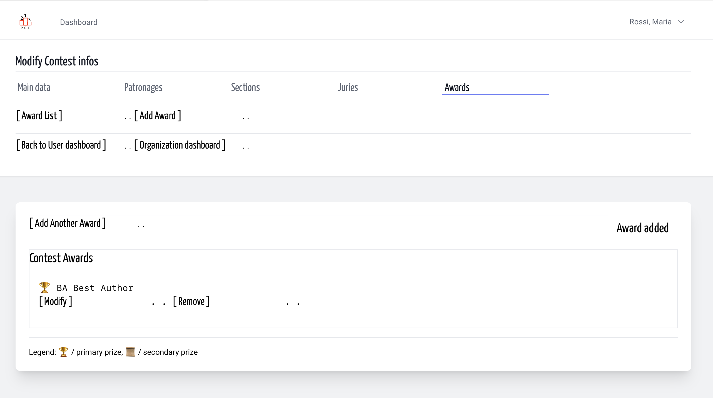

# Awards | Contest Design | Organization
<!-- absolute links are /resources/docs/1.0/    -->
<!-- larecipe links are /{{route}}/{{version}}/ -->
<!-- images must be uploaded in same folder of md then url prefixed by ./  -->

- [Awards List](listed.md)
- [Add a Prize](add.md)
- [Modify](modify.md)
- [Remove](remove.md)

---

## About

Every photography contest has at least one prize. And usually, contests become interesting when they offer a lot of prizes, and this aspect of the contest’s structure focuses on the prizes.

There shouldn’t be major and minor prizes, or first- and second-tier prizes; however, for the federations that grant their patronage, only some are considered prizes, while others are not.

To insert prize in contest you must choose a prize code then add a prize description and define when necessary if it's "a prize" or other.

Next, a suggest: award code must be sortable because the presentation order is guided by award code. And to avoid to insert a new prize between prize 6 and 7 we ask you to use Uppercase Letters for award codes.

&nbsp;

From Contest Design page

&nbsp;

&nbsp;

And empty award list, add first award.

&nbsp;

After first award add

