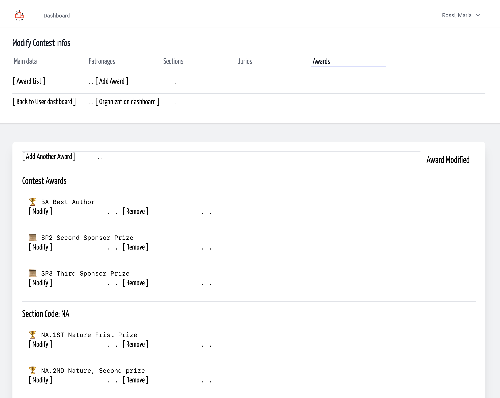
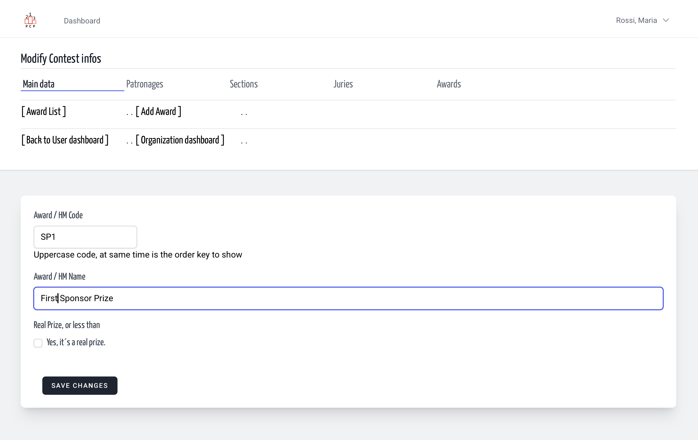
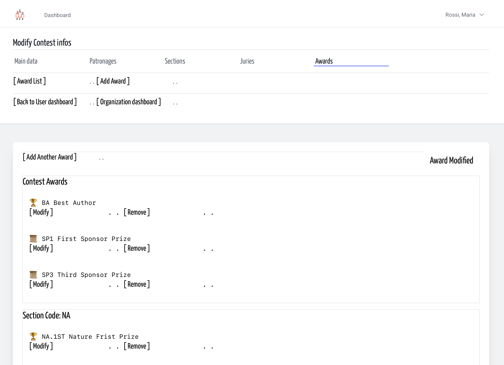

# Awards | Contest Design | Organization
<!-- absolute links are /resources/docs/1.0/    -->
<!-- larecipe links are /{{route}}/{{version}}/ -->
<!-- images must be uploaded in same folder of md then url prefixed by ./  -->

- [Awards List](listed.md)
- [Add a Prize](add.md)
- [Modify](modify.md)
- [Remove](remove.md)

---

## Modify a Contest prize / a Section Prize

Chose the modify link, then modify, that's all.
What you can't modify? The group. Contest prize remain
contest prize, section prize remain section prize.
So, if you need to change a prize from contest to section
the regular way is a delete and a insert.

&nbsp;

&nbsp;

&nbsp;

