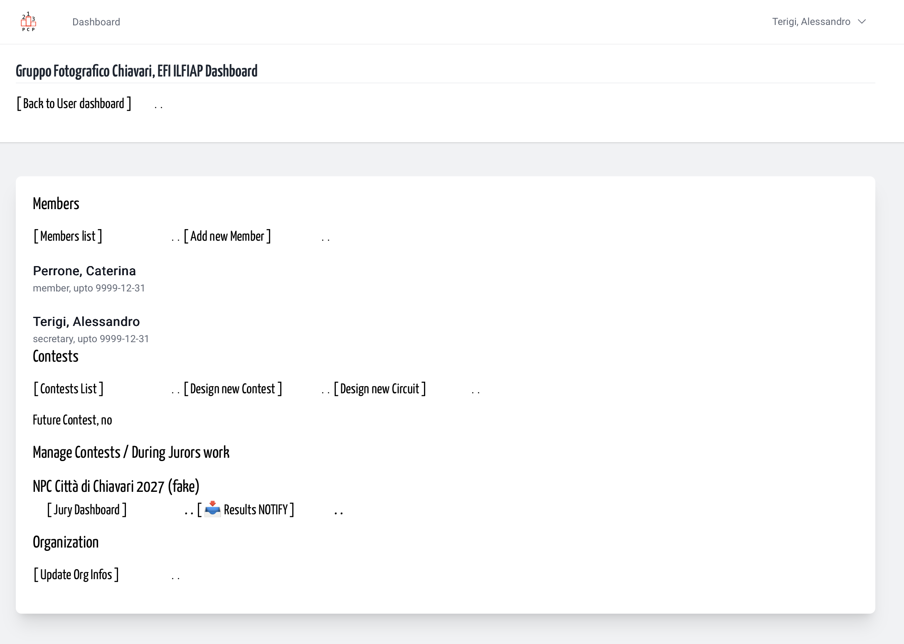
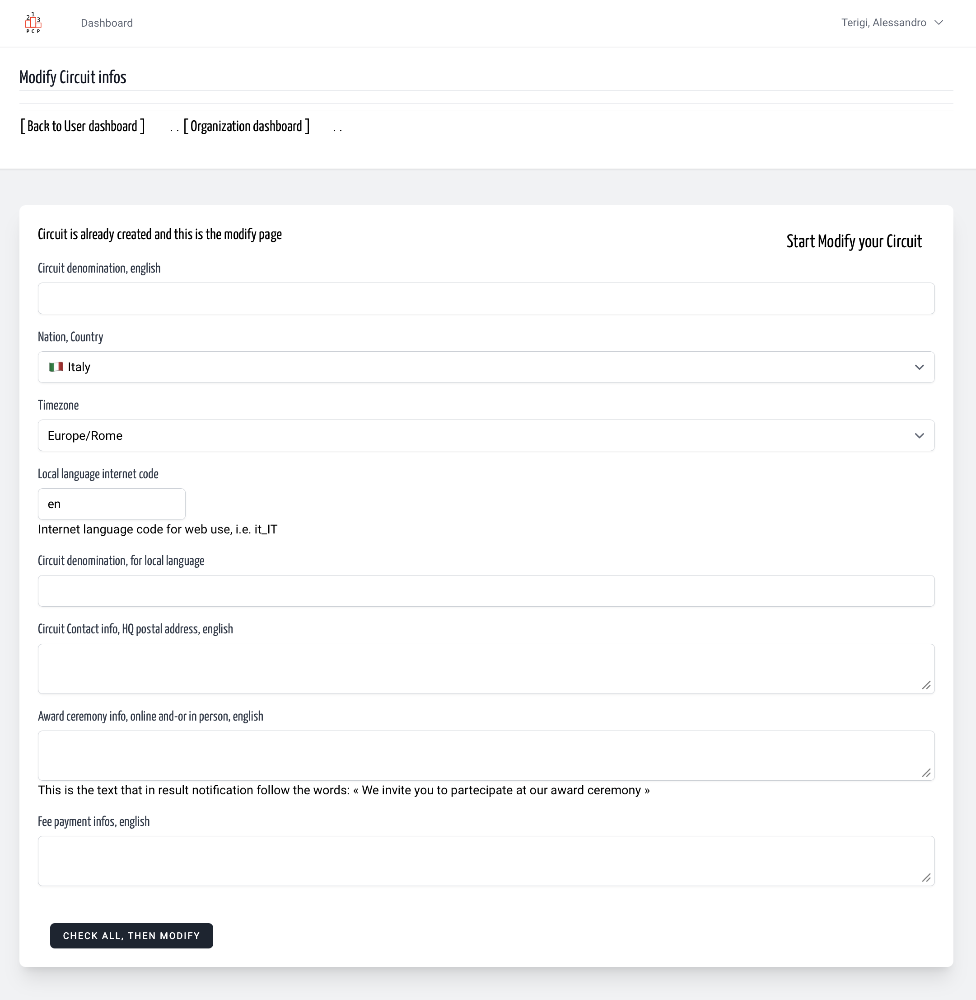
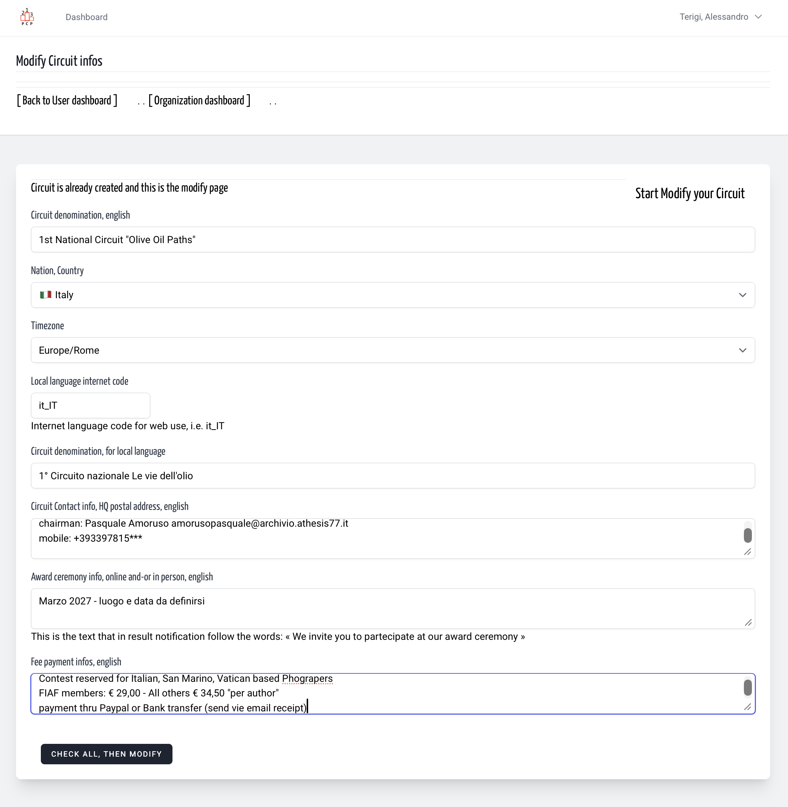

- [New w/name](./add.md)
- [Name modify](./modify.md)
- [Calendar](./calendar.md)
- [Web links](./weblink.md)
- [Contest Detail](./detail.md)

---

When a group of contest have the same section themes, the
same calendar, and a unique organization to manage subscription,
they usually are grouped into a Circuit.

Here Circuit have the common part of all contest, not the jury
composition. btw.

&nbsp;

## Add a Circuit

It's not mandatory, but useful define *first the Circuit, then the Contests*,
so common choices are downloaded from circuit to contest. But Circuit can be
register also after the contests, the contest_id should be update later.

*This is the way* (cit)  
From Organization dashboard, after the link Define Contest, we find the
Design New Circuit link

&nbsp;

The Circuit empty form (as new)

&nbsp;

The Circuit filled form (info from FIAF public contest panel)

&nbsp;

Updated info

Next Step: