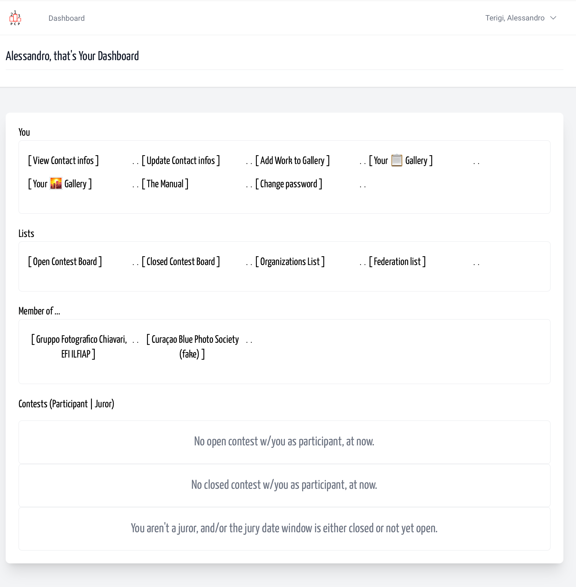
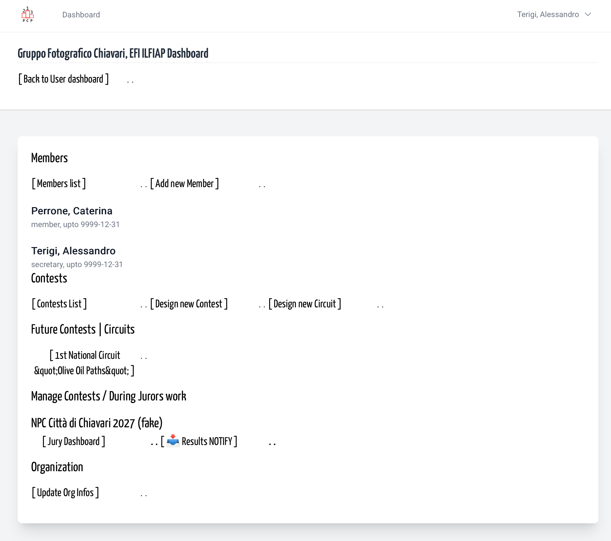
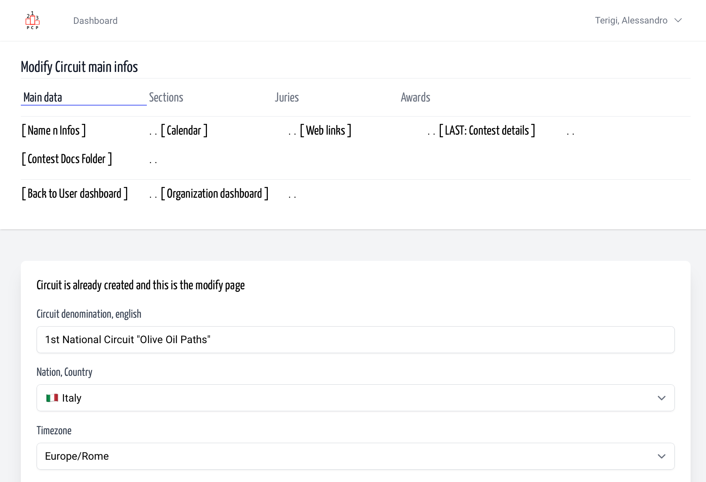
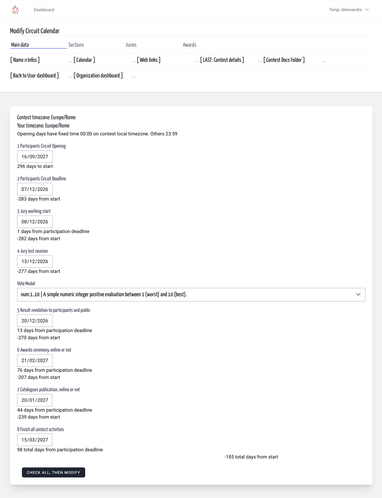
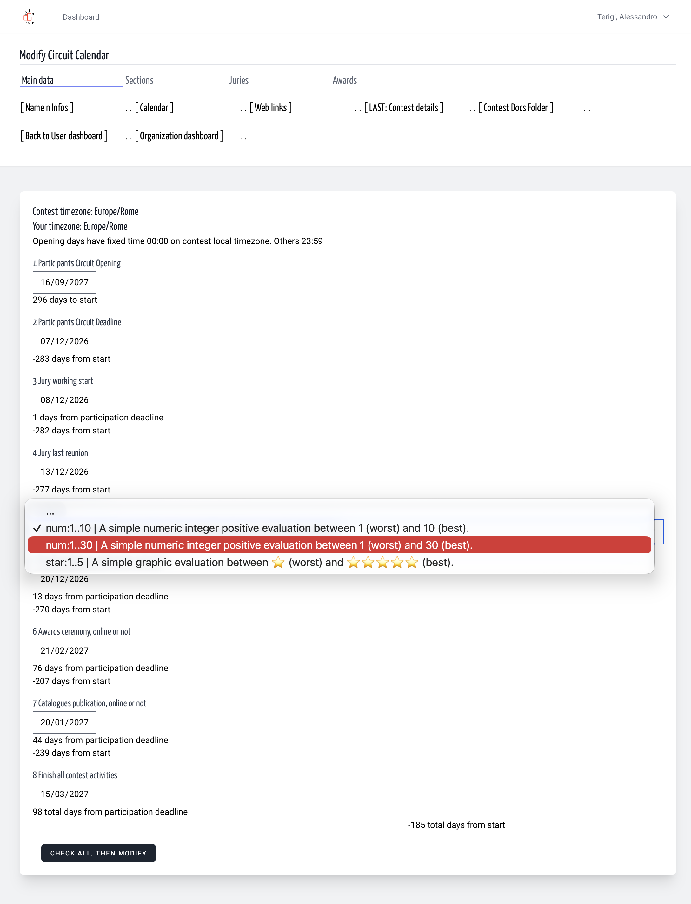
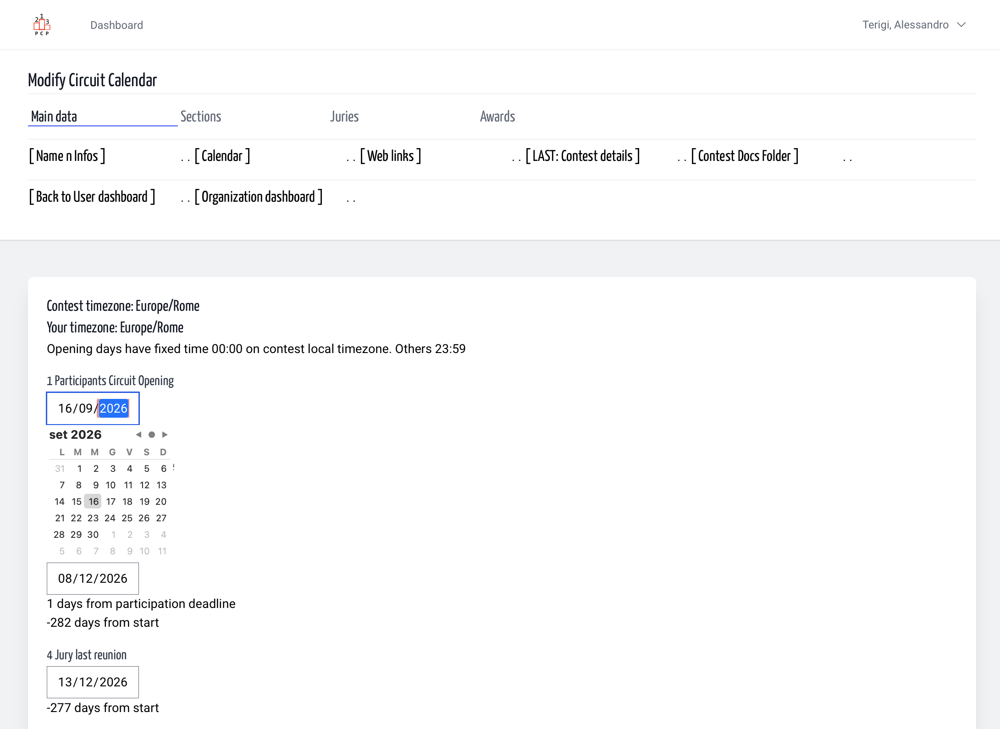
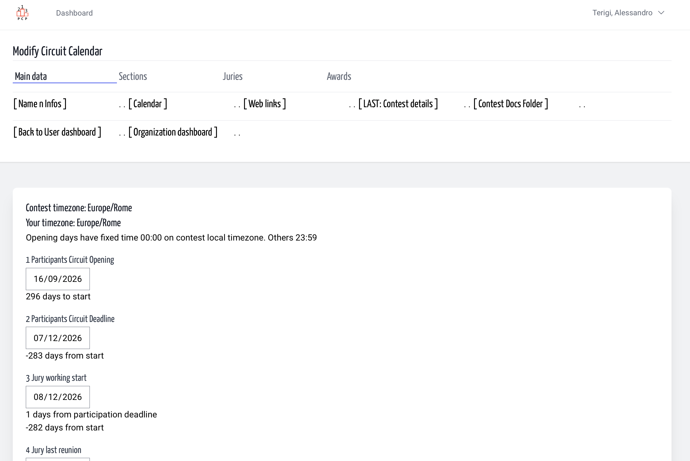
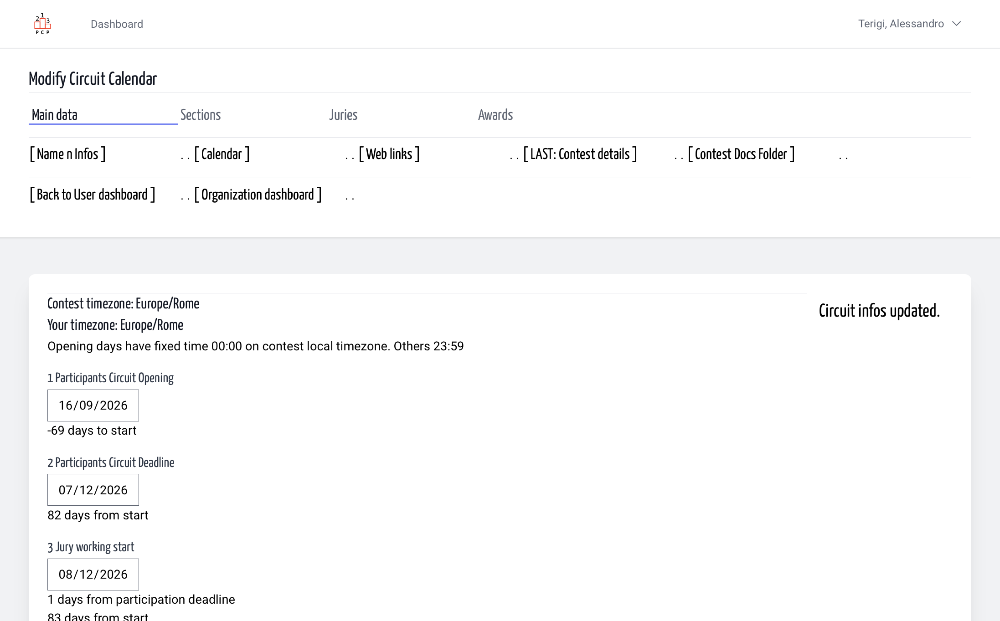

- [New w/name](./add.md)
- [Name modify](./modify.md)
- [Calendar](./calendar.md)
- [Web links](./weblink.md)
- [Contest Detail](./detail.md)

---

Circuit Calendar is an 8 date fix, and this calendar
is common fr every contest be in Circuit.
Under every date we count:

- for Contest opening how many day from now to start
- for other dates, how many day from start.

Predefined dates are distributed in order to give you the
time to organize. Check Federation regulatory for info about
contest timing. Btw date 1 <= date 2 <= date 3 and so on.

&nbsp;

From your personal dashboard go to Organization dashboard

&nbsp;

As Circuit is by-default planned "next year", you see it under Future Contest | Circuits label

&nbsp;

Click on the link put you on first circuit name and main info panel, then
follow under the main nav bar the second lnk to reach calendar panel.

&nbsp;

Here you can adjust date with the usual browser date input

&nbsp;

And under the jury window you can choice how your jurors vote.
Actually we use a numerical way based on vote, but it's not
the only way a jury can work. In our Todolist is also a in/out
selection, useful for contest jury in person and a small amount of
works to examine.

&nbsp;

&nbsp;

&nbsp;

