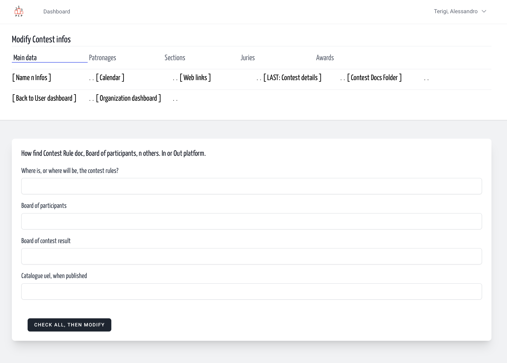

- [New w/name](./add.md)
- [Name modify](./modify.md)
- [Calendar](./calendar.md)
- [Web links](./weblink.md)
- [Contest Detail](./detail.md)

---

Here we have a list of URL to fill.  
Even are facultative, then you can fill later, when some
pages are defined and reachable, public.  

1. Rules url page link
2. Board of participants link
3. Board of results link
4. Catalogue link

These should be a full address link, starting with usual https://

