# Jurors | Contest Design | Organization
<!-- absolute links are /resources/docs/1.0/    -->
<!-- larecipe links are /{{route}}/{{version}}/ -->
<!-- images must be uploaded in same folder of md then url prefixed by ./  -->

- [Jury members](listed.md)
- [Add a Juror](add.md)
- [Modify some Juror info](modify.md)
- [Remove a Juror](remove.md)

---

## Add a juror to Jury

You can add a juror after received her/him consent to be juror, btw.
Here we ask 4 infos, and start from Contest Design primary navigation bar.
After filled (Contest) Section area click on Juries.  
Here you have a list of Section with or with none Jurors added.  

&nbsp;

First we ask an email, because the person should be already present
in Platform with her/him email.  

If present: name, lastname, country are picked from platform  
otherwise: name, lastname, country are asked to you for add a free account on platform.

Latest we ask for a qualify, as "President of Milkway Astro Photo Club",

&nbsp;

From Contest Design page
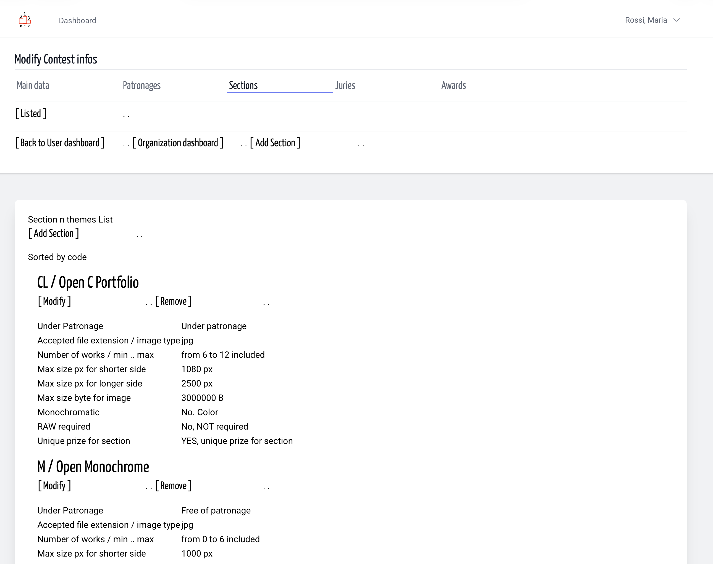

&nbsp;

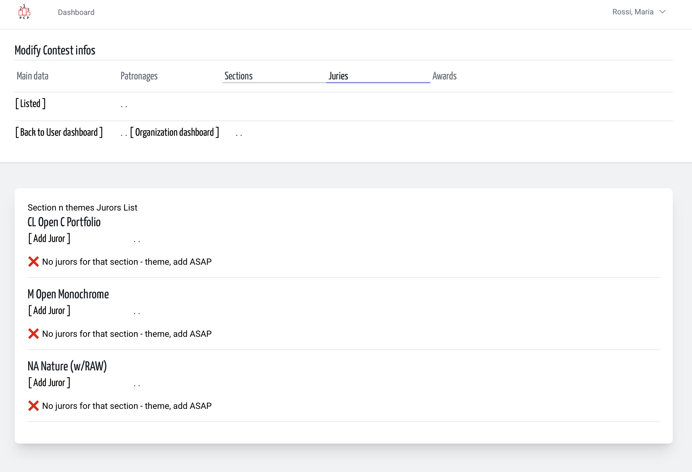

&nbsp;

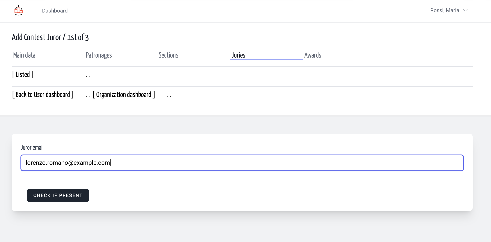

&nbsp;

From first to last, she/he is already in platform.
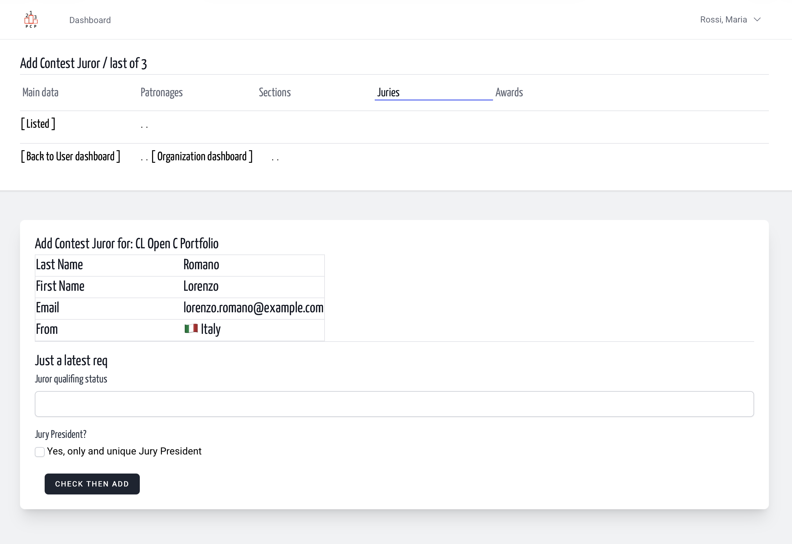

&nbsp;

Last two request: a qualifying status
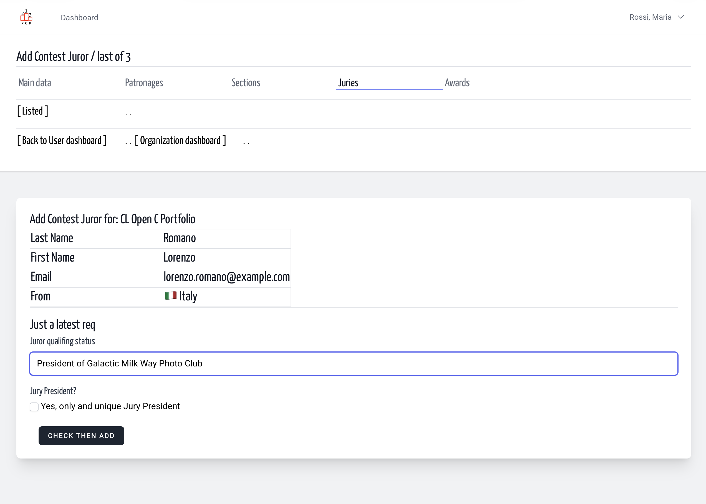

&nbsp;

And a new juror is added.
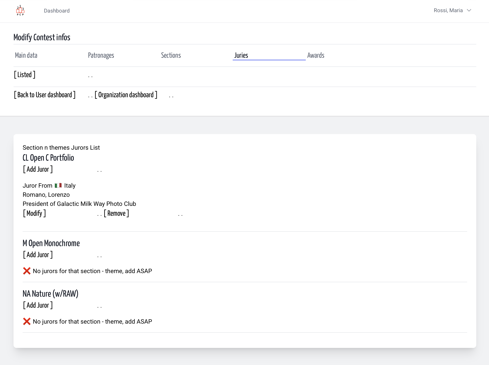

&nbsp;

What if? she/he is not in Platform
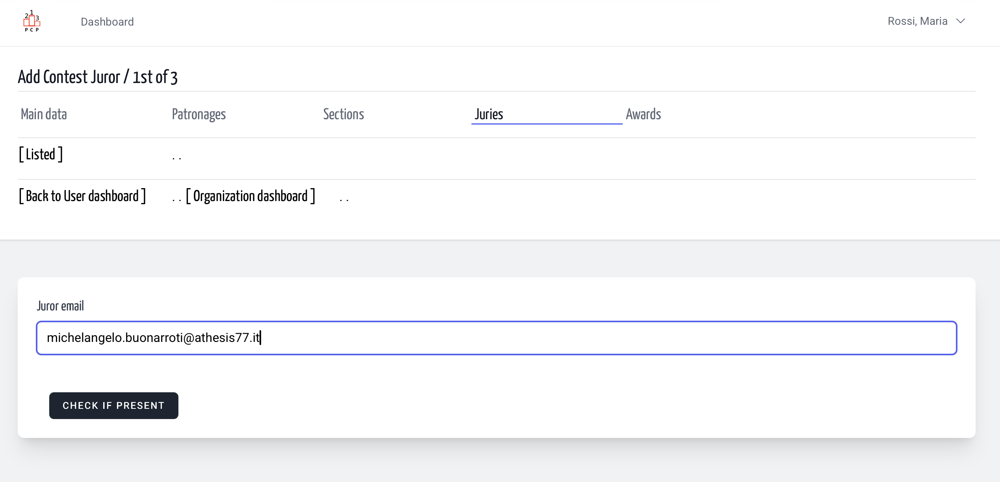

&nbsp;

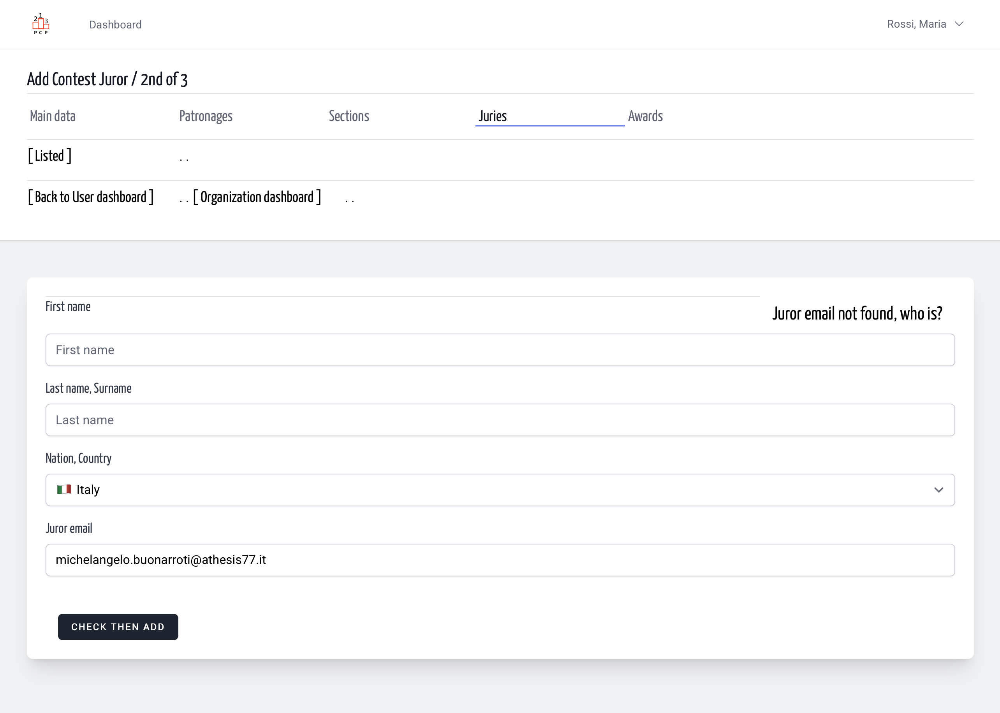

&nbsp;

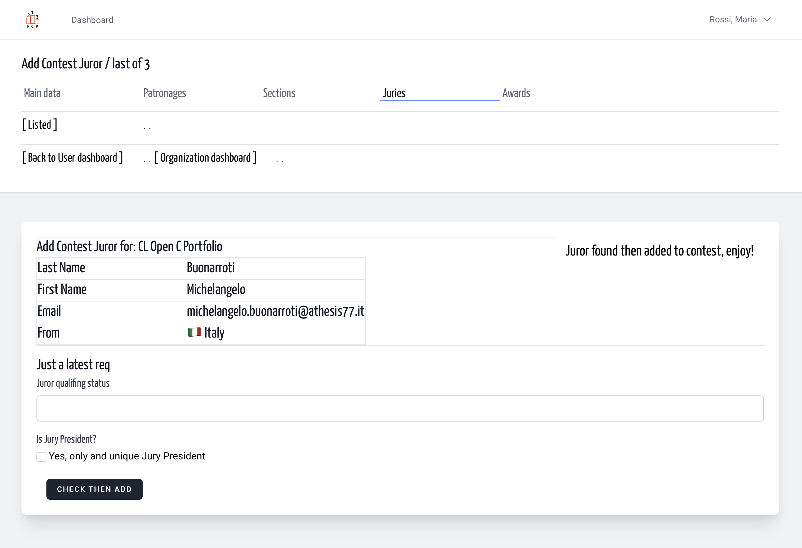

&nbsp;

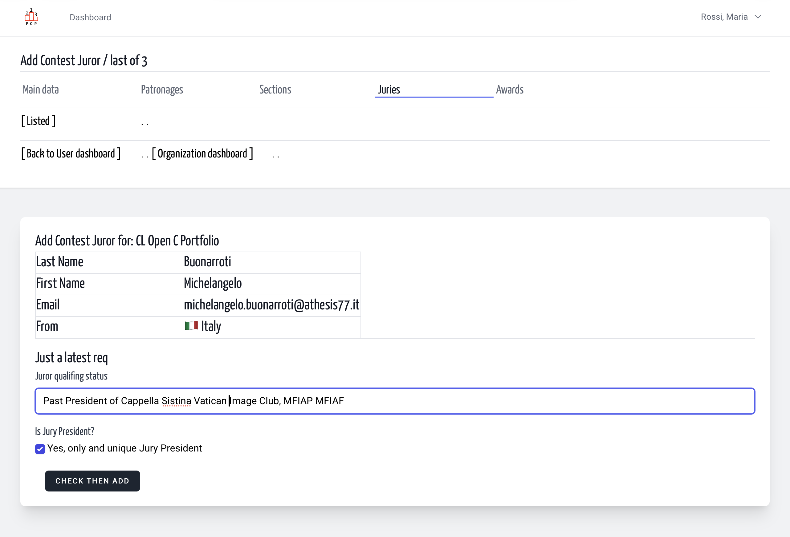

&nbsp;

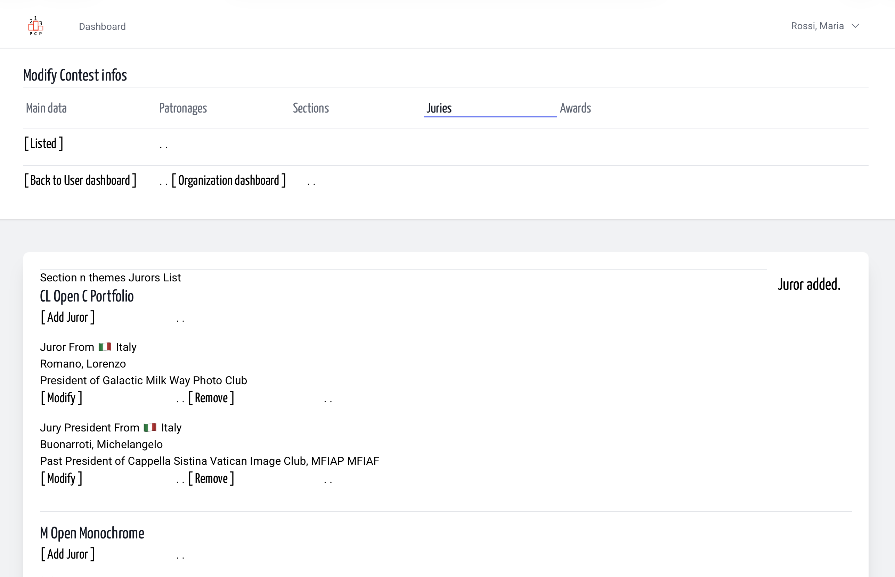
