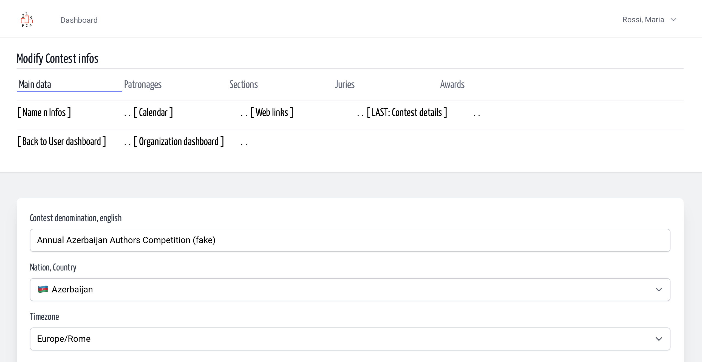
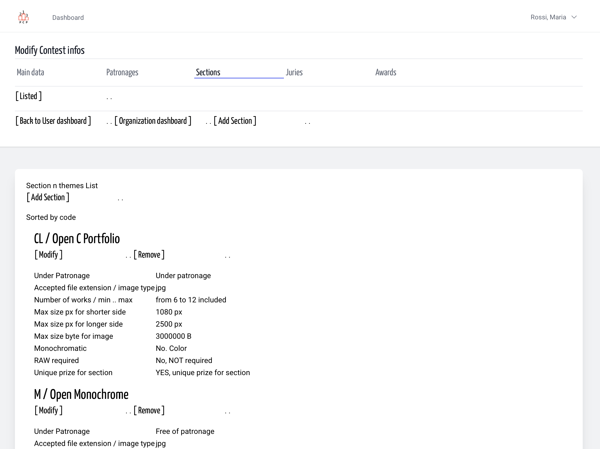
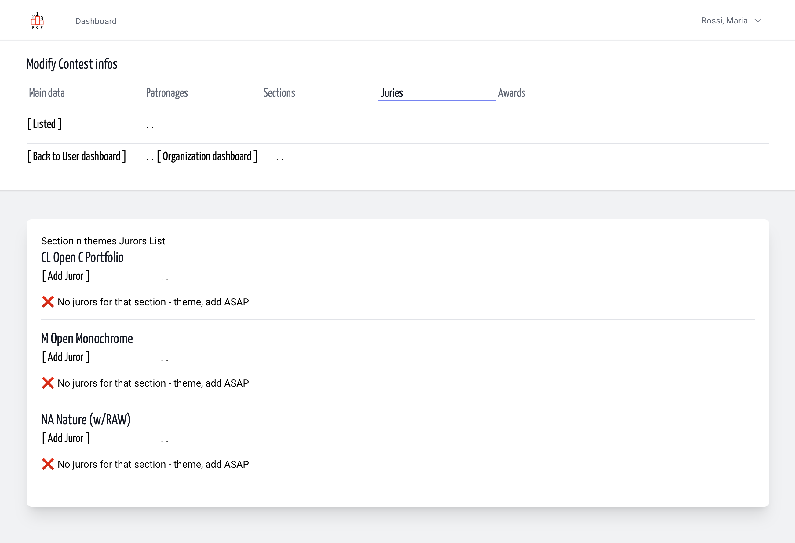

# Jurors | Contest Design | Organization
<!-- absolute links are /resources/docs/1.0/    -->
<!-- larecipe links are /{{route}}/{{version}}/ -->
<!-- images must be uploaded in same folder of md then url prefixed by ./  -->

- [Jury members](listed.md)
- [Add a Juror](add.md)
- [Modify some Juror info](modify.md)
- [Remove a Juror](remove.md)

---

## About

Some contest are relatively small so a jury can review all
the works for all the sections, but for medium-large contest
with hundreds of participant and i.e. 5 or 7 section - themes,
must be assigned a jury for every section.  
When you came to Organization Contest Design dashboard
in the main navigation bar there is a link Juries.

&nbsp;

From Contest Design page

&nbsp;

The Section list (no juror here)

&nbsp;

The section list with (no) Jurors List

