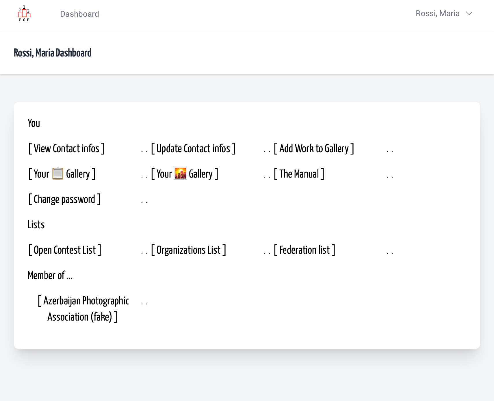
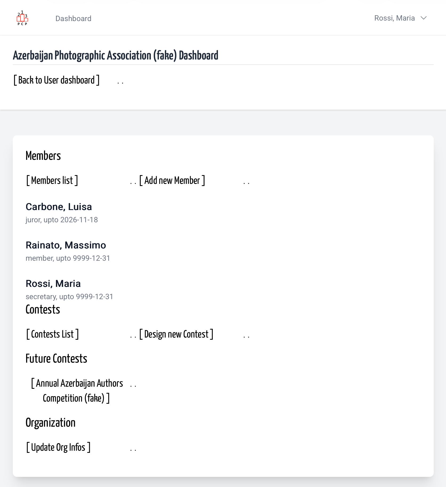
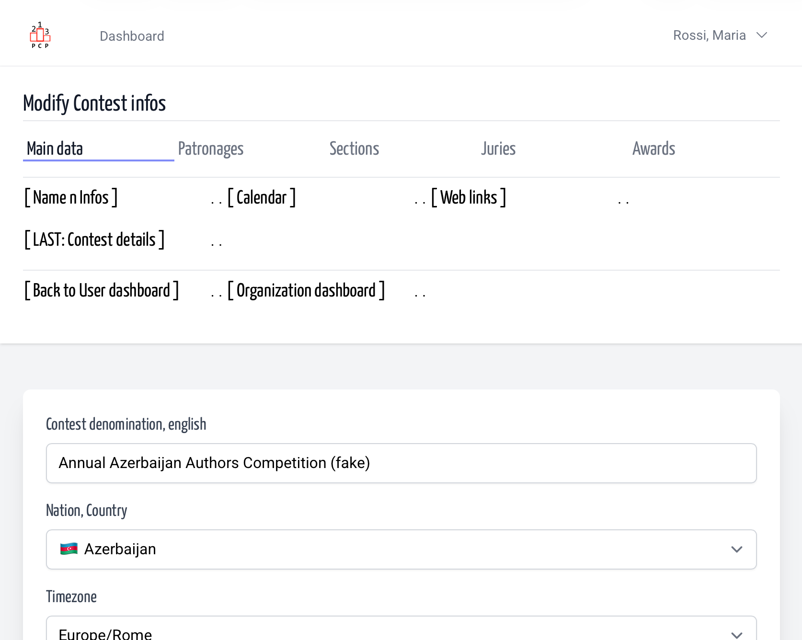
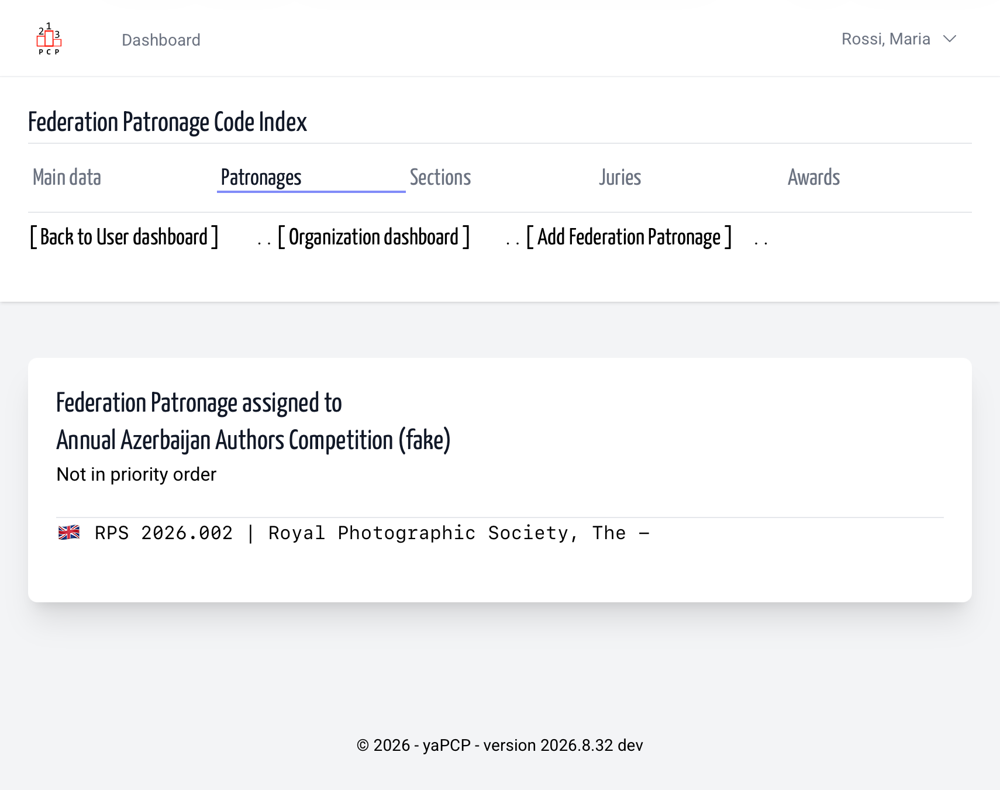

# Contest Federation Patronages | Contest Design | Organization

- [Add new](add.md)
- [Modify](modify.md)
- [Remove](remove.md)

---

That's not a MUST HAVE, but in most cases Photographic
Salon had interest to receive Federation Patronages.
The fact that Federation impose some requirements, and
had a sort of control before, running, and after the
contest activities make a Patronized Salon more interesting for
contest participants, who know that contest result
are eligible for Federation distinction and other
merit based honour.

Initially the *patronage federation code* was only a
information text, but later appears more useful obtain
a structured relation between federation, and contest.

##  Reach Contest Patronage page

From personal dashboard follow

&nbsp;

...The organization dashboard link...

&nbsp;

...Then in the main / unique navigation bar ...

&nbsp;

...The Patronages link...

