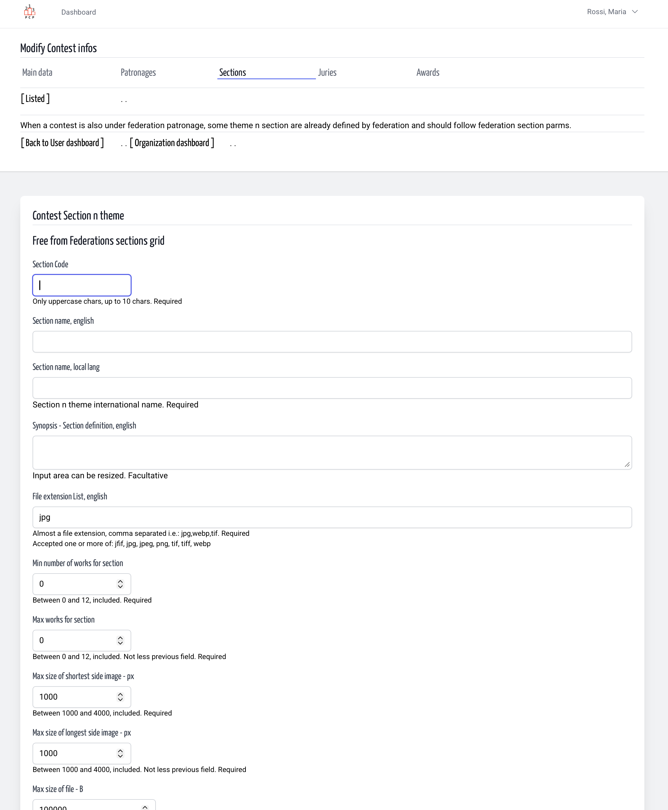
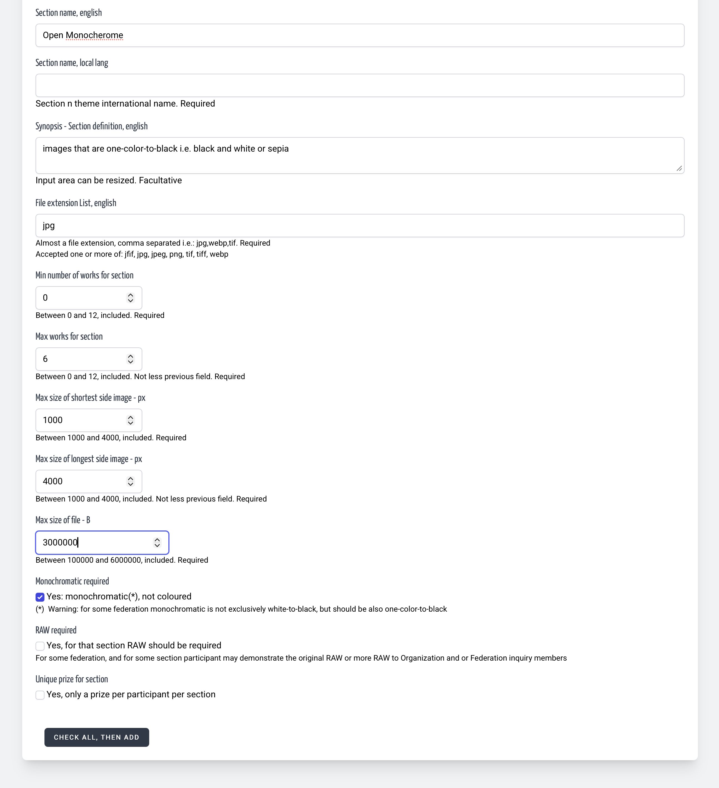

# Themes n Sections | Contest Design | Organization
<!-- No title but that is the user manual, plain text and how to -->
<!-- absolute links are /resources/docs/1.0/    -->
<!-- larecipe links are /{{route}}/{{version}}/ -->
<!-- images must be uploaded in same folder of md then url prefixed by ./  -->

- [Section Index](listed.md)
- [Add FP free](add1.md)
- [Add with FP](add2.md)
- [Modify FP free](modify1.md)
- [Modify with FP](modify2.md)
- [Remove](remove.md)

---

## About

Tautologically *Contest Section are contest sections*. But to help organization
we don't ask only a code and a name, but here we ask some infos that can be
checked automatically. And even you have a Federation Patronized contest,
should be some section that are out-of-federation-patronage.
So the form for a contest free of any federation patronage is simplified.

&nbsp;

Contest Design page, under the page title the contest design main navigation menù with "Section" tab
  

&nbsp;

Contest Design page, under the page title the contest design main navigation menù with "Section" tab
  

&nbsp;

Fields form are:

- **Section Code**  
  *Uppercase code, min 1 upto 10 char* must be unique in contest
- **Section Name**  
  In international english, short description of theme and section
- **Section Name, local lang**  
  for future use
- **Synopsis**  
  A description - definition for section n theme, in international english.
  *textarea can be enlarged manually*
- **File extension list**  
  Actually all photographic contest are JPEG based, but when a jury can evaluate
  a photographic image stored in WebP or Jpx with a browser session, **why not?**
  That's a multi-value filed, default value is jpg, when change it
  insert a list of file extension in lowercase
  comma separated values.
- **Min / Max number of works**  
  There two fields are used to distinguish section for single photos
  by section for short-story - reportage - portfolio section.
  When min works is 0 it's a single photo section  
  When min works is > 0 it's a portfolio section.
- **Short and Long max size**  
  Horizontal, Vertical, Squared, these two numeric fields
  require *how many pixel*.
- **File size Bytes**  
  In the past photographic contest may require a file size limit
  usually 1,44 MiB as floppy capacity. here you can inserta value
  between 100 KB and 6 MB.
- **Mono only**  
  Only monochrome can partecipate in that section y/n.
- **RAW required**  
  Some contests require that, for images that have been accepted or even awarded
  prizes, the original RAW files be available; the contestant must provide these
  to the organizers upon request within a relatively short period of time.
- **Cumulative prizes**  
  Can the author give *only a prize per section*? Not 2 or more prizes, one only.
