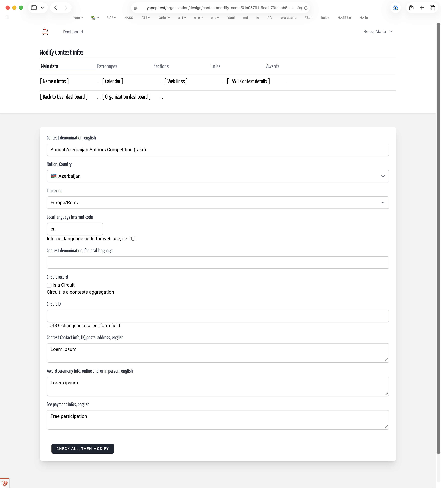
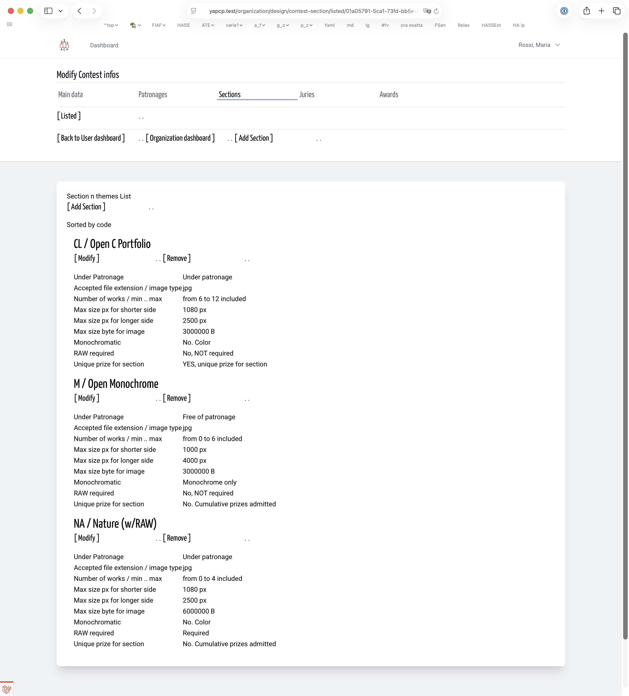
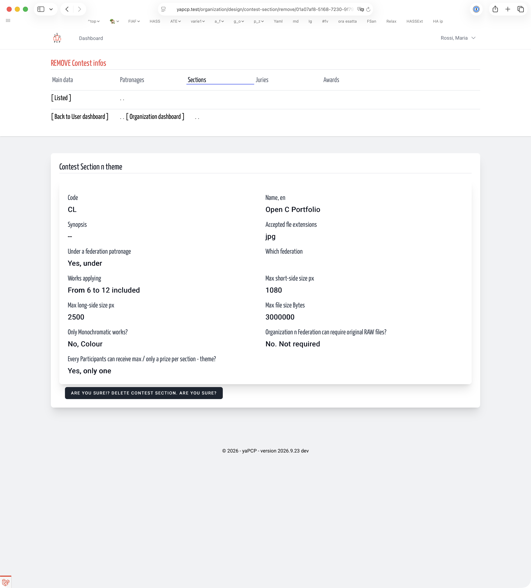
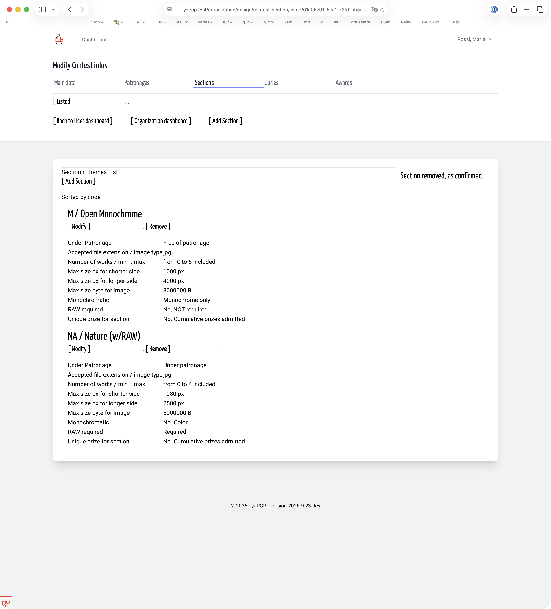

# Themes n Sections | Contest Design | Organization
<!-- No title but that is the user manual, plain text and how to -->
<!-- absolute links are /resources/docs/1.0/    -->
<!-- larecipe links are /{{route}}/{{version}}/ -->
<!-- images must be uploaded in same folder of md then url prefixed by ./  -->

- [Section Index](listed.md)
- [Add FP free](add1.md)
- [Add with FP](add2.md)
- [Modify](modify.md)
- [Remove](remove.md)

---

Wrong theme can be easily removed only with a confirmation.

&nbsp;

  

&nbsp;

  

&nbsp;

  

&nbsp;

