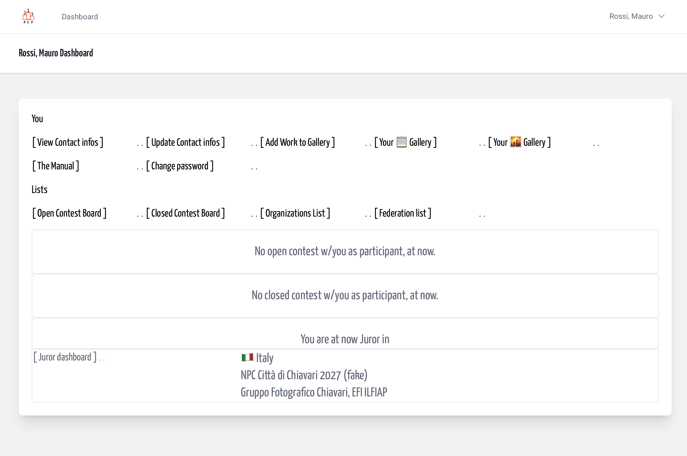
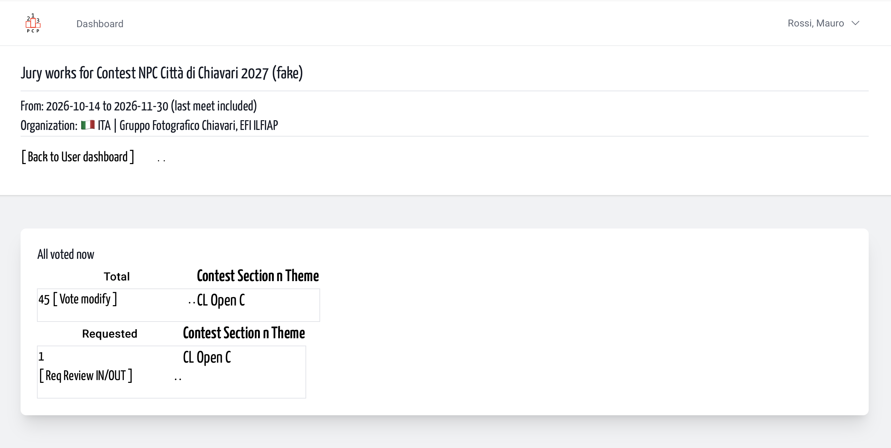
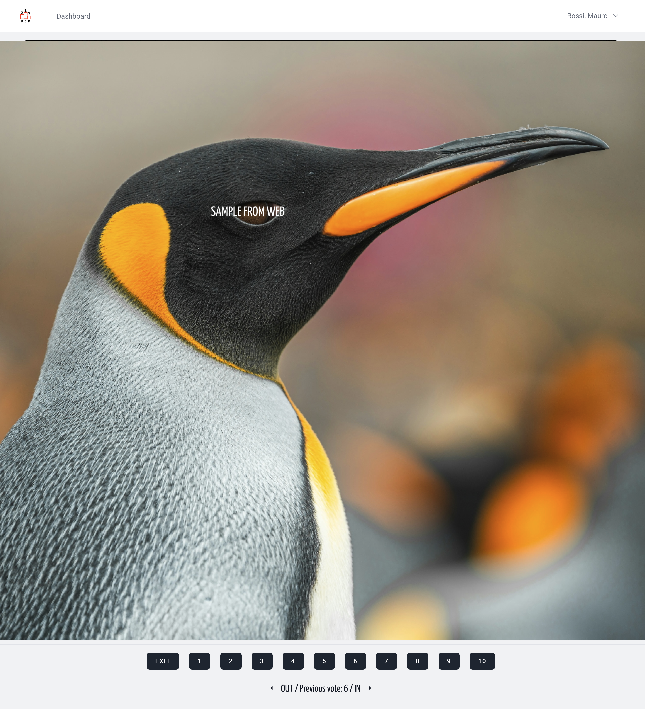
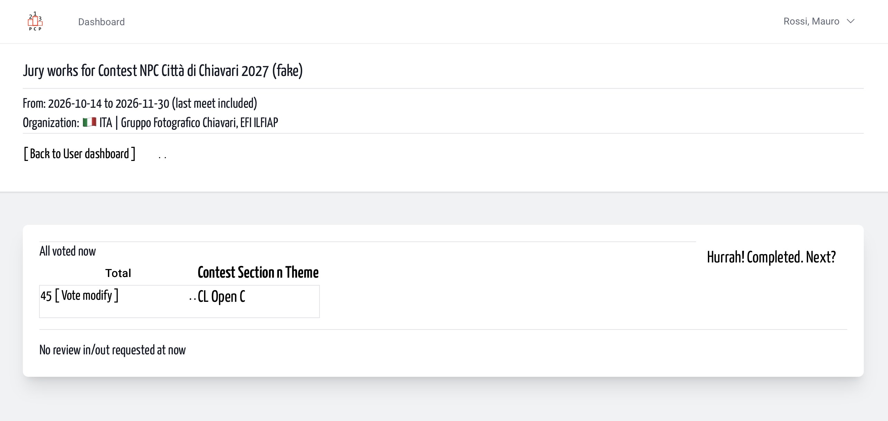

# In? 👍🏻 or Out?👎 | Jurors
<!-- absolute links are /resources/docs/1.0/    -->
<!-- larecipe links are /{{route}}/{{version}}/ -->
<!-- images must be uploaded in same folder of md then url prefixed by ./  -->

---

## Sometimes the vote is for IN /OUT

Once all rounds of voting have been completed, the organizers may request that you make a series of changes to votes that have already been cast. This applies to competitions where the organizers are required to remain within a certain percentage range for the ratio of shortlisted entrants to total participants, and this target has not been met.

&nbsp;

The organizers will therefore ask you, via the platform, to review a limited number of entries to resolve the issue. It is your responsibility to review the entries and the votes cast, and you have the option to lower, raise or even keep the vote the same.

&nbsp;

This may resolve, or at least reduce, the gap between the expected percentage and the actual percentage. The process is identical to that of changing a score on your own initiative, except that the overview view is bypassed and you select one image at a time.

*Translated with DeepL.com (free version)*

&nbsp;

&nbsp;

&nbsp;

&nbsp;

&nbsp;
