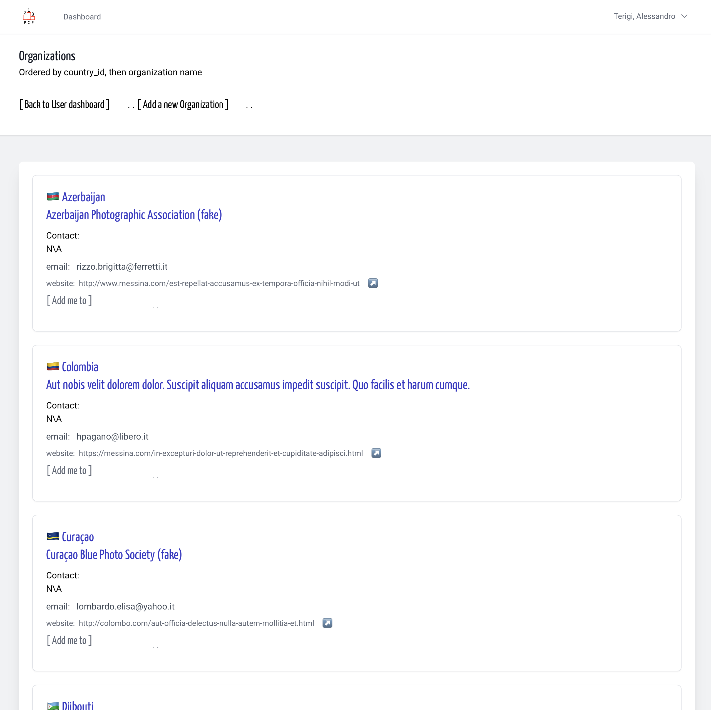
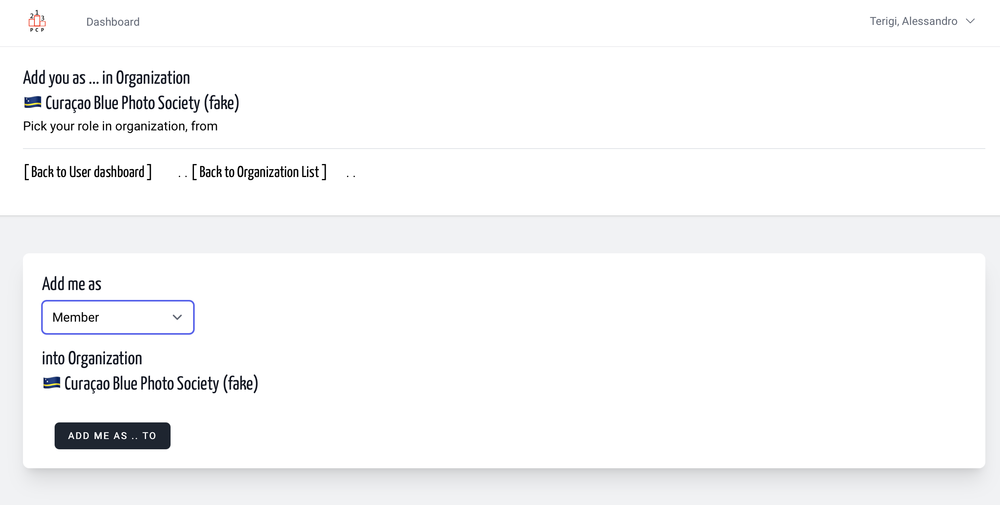
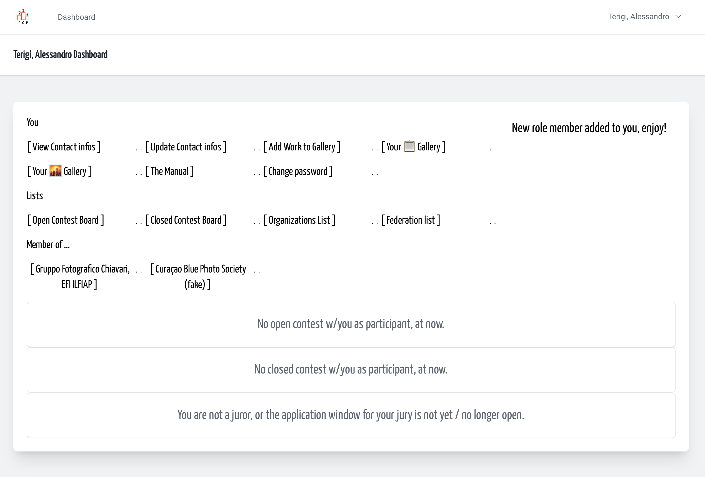

# Add me to (an existing Organization)
<!-- absolute links are /resources/docs/1.0/    -->
<!-- larecipe links are /{{route}}/{{version}}/ -->

<!-- images must be uploaded in same folder of md then url prefixed by ./  -->

- [&nbsp;](#)

---

Use the **Add me to** link  

&nbsp;

&nbsp;

Fill the form - simply choice a role

&nbsp;

&nbsp;

Then click on unique button

&nbsp;

&nbsp;

Clicking on *organization link* in your dashboard you enter in the *Organization Dashboard*

&nbsp;

When you see yourself as Organization member and what role.

