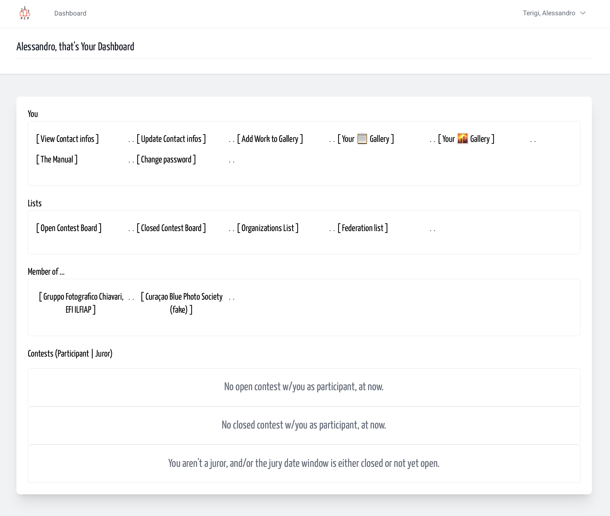
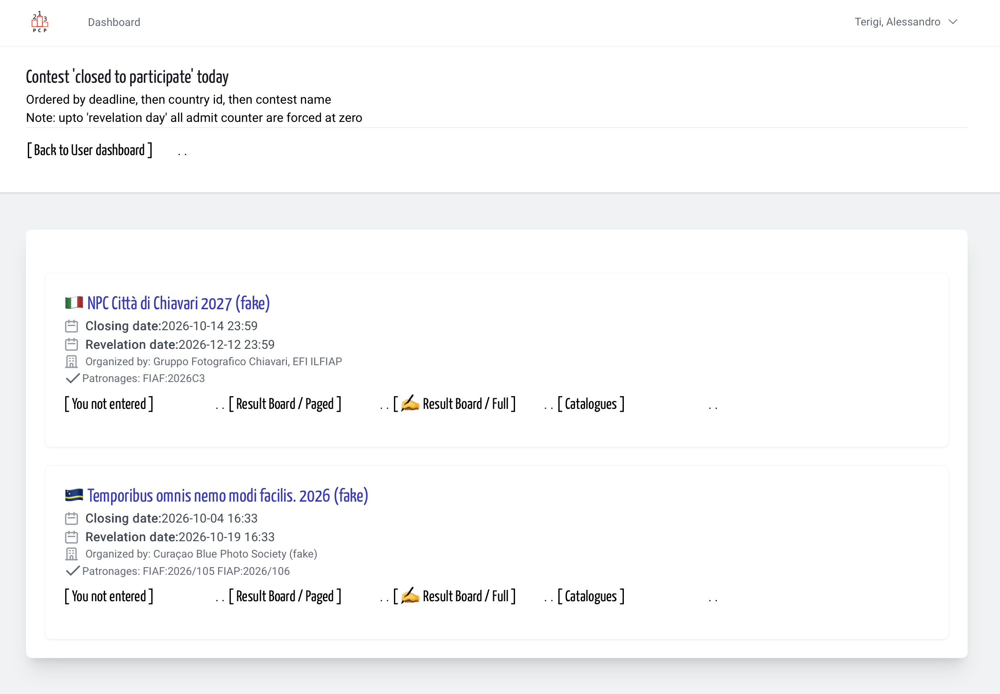
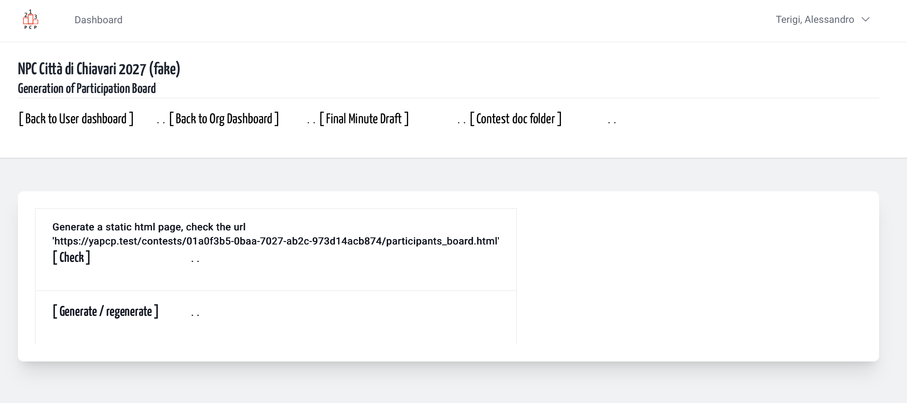

## It's just a click, really

Every Contest had a result board, we made 2 versions:
one is paginated, the other is a static web page
with all participants. 

To build the Full participant Board List,
you as organization member start from your User dashboard

&nbsp;

Then click over the link Result Board Full of your contest

&nbsp;

Confirm the start of job ()

&nbsp;

Feedback that the job was stated

&nbsp;

Feedback that the job has done: change the icon on the link

&nbsp;

