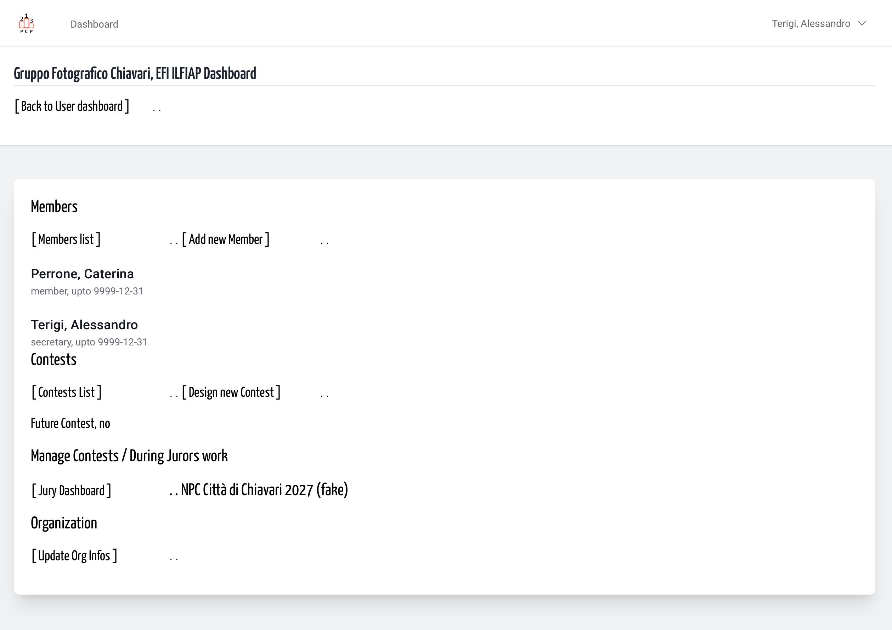
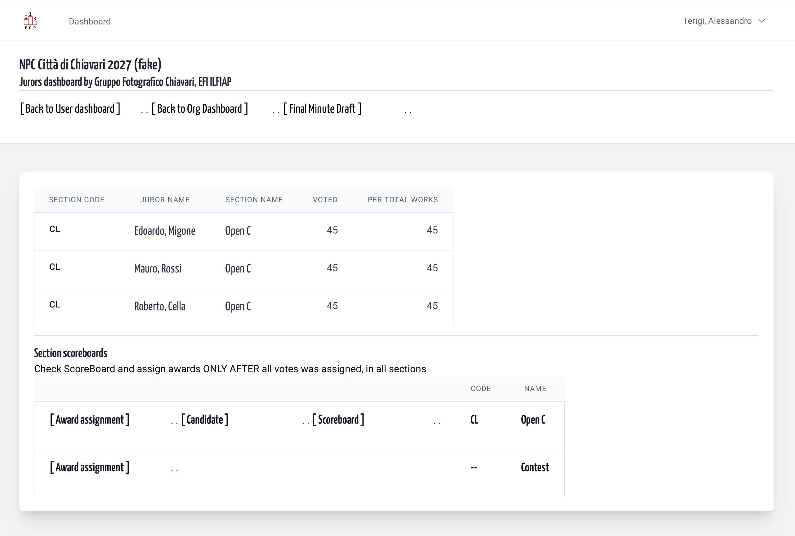
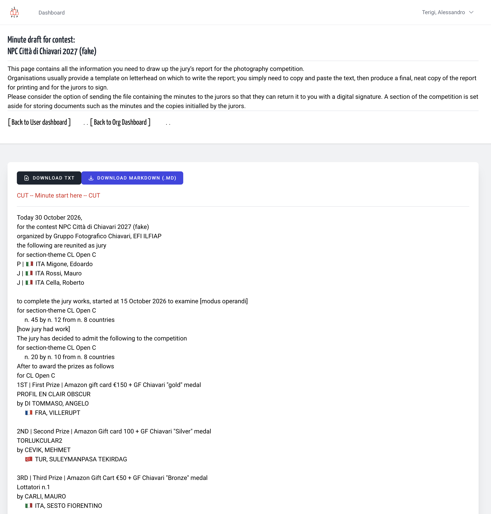
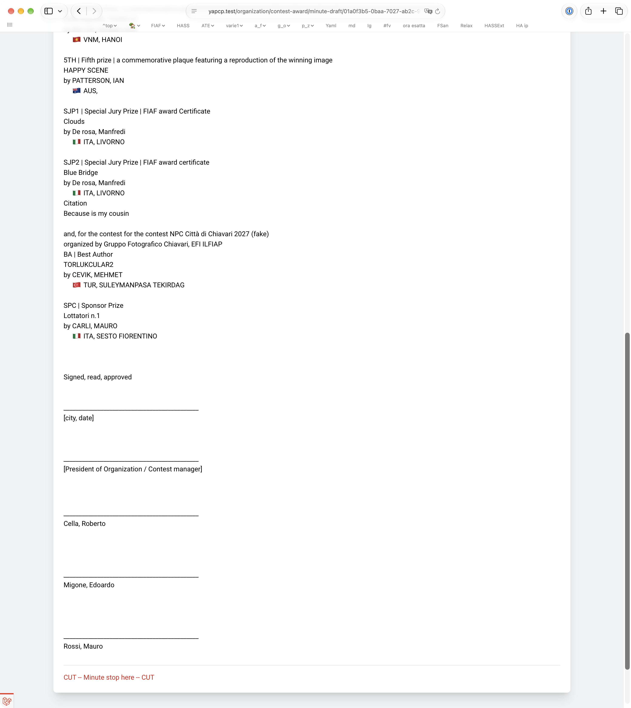

## It's just a click, really

Every contest require as last act of a jury meeting the
write of a minute, indexing: contest infos,
how many authors participants, how many works,
and for every section-themes 
how many admitted, list of jurors, and a list of awards assigned,
also for contest.

So, when all that infos are on the platform, why don't
give a draft from it?

Into the contest dashboard a link [Minute draft]
give you a page with:

1. date of minute
1. info of contest
    1. contest name
    1. contest organization
    1. list of section n themes
1. loop for every section
    1. section-theme name
    1. jury composition
    1. number of works participants
    1. number of authors participants
    1. number of work in Admit
    1. number of authors in Admit
1. a section-themes loop with
    1. award name
    1. award work winner and t's award work author
    1. award work author
1. then the same for contest awards
    1. award group name, if

Instruction for organization
- print and sign every page from organization and jury members for approval
- save and send to all remote juror for digital signature

To reach the Juror Minute Draft, from your
organization dashboard follow the contest Jury Dashboard.  

&nbsp;

Here is, in upper right, the link for [Final Minute Draft]  

&nbsp;

First half of Minute

&nbsp;

Last half of Minute

Here two buttons can permit you o download a "txt only"
minute and a "markdown" version to be imported in external editors.
