# Contest Works Review | Organization Contest Management
<!-- absolute links are /resources/docs/1.0/    -->
<!-- larecipe links are /{{route}}/{{version}}/ -->

<!-- images must be uploaded in same folder of md then url prefixed by ./  -->

- [&nbsp;](#)

---

## About that function

Some checks on the images submitted by entrants to competitions can be carried out automatically, but all images must be viewed by a human to ensure they comply with the competition’s theme.

This should not be a form of pre-judgement that replaces that of the jury, but merely a technical assessment. For example, in all good faith, an entrant may fail to realise that their work, which they have declared to be monochrome, does not, due to the effect of a glaze, fall within the concept of black and white required by the theme section. Or there may be a small but visible personal mark in a corner that they are no longer aware they have left there.

*Translated with DeepL.com (free version)*

From organization dashboard to Contest Dashboard
under the "Manage Contests / Before Jury"
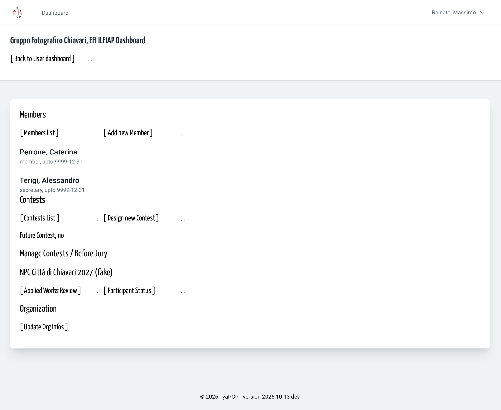

&nbsp;

Here his a list of unreviewed works, simply with
a title, every link put to a single image review
then after the list is updated.
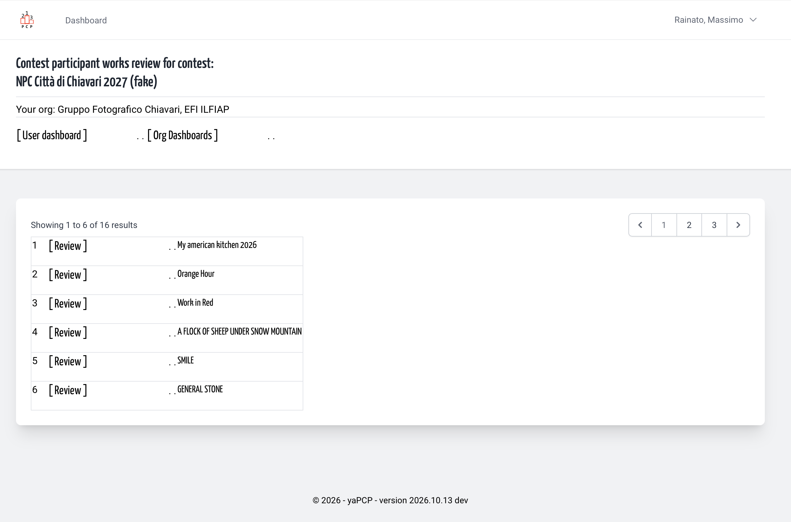

&nbsp;

When a Review link is choosed, you are in a single work
review page, with some infos, reserved to Organization members.
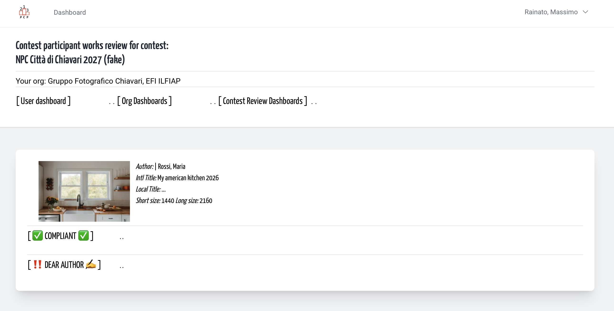

&nbsp;

If you click the miniature you can check the full size
image.
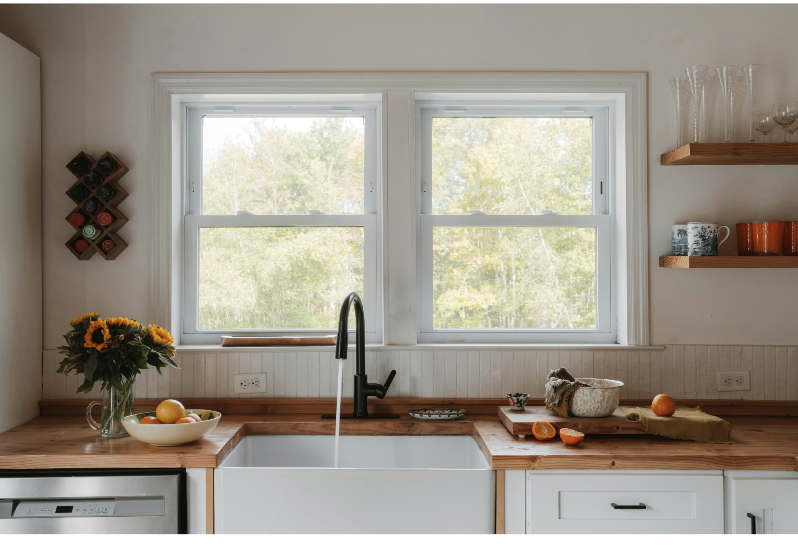

&nbsp;
Then back to single work review page and choose your answer link:
are all ok / compliant, or you need to explain to author
a notify about her/him work?

---

## A sample of work about Contest work review

Initial work list, pick the first 
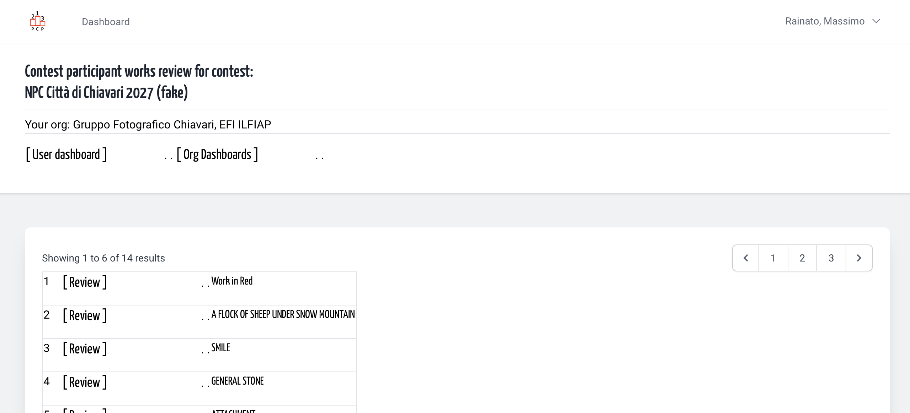

Single image card, with 2 choice: ✅ or ‼️
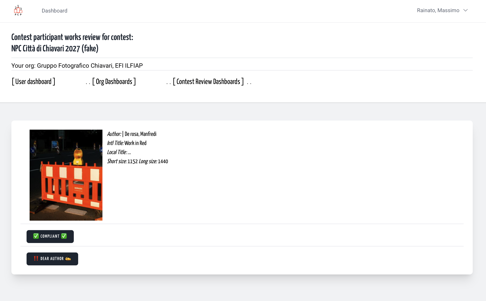

Available(?) full screen review.
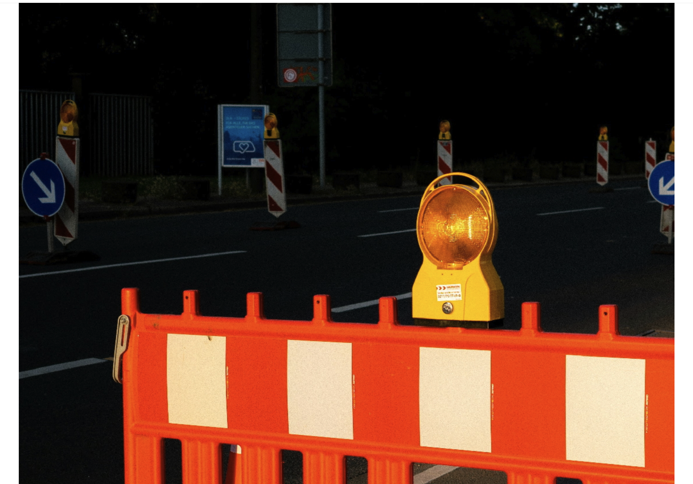

&nbsp;

Result: a message and a shorter list.
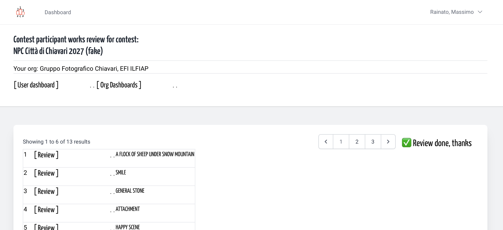

&nbsp;

&nbsp;

Another image with an (inesistent, it's a sample) trouble that require a warn notification
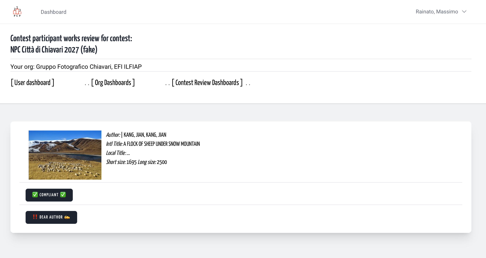

&nbsp;

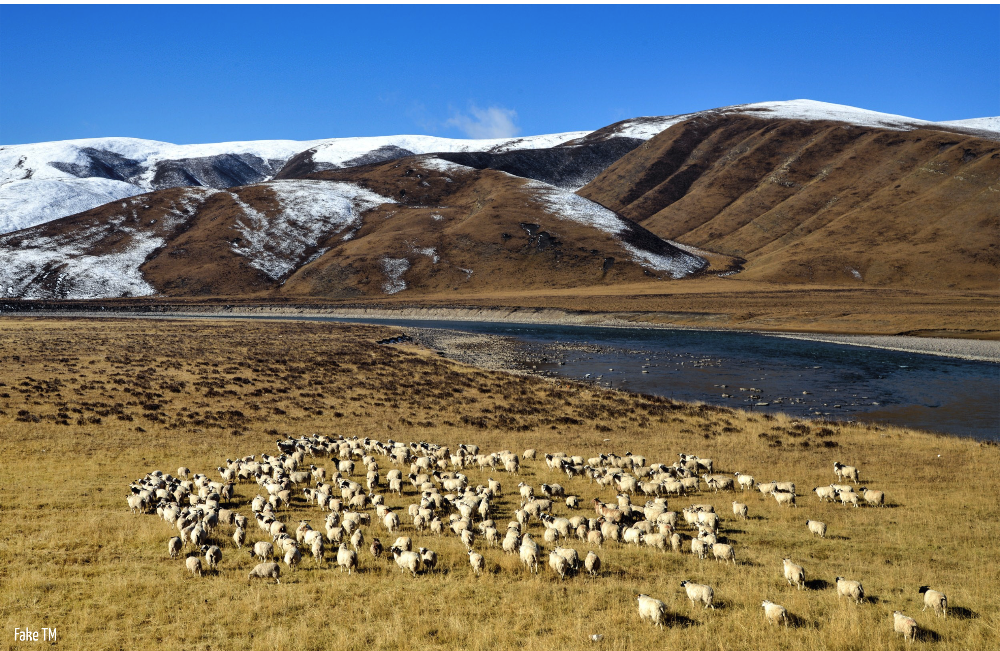

&nbsp;

In the form the Organization review can explain why that image was shifted out of contest.
PLEASE, CAREFULLY as a Best Client Services of The Year.
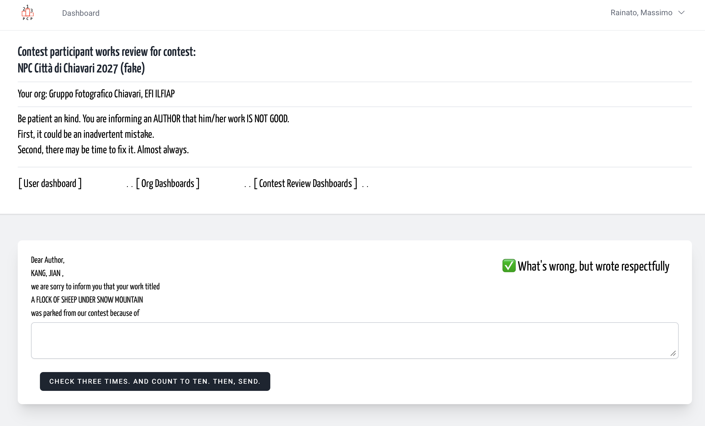

&nbsp;

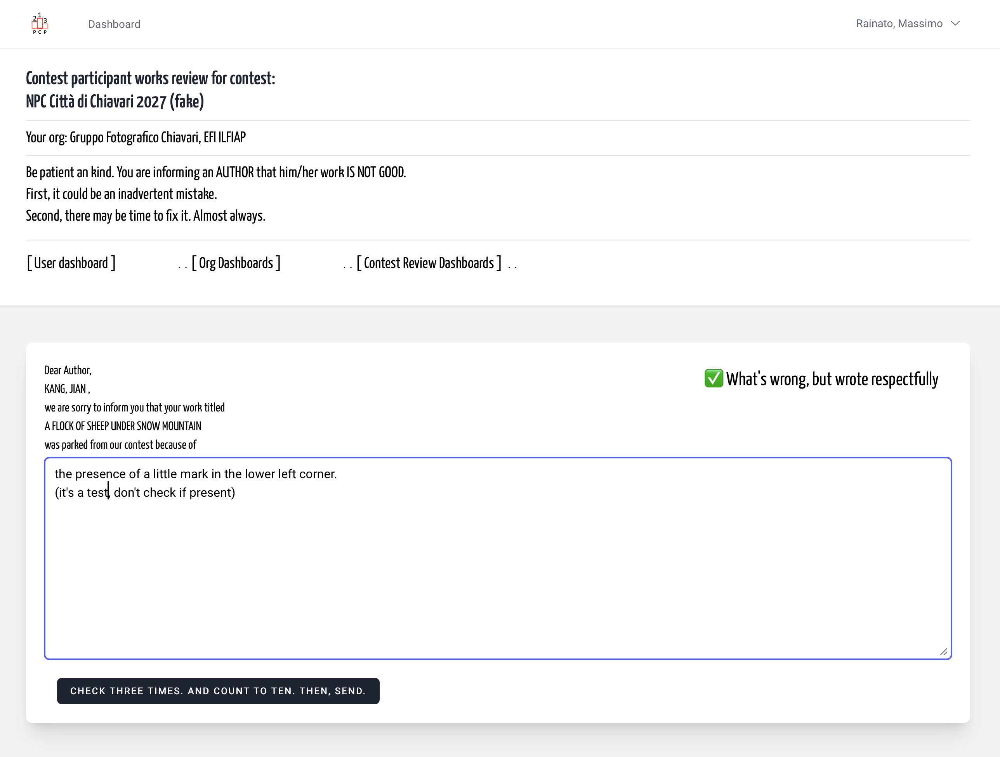

&nbsp;

Result: Notification sended, shorted list.
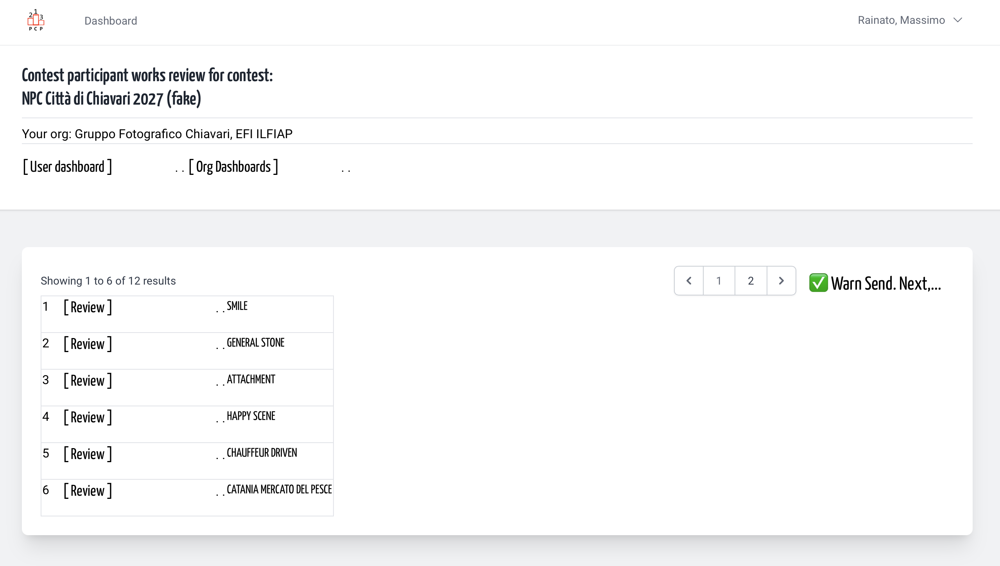

&nbsp;

The Notification on the other side
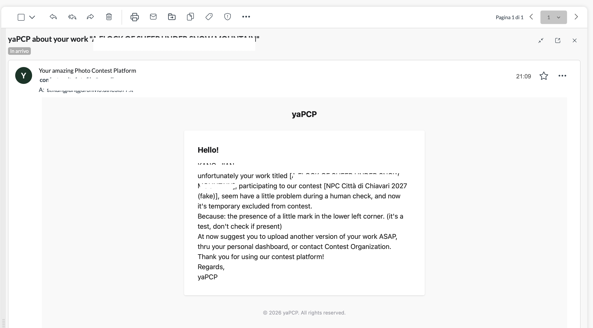

&nbsp;
