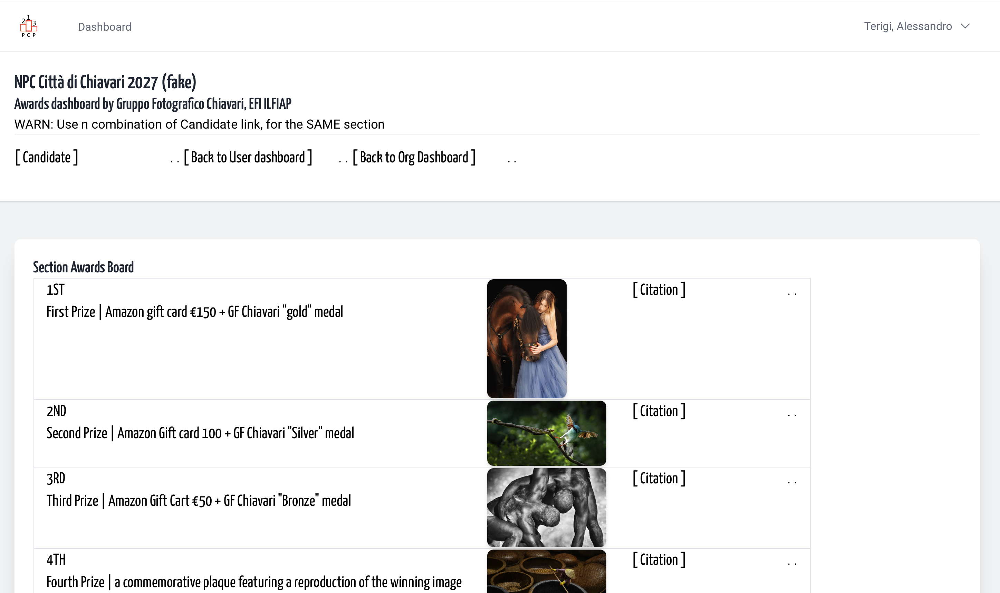
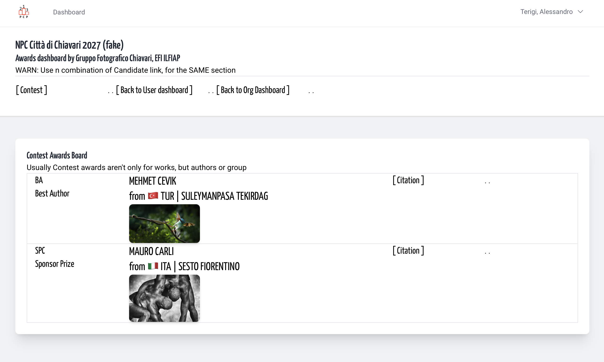
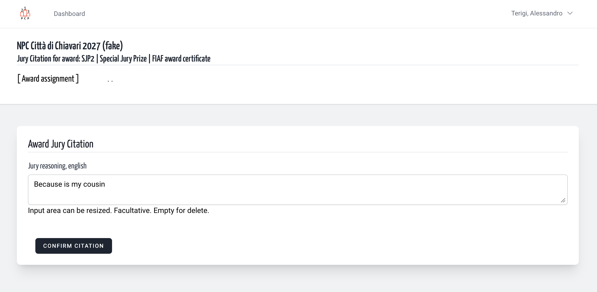
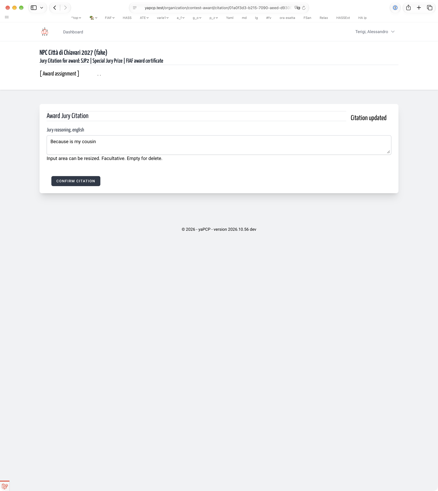

## About that function

It's usual but also facultative, that for some awards the jury exposes it's reasons,
extend a citation. So, in the Award list is present a link to open
a panel to insert it.

From the section award listed

&nbsp;

And also from the contest award listed

&nbsp;

When a previous citation is present, it's exposed.

&nbsp;

After your update, a message in upper right part of windows say you due.

