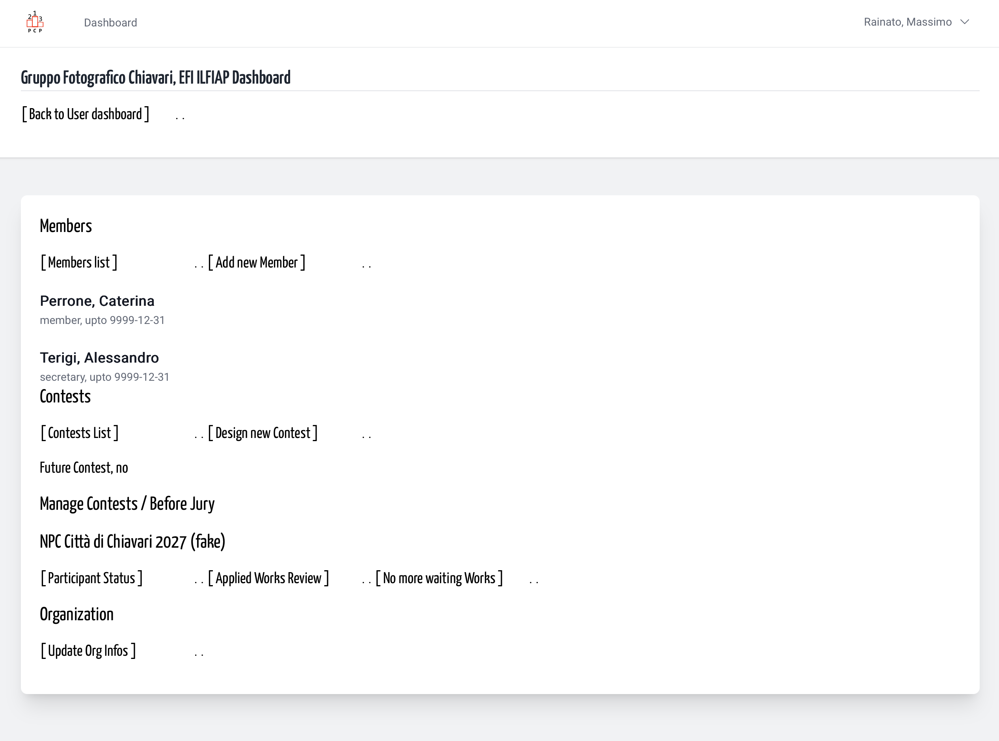
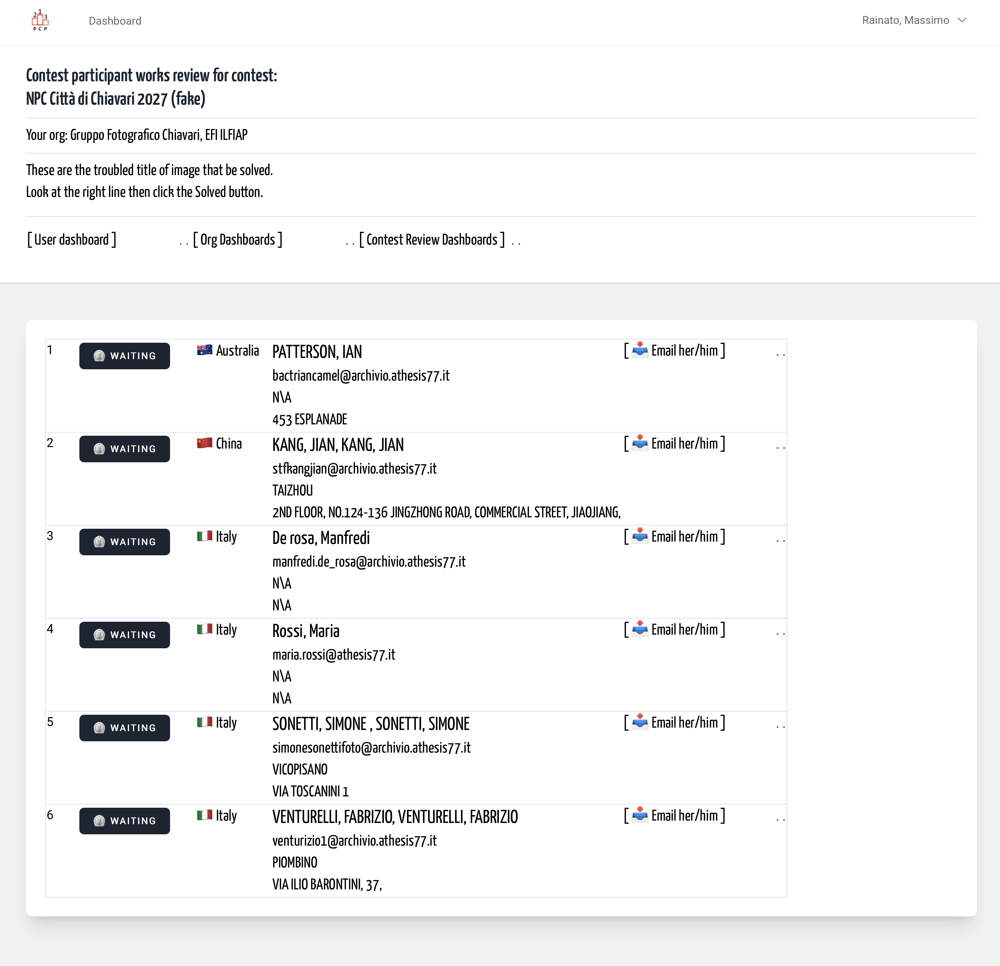
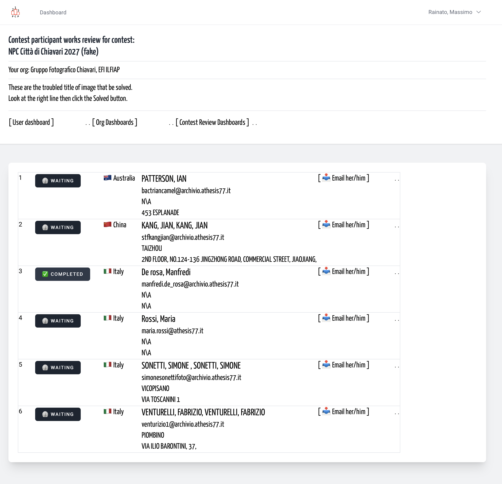
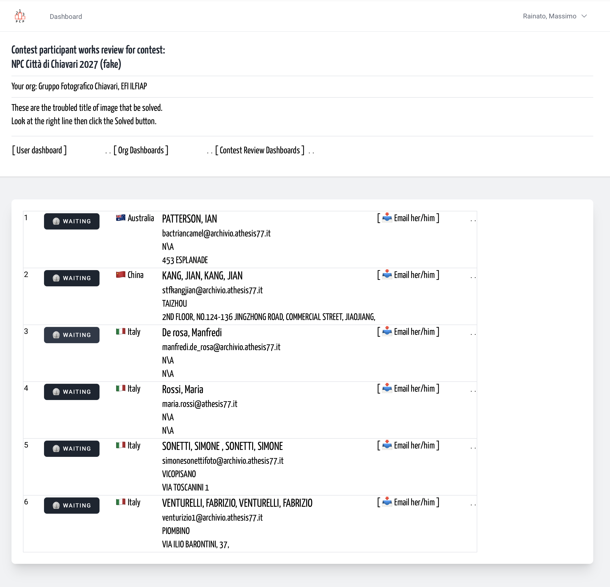

# Contest participant payment switch | Organization Contest Management
<!-- absolute links are /resources/docs/1.0/    -->
<!-- larecipe links are /{{route}}/{{version}}/ -->

<!-- images must be uploaded in same folder of md then url prefixed by ./  -->

- [&nbsp;](#)

---

## About that function

With the exception of competitions with free entry, payment of the full entry 
fee is an essential condition for taking part in competitions. 

At present, the platform does not allow payments to be made via the platform 
itself; payments must therefore be made via third-party payment platforms, 
e.g. bank transfer, cash, PayPal™, and others.

From The Organization dashboard you follow the "participant Status" and reach 
a paginated list. 

&nbsp;

Here the participants have a status and are ordered by
country code, last and first name. To avoid homonyms errors, email address and 
part of postal address is listed.

&nbsp;

Click on the button

&nbsp;

Was the wrong line? click again on the same.

