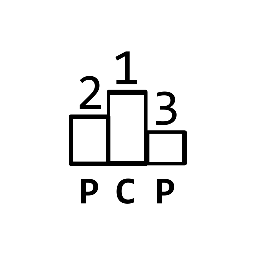
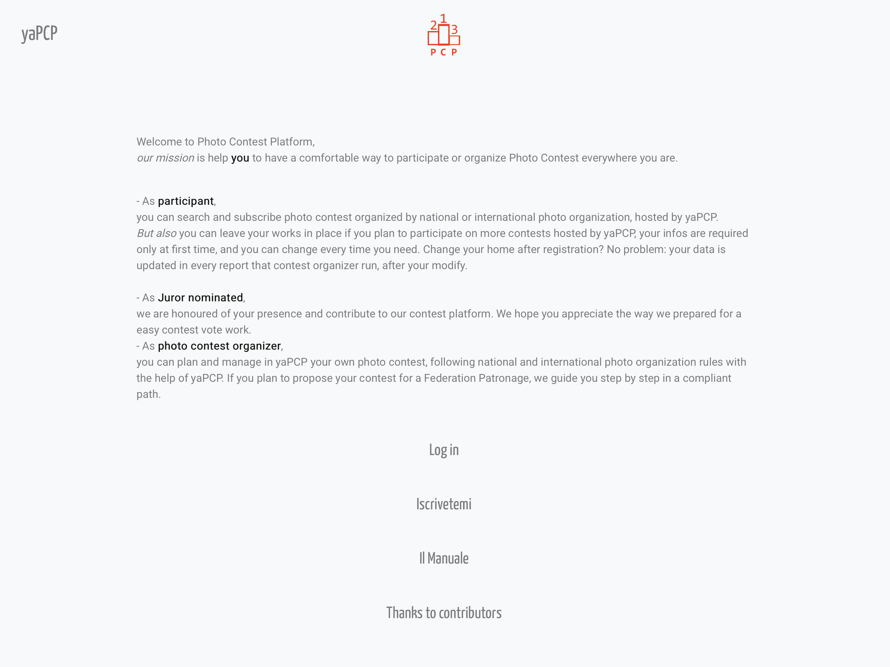

## First Visit? What is yaPCP?

yaPCP is: *yeah, an amazing photo contest platform*?  

You should register in, and with your best images become a [**Contest participant**](#contest-participant), and/or become in your Organization a [**Contest organizer**](#member-of-contest-organizer), and/or vote as [**Contest juror**](#contest-juror). You can also be
authorized as **Federation member** to monitor *Contest* and some *User Works* to determine if they are regular or violate any of your federation rules.

---

## As Contest Participant

- Register to our platform.
- Upload your best photos in your depot.
- See the *Open Contest list*, and easy participate to one, or more. If requested, pay the fee.
  That's all your effort. Then wait for response day.
- We do our best to help you avoid fault.  
  If a section-theme is marked
  as *monochromatic only*, and you upload a colored
  image, we warn you before load.  
  When size limit is 2500 px wide and your work is 3000 px size,
  we warn you, to avoid a mistake.  
  When section require 4 works and you try to load 5th, yes: we warn you.
- NEXT/ TO DO: we plan to federate various contest platform,
  with a secure and private way to apply from/for an external contest with the yapcp platform.

---

## Member of Contest Organizer

- Add and manage your planned photo contest, in a way compliant for your sponsor federation.
- Some checks are automate but not at all. You decide who are ok for Jury review or ask author if some few pixels seems wrong.
- in a sum-based-votes view you can decide what set of works are "admit".
- You manage the final jury and assign prizes, with a minute contest redacted automatically with no error and signed fast from juror.
- You give automatic report and zip with photo ready for catalogue.
- List of participants, and list of photo in nicely order.

---

## Contest Juror

- For the period preceding the final meeting, you can assign and manage assigned vote for every section-n-theme.
- Before the final meeting you should vote for a go n stop
- And in last Juror meet assign Prizes and Mentions.

---

## The yaPCP mark

Our trademark reflect a podium with 1st 2nd 3th place.
Because contest have winners.

WARN: 💬 That docs are based on dev version so base address is <http://yapcp.test/>,  
when i put "in production" the base address change. Most of them are totally or partially translated in italian lang.

---

## Welcome aboard

The welcome page when reach platform first time.
Message wil not repeat twice.

