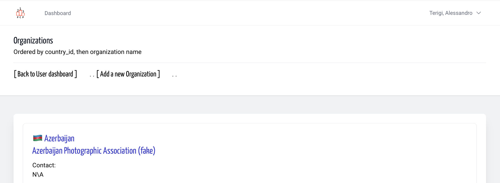
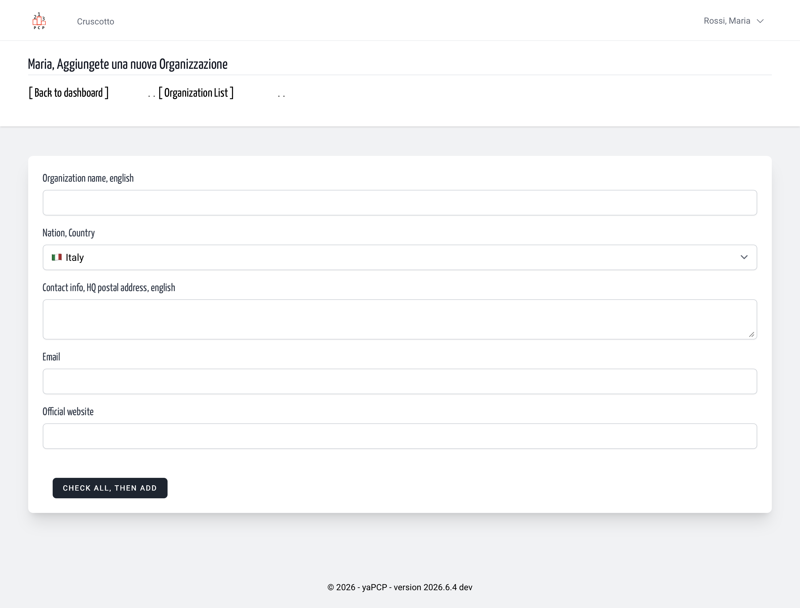
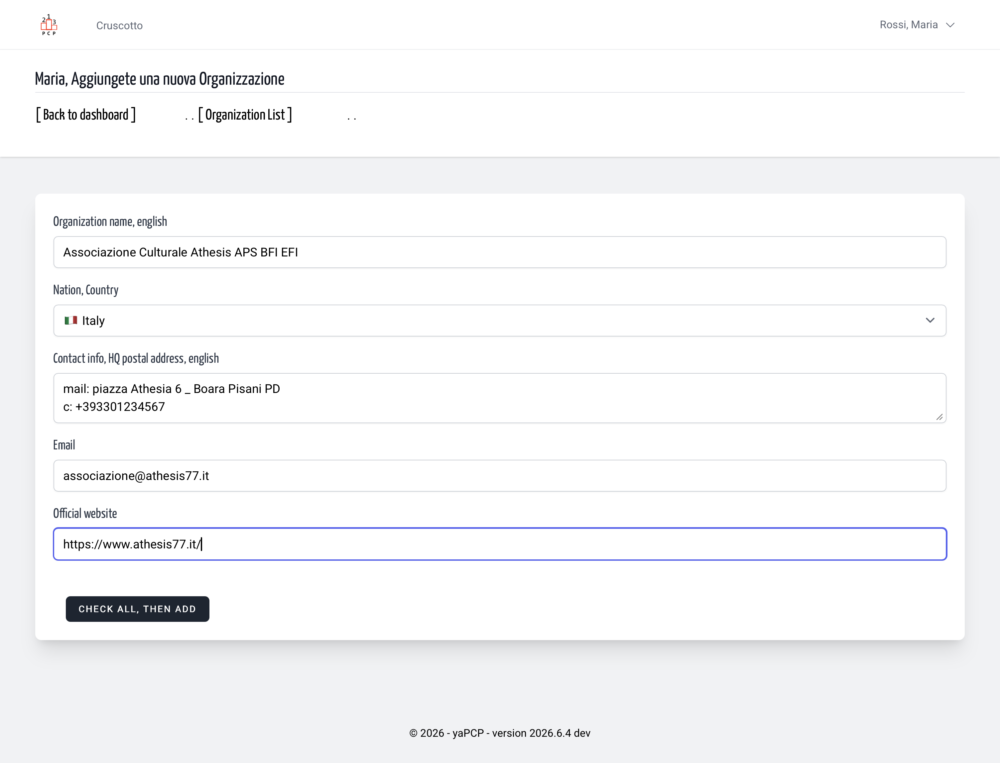
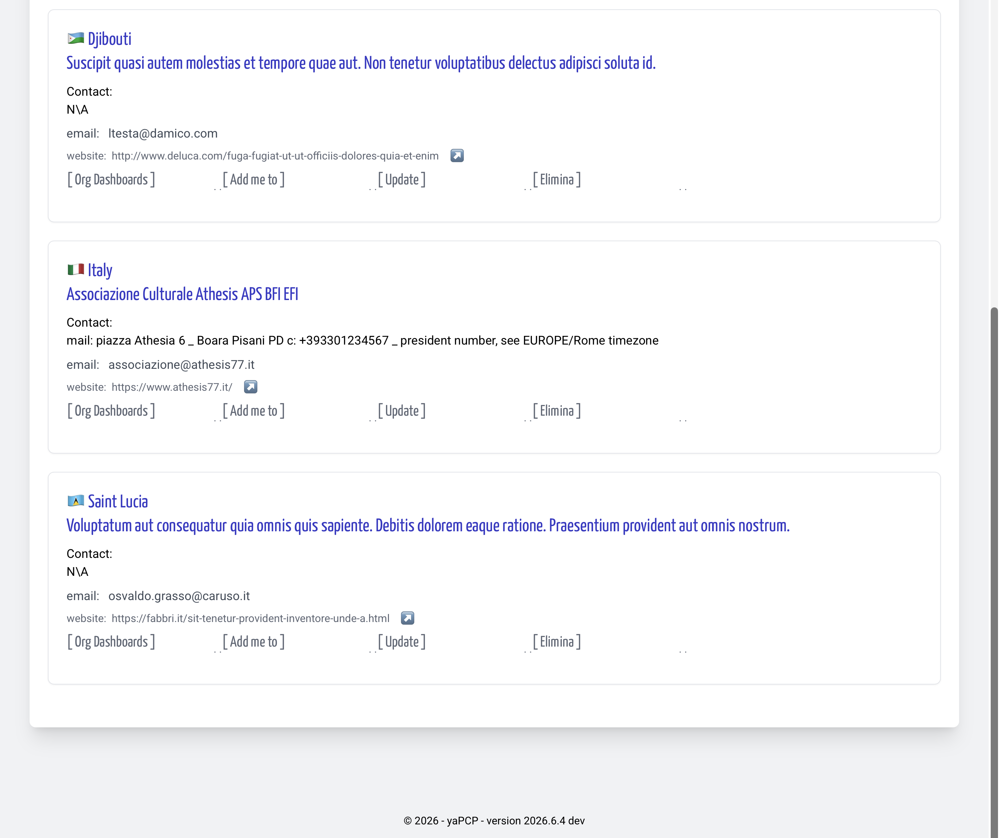
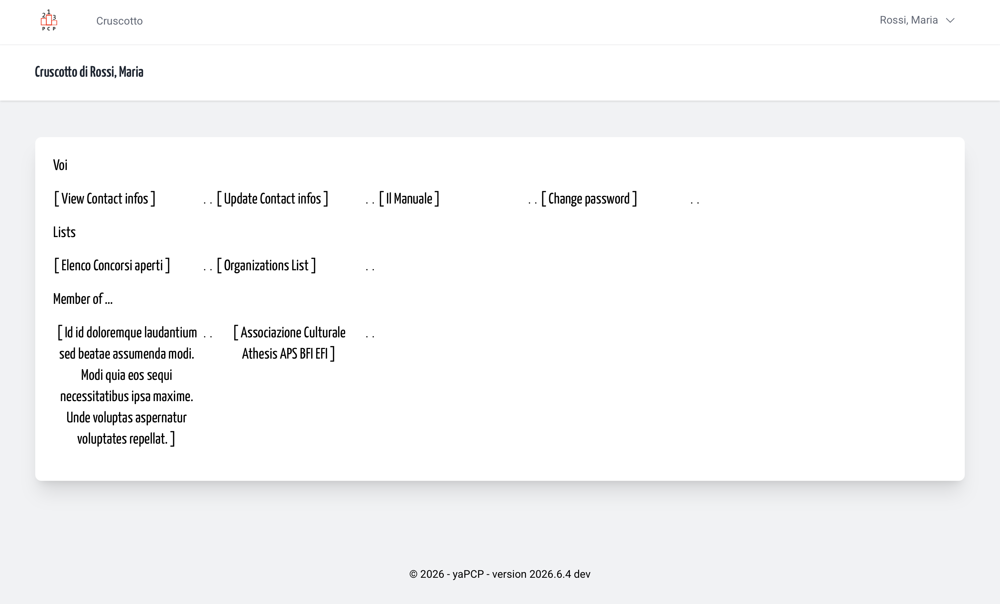
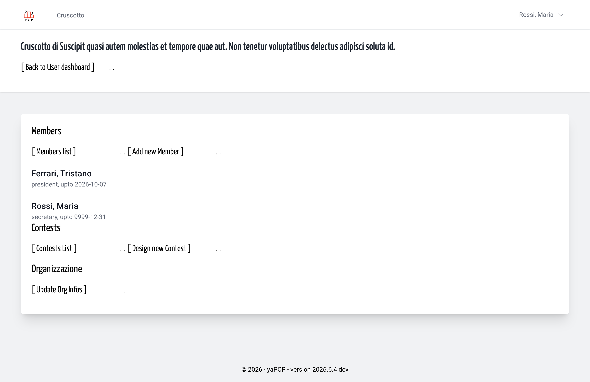
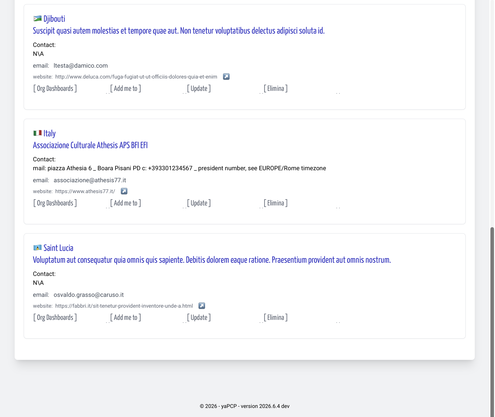
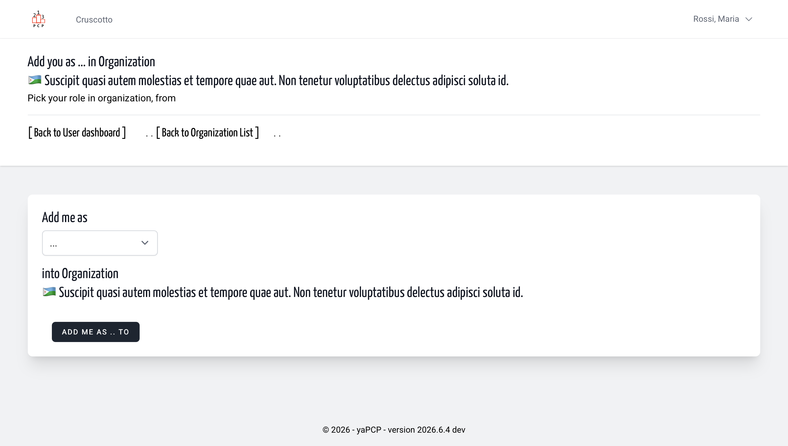
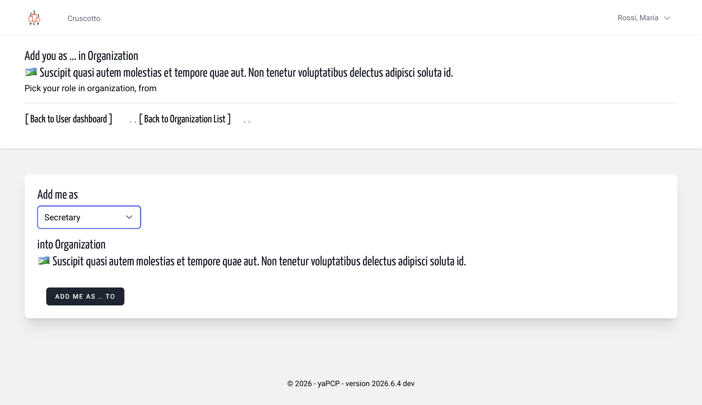
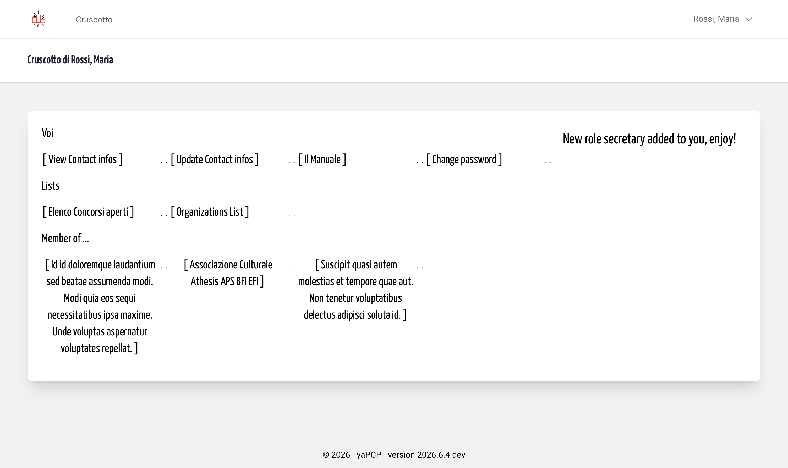

- [Add a new Organization](#add-a-new-organization)
- [Add you in an existing](#add-you-in-an-existin-organization)

---

## Organization? What kind of -?

Photographers who participate in photography contests may be individuals or members of a photography club, a photography association, or an informal group.
Here, we have decided to refer to photography clubs and photography associations as “Organizations,” or rather, they should be listed on the platform when they are organizers of photography contests.
Even when you enter a contest, you can indicate which photography club or association you belong to, in case the contest plans to award a prize to the group with the most participants—and such a symbolic prize is often offered.

*Translated with DeepL.com (free version)*

I fotografi che partecipano ai concorsi fotografici possono essere dei singoli o far parte di un circolo, di una associazione fotografi, o di un gruppo informale.
Qui abbiamo deciso di chiamare i Circolo fotografici come le associazioni fotografiche Organizzazioni, o meglio vanno inseriti nella piattaforma quando sono Organizzatori di Concorsi fotografici.
Anche quando partecipate a un concorso potete indicare a quale Circolo Fotografico o Associazione Fotografica siete membri, nel caso al concorso interessi assegnare un premio al gruppo più numeroso di partecipanti, e spesso questo premio simbolico c'è.

## Add a new Organization

You see the organization list and YOUR society isn't in the list.
Add a New organization? You can. Even if you are a new register user in platform.
So, from your User Dashboard click on Organization List,

&nbsp;

Then click on Add a new Organization link on the head nav bar  

Fill the few info required  

And that's all, a new Organization is in list  

And, (surprise?) in your dashboard, you are already an Organization member  

---

## Add You in an existin' Organization

Add you to an existing organization is more simple,

Use the **Add me to** link  

&nbsp;

Fill the form - simply choice a role

&nbsp;

Then click on unique button

&nbsp;

Clicking on *organization link* in your dashboard you enter in the *Organization Dashboard*

&nbsp;

When you see yourself as Organization member and what role.

