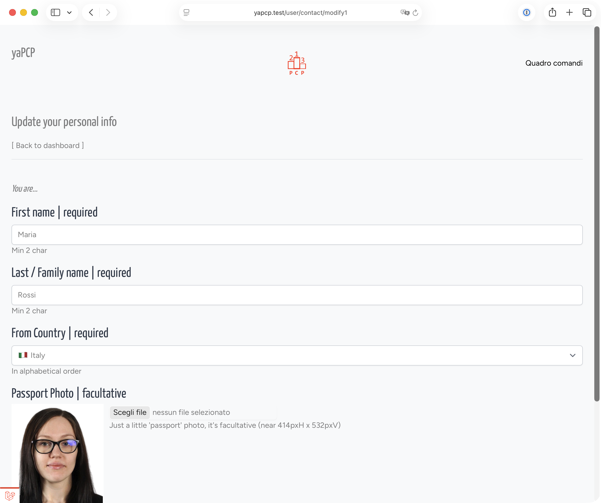
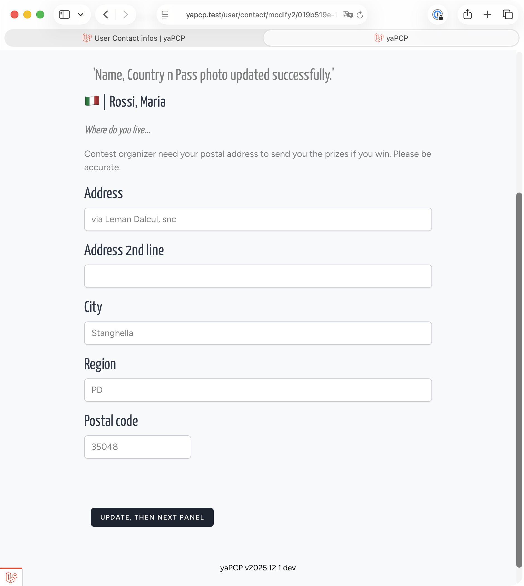
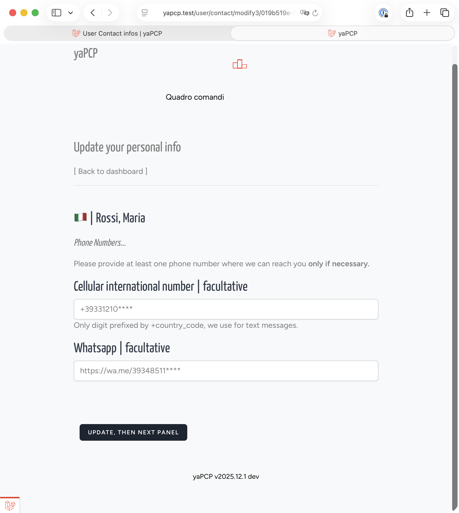
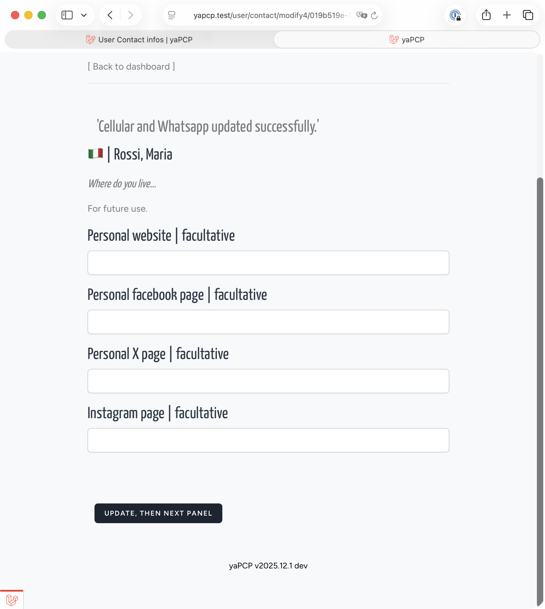
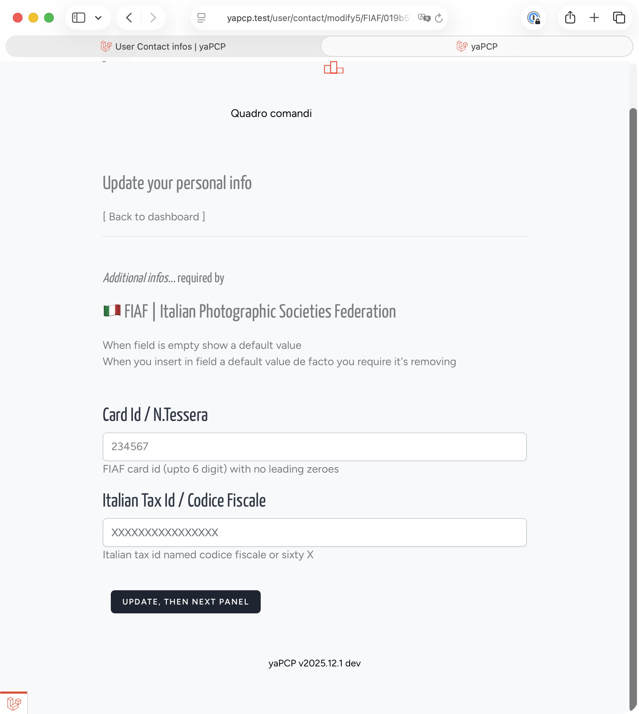

## The Contact Detail 5 Cards

To enter many competitions, you have to re-enter your personal details *every single time*. **But not here**.  
We’ve built yaPCP specifically, so that you only have to enter your details once, and use them multiple times.
But you can edit them whenever you need to.

In future, with your explicit consent, we may also send your data to third-party platforms outside this platform.
We plan to create a *trusted network between platforms* that will enable the exchange of personal data and creative works.

Registering on the platform requires just a few details: surname and first name, email address and password. This, however, is the details form used for competition entry, so we need some essential information and some optional details. Who you are, where you are, and more.

To make it easier for you to fill in the necessary details, we have organised the required information into five groups. The fifth section also contains optional information which becomes essential if you enter competitions sponsored by certain federations; for example, the Fédération Internationale de l’Art Photographique requires you to provide your FIAP Photographer Number (‘FIAP code’).

After Login to platform thru yur personal Dashboard, first up n left
you find [ Your Contact Infos ],
the link that put you on first panel.  

*Translated with DeepL.com (free version)*

## 1/5. You are

Mandatory field are indicated as 'required' (not minimal invisible asterisk, clear words)

- First name
- Family / Last name
- Home Country
- A *passport* photo

When you fill the fields and click on bottom button data are updated and if there's no error you land in second page

## 2/5. Postal address

Here we require info to pass to contest
organizer for send you medal, HM and all
you win (first: be optimist).

## 3/5. Cell numbers

Here we require (facultative) how contact you
in a faster and reliable way than email.
Email remain first communication channel
but in case of email fails we ask how contact you thru sms or whatsapp messages.

## 4/5. Social and portfolio

Facultative web address and social pages, for future use we offer
you some link to add to your presentation
in report and catalogues.

## 5/5. One more...

There are infos required from all the contests, and others
required only by federation sponsorship requirement, i.e. federation card id.
So, in that form we ask the "one more" fields required from
federation to federation.

In that sample Italian federation FIAF
ask for it's card id and a personal tax identification, in italian: *codice fiscale*.

Field name, label, suggestion and default value
are proposed. **Trick**: to remove a value,
insert the *default* value.

