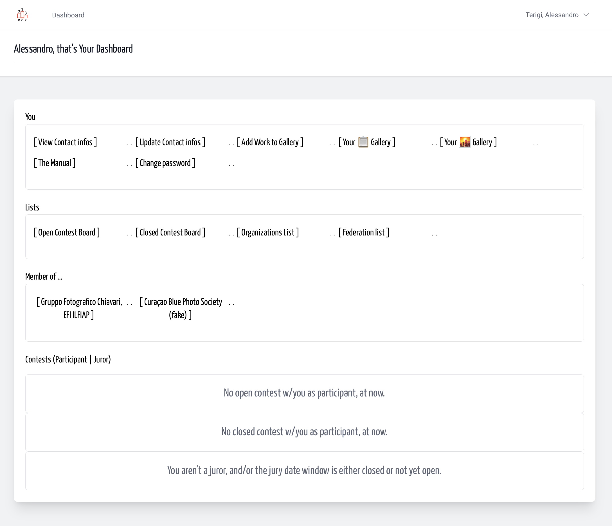
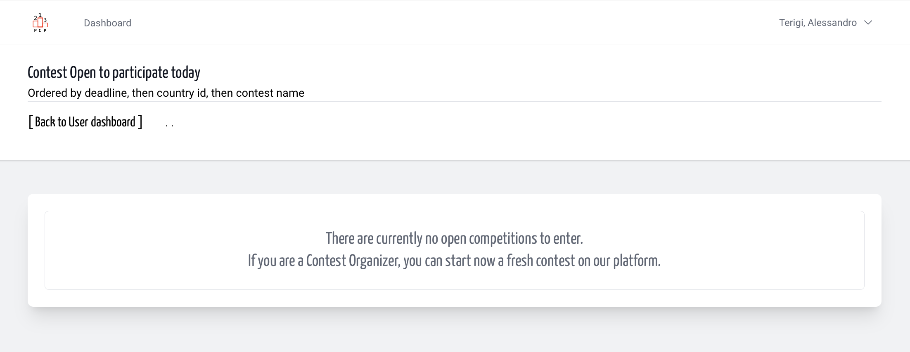
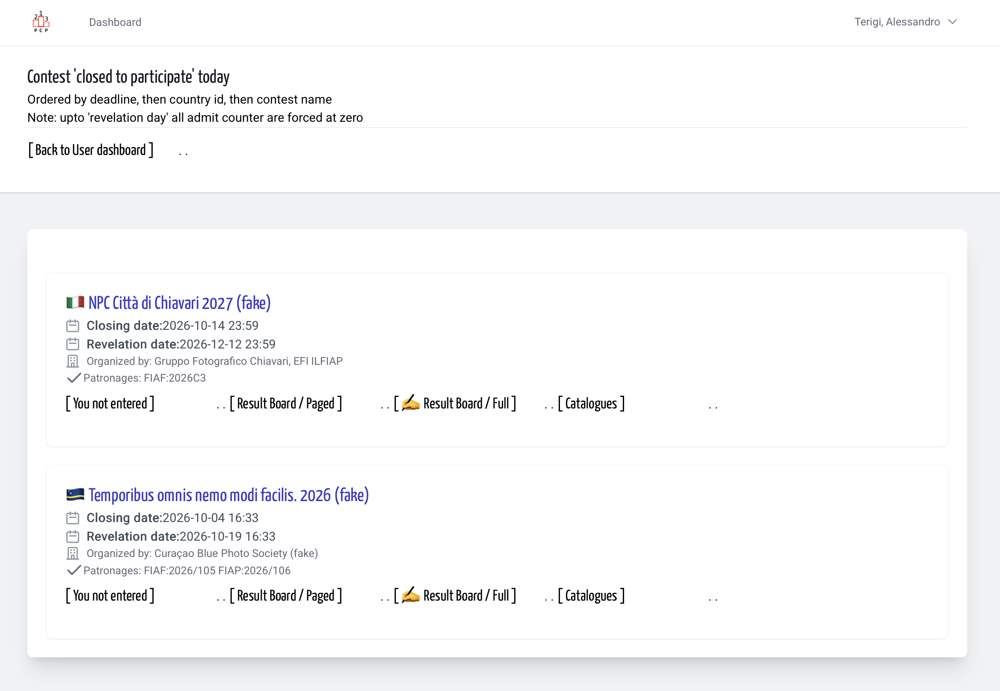
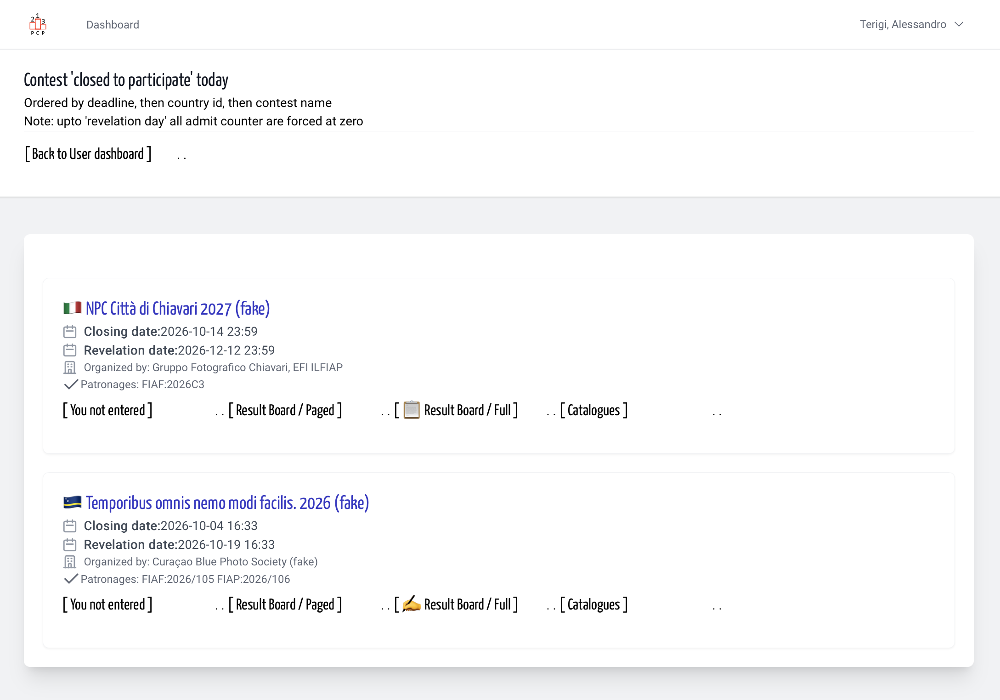
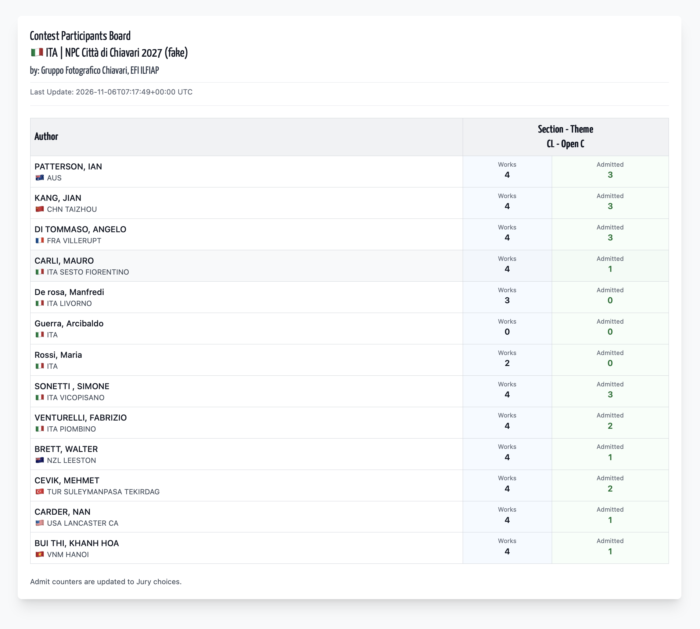

## Definition

When an organization plans a contest, it sets a start date and a
deadline for submitting entries. The list of contests that “as of today”
fall within this timeframe is the *list of Open Contests*.  
otherwise when the deadline for submittin works is gone, they are named
*Closed Contest*, and after the last jury meeting shoud appear also a
Result Board, that we serve in 2 way: paginated, of full table. And, when prepared, a link to pdf catalogue and/or web based catalogue.

How view that list for? From your personal dashboard 

&nbsp;

Your personal Dashboard, in the middle the Contest nav bar

&nbsp;

Following the Open Contest Board sometimes you can't see any contest open,
otherwise you see a list of contest that are in the participation window.

&nbsp;

Following the Closed Contest Board you can see the Contest that are 
over the participation deadline, maybe in the Jury work window or in
after the last jury meeting, or catalogued ready.

&nbsp;

Only if you are member of Contest Organiser, you can generate the
full participation board. Then the icon before the link change to 📋.  
And the link point directly to a static html page, easy and faster.

&nbsp;

Some details can change, but the core remains. A list of participants 
sorted by country code, surname/last name, name/first name, and few info.  
For every contest section-theme: how many images are presented, how many of
them reach the goal of "admit".  
*TODO add the award list, only text no miniature*

