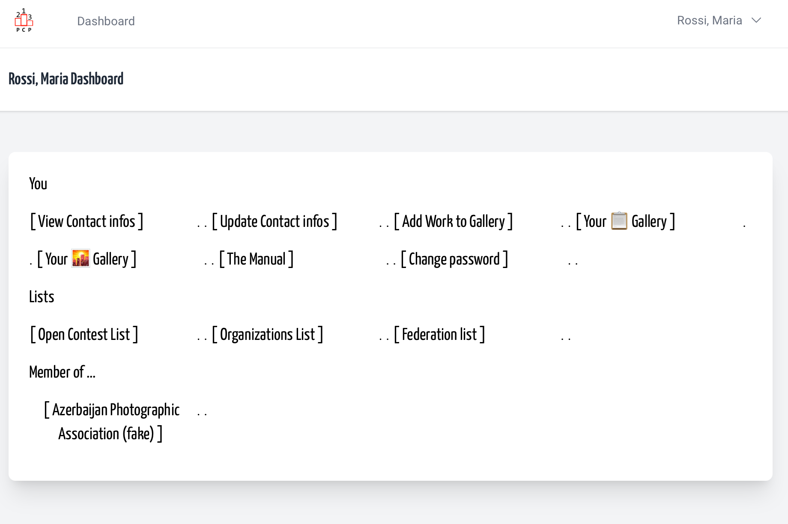
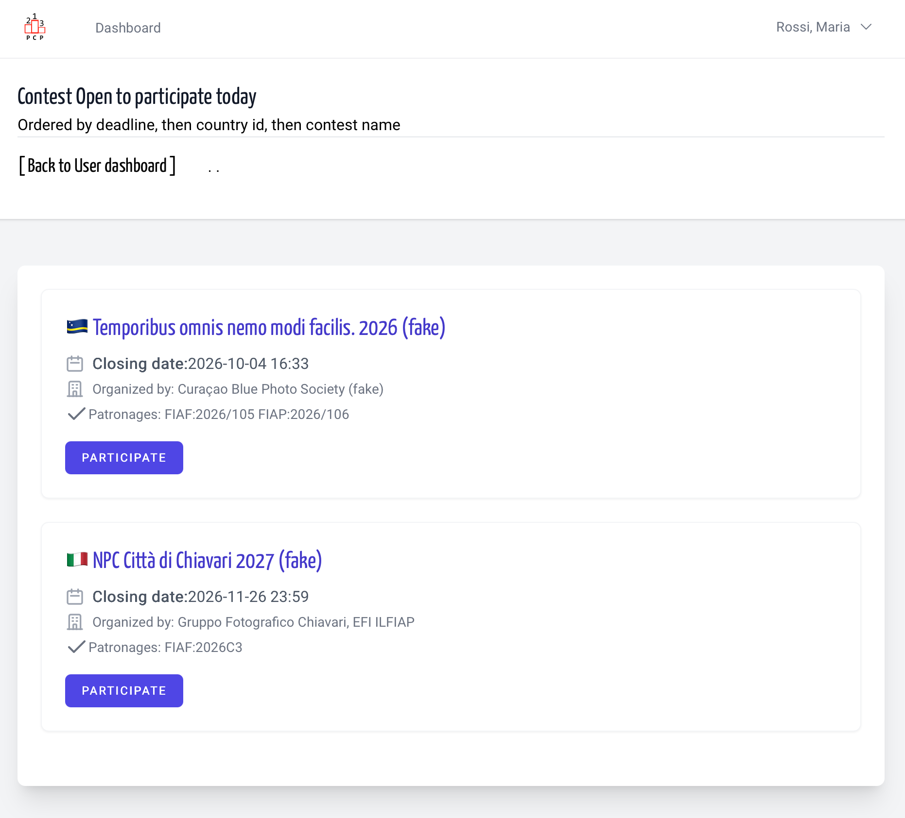
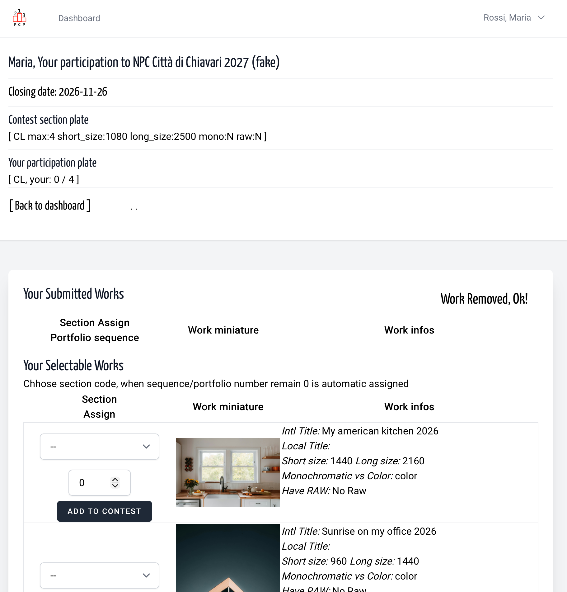
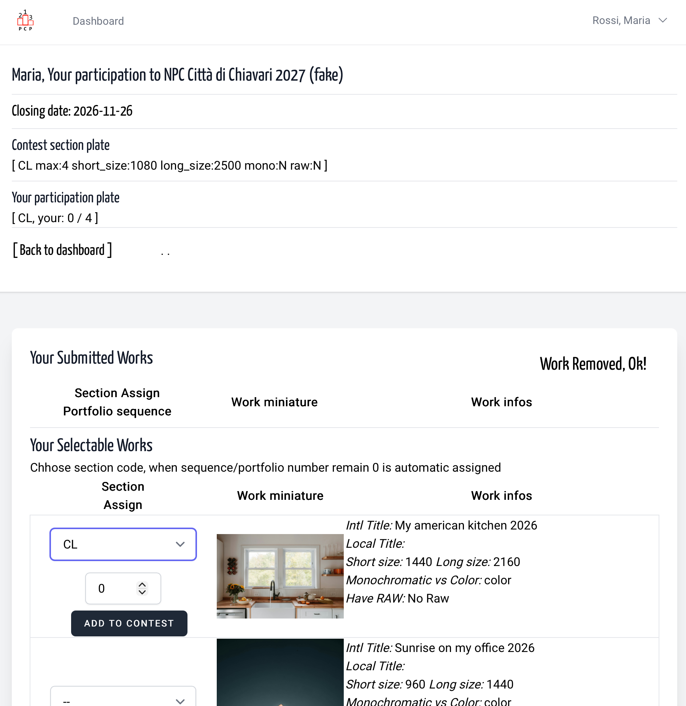
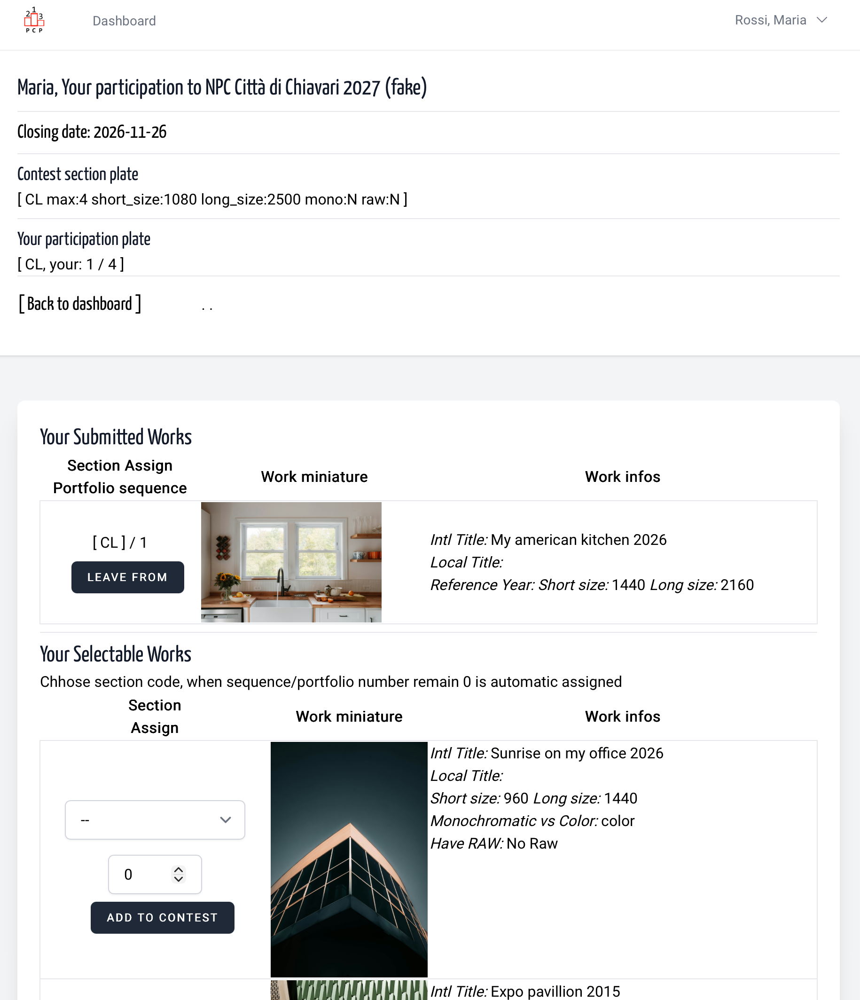
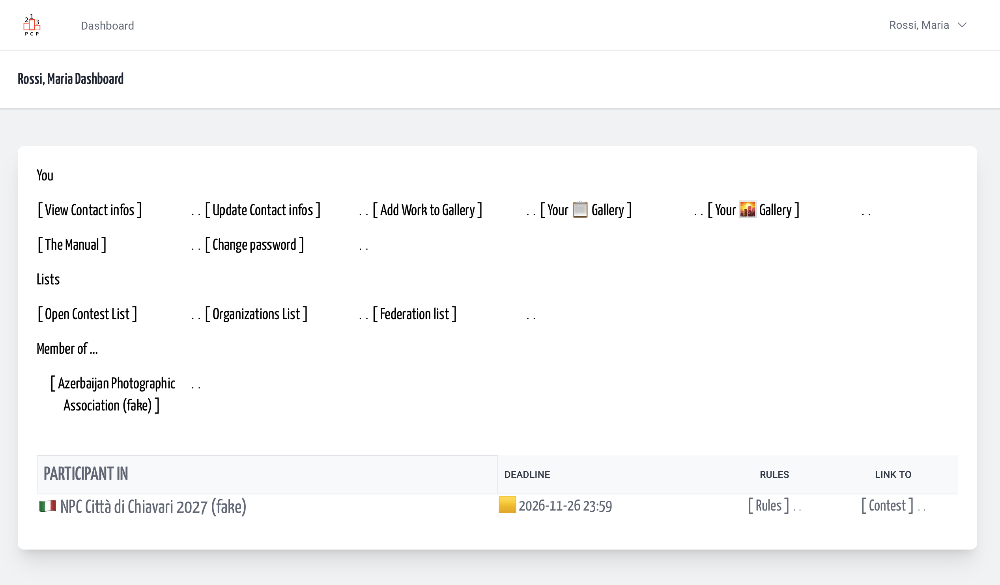
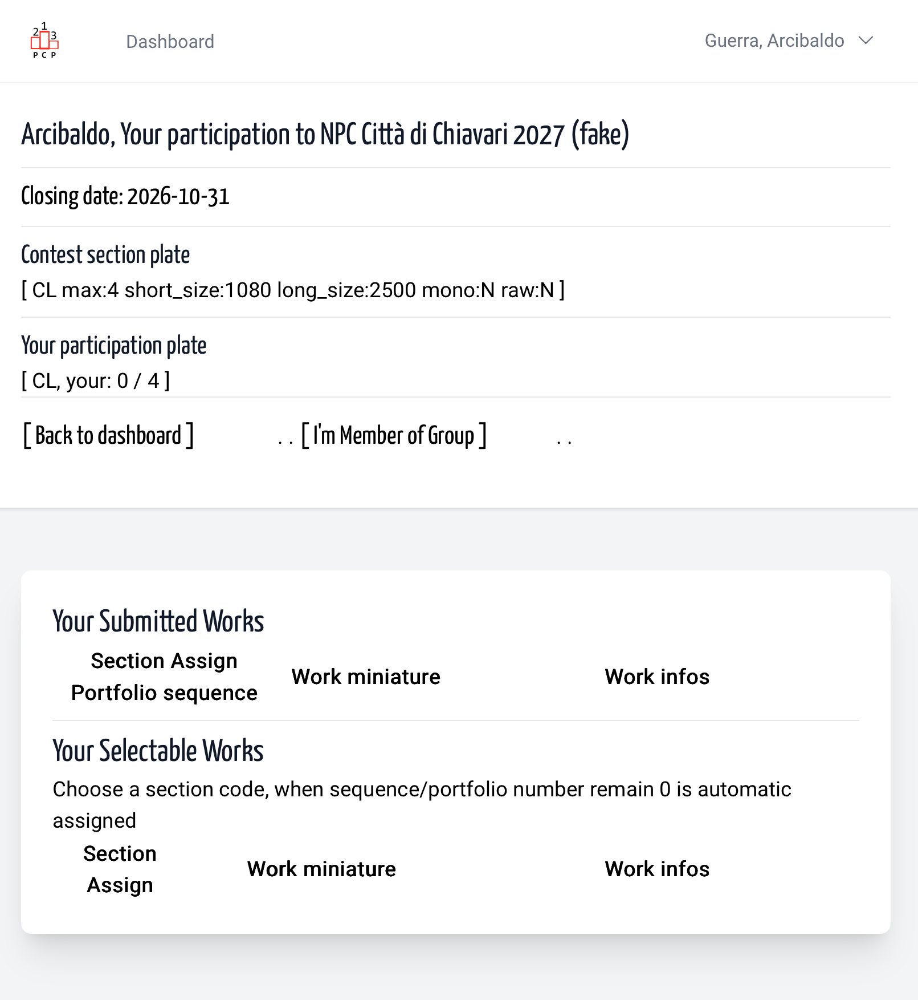
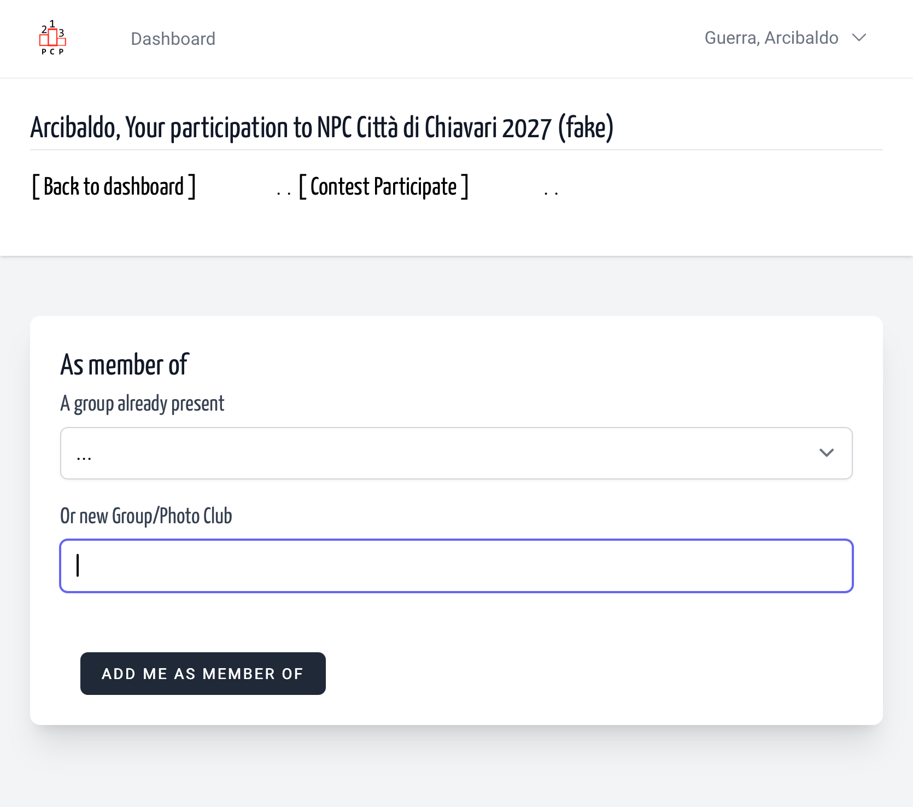
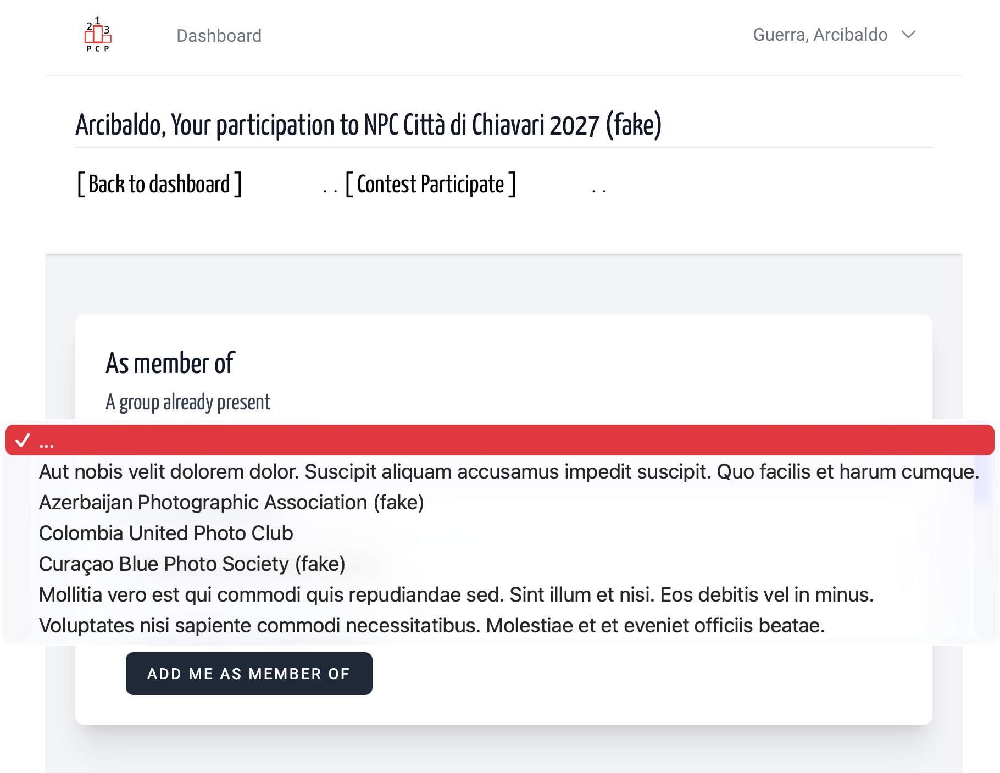
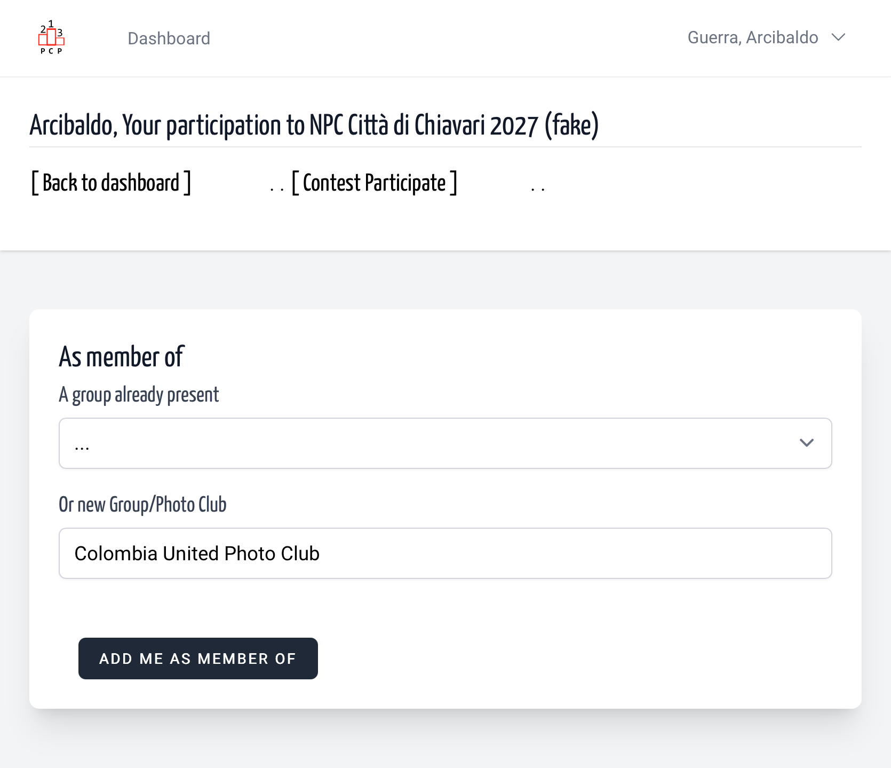

## General

After upload of your beautiful works in your personal space, you can choose
che Contest List in your Dashboard, and see which contest are in "participation window",
and you can participate. In an FAST AND EASY WAY.  

&nbsp;

Your dashboard

&nbsp;

An Open Contest list

&nbsp;

Here there are some info about: the contest ending date; a list of section codes with info about the theme / section - min/max number of works, short/long size in pixel, if monochromatic only, if RAW can be requested. These few infos are what you consider to apply a work to contest.

&nbsp;

Choose the section code, and only if for a portfolio add a sequence number, instead leave 0 and push the button

&nbsp;

And ...done. The page refresh putting your work upper.

&nbsp;

When you return in your dashboard a gentle reminder about
contest you have subscribed, with a yellow flag
until Contest Organization assure that your contest fee was received.  
After the deadline, the contest shift in Closed Contest list.

## For contest with "biggest photo club"

We added a link to indicate your membership to any group,
even not registered on the platform. Use the link `I'm Member of Group`
to open the page, choose from a previous inserted group list
(integrated with organizations registered in platform)
or add a new group name.

&nbsp;

&nbsp;

&nbsp;

&nbsp;

&nbsp;

