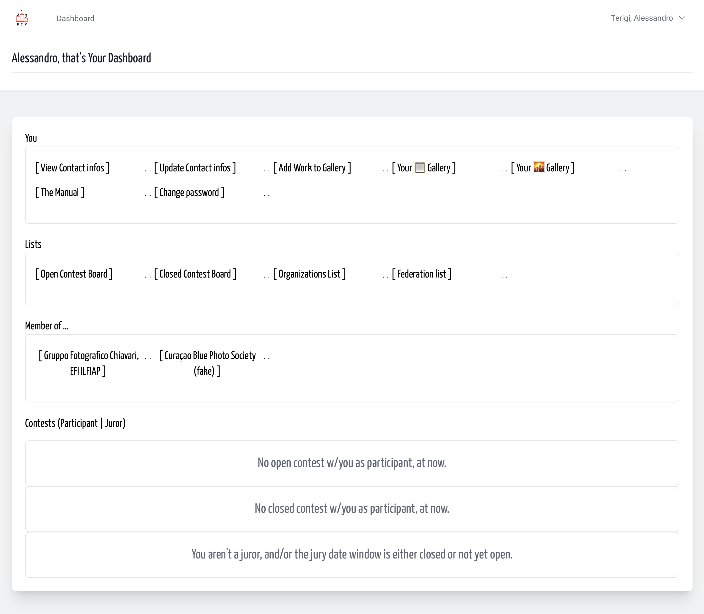

# User dashboard

**More dashboards**

User has her/him personal `User Dashboard`, then photo club here named
Organizations has its `Organization Dashboard`, users temporary elevated as jurors have a `Juror Dashboard`. And, of course, exists also the `Contest Dashboard`.

In `User Dashboard` we reunite all you can do in yaPCP.  
The (user') dashboard content may change over time, depending on what you want to do.  
Are you a member of an existing organization? Add yourself in the organization role list, or Add your photographic organization.  
Then you have in your dashboard a link for
[Organization Dashboard]((/{{route}}/{{version}}/organizations/dashboard)).

Are you a member of an existing Federation? Contact us
to enter in Federation roles, with the authority to check
contest that your federation sponsorship.

---

## A journey over your powerful dashboard

Reached after successful login, and also [here as link](/user/dashboard).

Here we recognize some block of links. Upper is a block over your personal data,
i.e. postal address, email, timezone and (warn: for future use? in contest catalogues)
url of your social and personal pages.

After user creation your personal data are empty or with a default value,
so - after first first login - you can or must update them.

---

## Your data

### [View Contact infos]

We chose to separate access platform data (email and password) from your
Contact data, so anytime a "list of people" are password free. Anytime, password
are hashed and nobody, never us, can recreate original password  

*Contact Infos* are all the data usually you send thru a contest application form.
Here you find also che panel to change email address AND your password,
it's not the unique point of change, you can change the password
also using a link into the login panel.

### [Update Contact infos]

It's composed by a five simple card: who are you + where are you (default country is: Italy), who's your postal address,
online address, and others like your personal page (reserved, for future use) and
infos requested only by a federation (one more field) that can be requested
in federation sponsored contests.

> <!-- to avoid index for Larecipe -->
- [Update your personal contact info](contact_infos.md)
  even during a contest run.

### [Add Work to Gallery]

*Nome omen*, in that page you can add Works, even masterpieces, to your personal
Photo depot. You can upload and define your best works before registering for a contest.
So, when you apply for a contest are already uploaded and can
easily add to the right section - Theme just with a pair of click.  
Some check are done automatically and other manually to ensure
in the next contest your works are already ok.

### [Your 📋 Gallery]

Here are listed your works order by title.

###  [Your 🌇 Gallery]

Here are listed your works as miniature grid.

### [The Manual]

Reach here, the User Manual.

### [Change password]

As indicate previously, Contact infos are separated from platform access data,
here you can change password.

---

## Lists

### Open Contest Board

Here we list the contest with *participation window* opened today.  
Instead, if you are searching *contest of your organization*, you find it in
your organization dashboard, below *Member of ...*.

### Closed Contest Board

All closed contest each with results board, and online catalogues.

### Organization List

In that space you can find the organization list, if your Organization isn't
in the list, and you wanna add t, you can. And if you want add yourself as
member of a listed organization (one or more, one at time)... You can.

> <!-- to avoid index for Larecipe -->
- [Add an organization](add_organization.md)
- [Add yourself to an existing organization](../organizations/add_me_to.md)

### Federation List

Here we have a federation list maintained by us,
we consider federation a photographic
association that build some rule about photographic contest,
and become sponsor for some of them, and base
the contest results as base for distinction and others.

> <!-- to avoid index for Larecipe -->
- Add a role in existing Organization
- Add your organization
- Add a role in existing Federation
- Add Your Federation

---

## Member of organizations

You can name it *... Photo Club*, *... Photo Society*,
*... Camera Club*, *... Photo Collective*, and more. So here we
see all only as **"Contest Organizer"**.

Every user in platform can freely register herself/himself as member
of an Organization. It's a mandatory pass when you plan to design
one or more Contest.

---

## Contests as participant or juror

### List of Open Contest

Previous list is "all" Open contest, here are contests where you are applied.
Open Contest means they are on the date window when Photograph
can add her/him works to participate.

### List of Closed Contest

Previous list is "all" Closed contest, here are contests where you are applied.
Closed contest are contest when date of participation is closed.
Depending from contest calendar should be listed:

- participants only, then
- participants, and results, then
- participants, results, and catalogues.

### Juror

When you are nominated as juror, here you can view the link
when you are n the jury windows dates.
