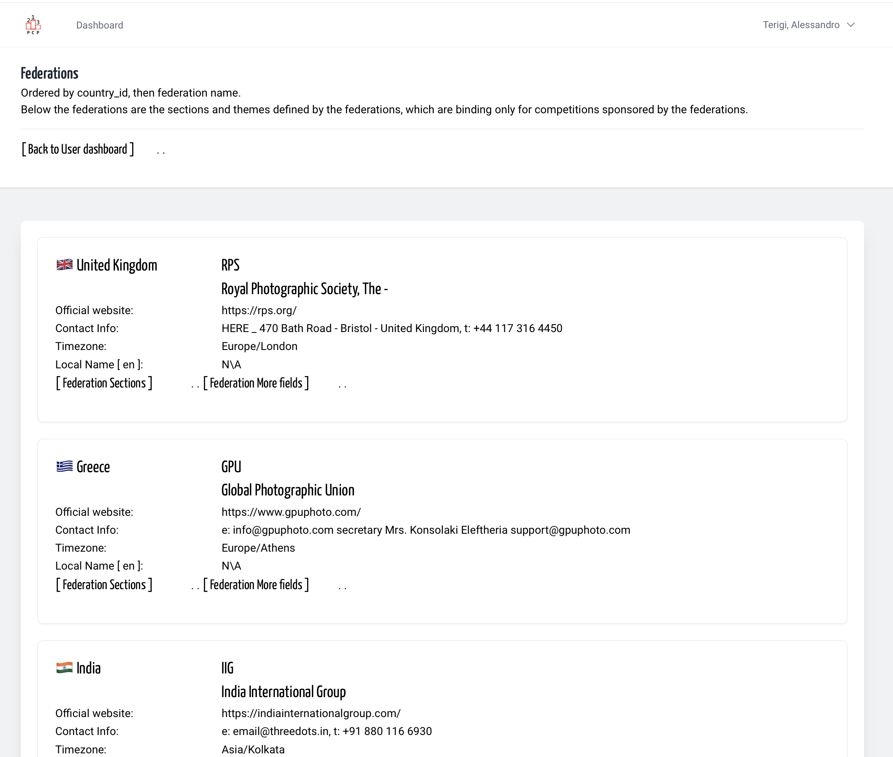

## Definition

"Federations" are national, or international photography associations that
represent, and coordinate photographers only in a country, or all the world.
Furthermore, to promote the growth of photographic culture, They establish
rules for conducting photography competitions and, usually  on the results of
these competitions, use them as a basis for awarding distinctions and
honors to the best photographers.  
*Translated with DeepL.com (free version)*

---

## Federation list

In yaPCP, for every Federation are exposed:

> <!-- -->
- the Country flag n Country english name
- The Federation' ID Code
- The international Federation name
- official web site *(main or regulation page)*
- contact details as HQ address, email, tel number, others
- timezone (to see difference between user office hours and HQ office hours)
- The local code and local name
- link to Federation' *list of sections n themes* page (as extracted from official federation docs)

*Note: Federation data are managed by admin group*

&nbsp;

