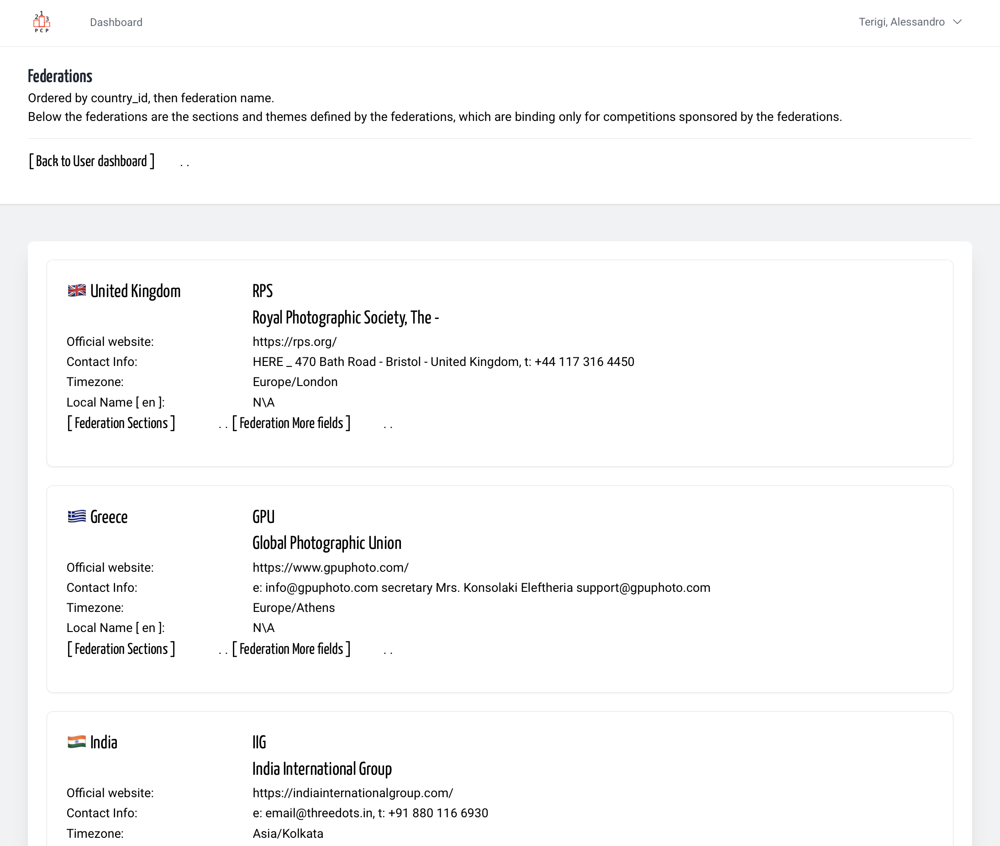
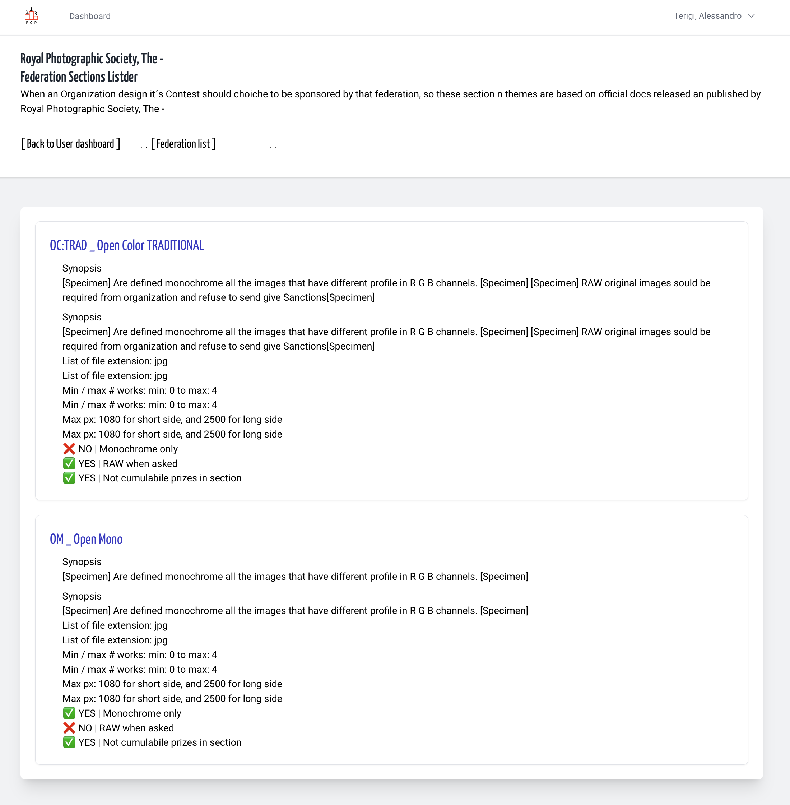
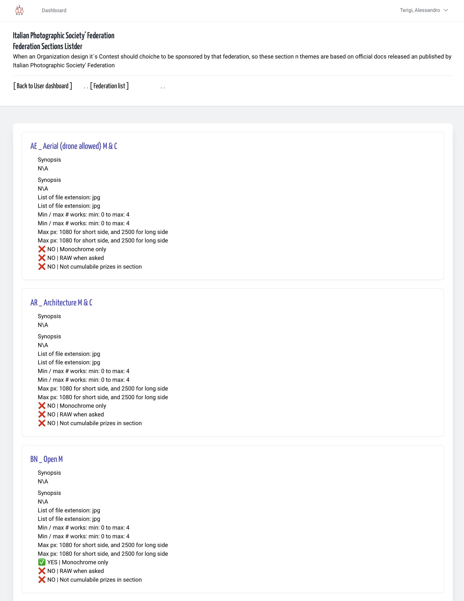

## Definition

**Federations** are national or international photography associations that
represent and coordinate photographers within a country, or around the world.
Furthermore, to promote the growth of photographic culture, they establish
rules for conducting photography competitions and, based on the results of
these competitions, use them as a basis for awarding distinctions and
honors to the best photographers.  

**Section n Themes** From official regulation docs,
for contest design and for Contest Rule
are defined a list of section and themes included i.e. *Open Monochrome*,
and *Open Color*. Other are usual *Nature*, *Travel*, *Street* and others.

It might seem as though this topic is only useful to competition organisers,
but in reality, knowing how to ‘categorise’ your photos according to the
federations’ themes and sections can help you choose the ones you think
are best suited for entry.

*Translated with DeepL.com (free version)*

---

## Federation list

From your User dashboard you can follow the Federation List link, then
for every Federation are exposed a Federation Section link.

&nbsp;

## Federation Section list

These are code and name of section that you can use in Contest
design, followed from some "automatizable check" rules, i.e. 'max pixel size'

&nbsp;

