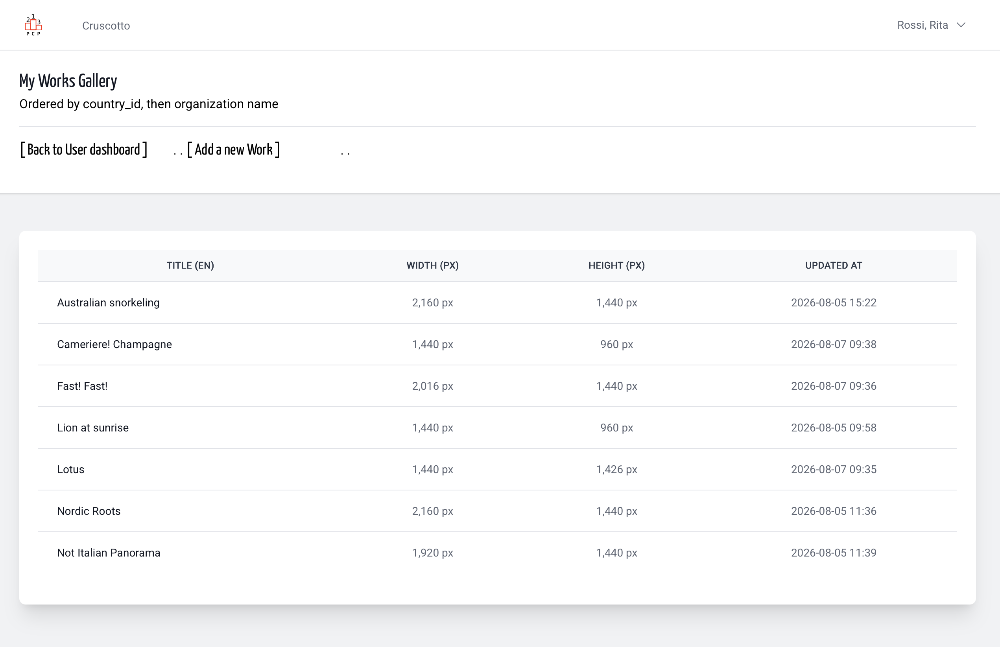
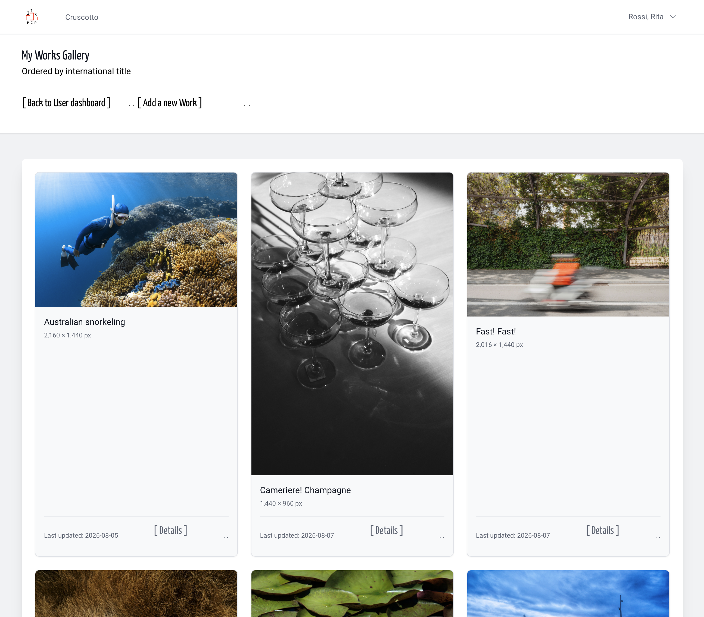

- [Caricamento](gallery_add.md)
- [Galleria come elenco](#come-elenco)
- [Galleria miniature](#miniature)
- [Modificare](work_modify.md)
- [Rimuovere](work_remove.md)

---

## About

We believe that the **main focus** for a
contest entrant should be taking good photos and enhancing them
in post-production. _Entering contests_ shouldn’t be an obstacle course.  
That’s why we created this platform,
where you write just once your contact details,
and submit your entries _temporarily_ just once,
and submit your entries _temporarily_ just once,
to participate in photography contests.
Here “temporarily” don’t mean _few hours_, or _few weeks_, we’re
offering you months of free storage.  

You already know (by ToS) that if you want to upload a large number of works
and keep them online for several months, we can work out an arrangement
for a small fee, with a clear and explicit agreement.

If you’re a contest organizer, you know how much of a “rush” there is to
upload entries at the last minute. If the entries are already on
the platform, this rush shouldn’t even exist.
The photographer chooses to participate, assigns the already-uploaded entries
to your wonderful themes and sections—once the photographer is done, you already have everything ready.  

_Translated with DeepL.com (free version)_  

&nbsp;

## [Upload Work](./gallery_add.md)

You can upload as many images as you like, whilst waiting to enter them into
a competition. If there are more than a hundred, or if they’ve been sitting there for more than three years,
ask yourself this: are they there to be entered into a competition, or just gathering dust?

Can you upload multiple versions of the same photo? Of course you can,
but for your own sake, don’t give them all the same title – you, of all people,
shouldn’t get your images mixed up. If you intend to
change the title or remove a duplicate, you’ll find what you need below.

[**How To**](./gallery_add.md)

## Gallery Show - as miniature grid

Upload one, ten or a hundred works; your gallery will display thumbnails 300px wide,
which we believe are sufficient to give a clear idea
of the uploaded photo whilst transferring less data.
The gallery will be backed up and archived for the
sole purpose of restoring the platform in the event of any problems.
The works will never be transferred or sent to third parties without your explicit consent, but you should not regard this as
your public online space, and we strongly advise against
uploading works to the platform of which you have no other copies.

### Gallery Show - as title list

This is useful if you want to quickly check the title of a work that has ‘already been used’. We would also take this opportunity to advise you not to use ‘untitled’ in its various forms as the title of a photograph; whilst this is a legitimate practice, it is frowned upon by many competitions and major international federations.

### Gallery show as miniature grid

This is useful if you want to view a photo that has already been uploaded, perhaps with a different crop. It is recommended that you do not give the same title to two different photos, even if they are ‘different crops’ of the same original photo. Whilst this is indeed a permissible practice, it is frowned upon by many competitions and major international federations.

## Change a detail of work

You may have noticed that both galleries feature a ‘Link Details’ option; this is used to view and edit some – but not all – of the artwork’s details.

[**How To**](./gallery_modify.md)

## Remove work from Gallery

When, in your gallery, you wish to
remove a work, you will be asked to confirm the deletion.
If you confirm, it will disappear from view in your gallery.

**Please note:** if a work has been at least ‘accepted’ in previous competitions, it remains in the *competition catalogue* and cannot be edited by the user.  
In special cases, please contact the platform administrators, explaining the situation clearly.

[**How To**](./gallery_remove.md)
